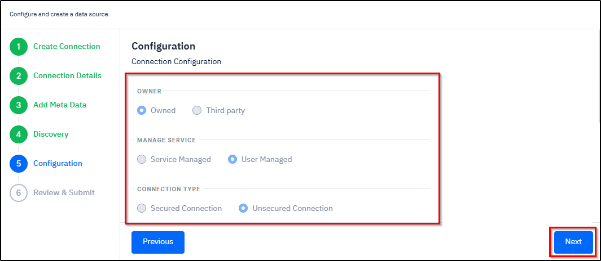

# Creating a PostgreSQL Connection

***

**Contents**

* [**Instructions for Using this Page**](creating-a-postgresql-connection.md#instructions-for-using-this-page)
* [**Overview**](creating-a-postgresql-connection.md#overview)
* [**Procedure**](creating-a-postgresql-connection.md#procedure)
* [**Related Topics**](creating-a-postgresql-connection.md#related-topics)

***

### Instructions for Using this Page

* Click on an image to view it in a larger and clearer format.
* Hover over an italicized annotated term (italic, blue, dotted and underlined) to view its meaning. Here is an example: [_<mark style="color:blue;">**Host Name**</mark>_](#user-content-fn-1)[^1]
* At any time during the workflow, you can return to the previous section by clicking the **Previous** button.
* The inputs shown in the images are for example purposes only. You must enter the correct and actual data.

***

## Overview

Creating a **PostgreSQL** connection involves a series of steps, including navigating to the PostgreSQL page, selecting a new or an existing data source, configuring the connection details, adding metadata, setting the discovery options, specifying owner, managed service, and connection type, reviewing the settings, and submitting the connection.

Once the connection is successfully established, the data source will appear on the **Connected Data Sources**  page.&#x20;

***

## Procedure

The expandable panels below guide you through the process of connecting PostgreSQL. Follow each step in sequence while configuring the connection. The system enables the next step only after the current step is completed.

1.<strong>Navigate to PostgreSQ</strong>L

A. On the **Left Navigation Bar** of **SCIKIQ** , expand **Connect to Data Source** under **SCIKIQ CONNECT**, and then click **Manage** **Data Source**.

<figure><figcaption>
Manage Data Source Menu Item
</figcaption></figure>

The All Data Sources page is displayed.

B. On the **All Data Sources** page, click **Relational Database** in the **left pane**.&#x20;

<figure><figcaption>
Relational Database Menu Item
</figcaption></figure>

The available relational databases appear on the right pane.&#x20;

C. On the **Right Pane,** click **PostGreSQL**.

<figure><figcaption>
Selecting PostGreSQL Data Source
</figcaption></figure>

The **PostGreSQL** page is displayed.&#x20;

<strong>2.Create Connection</strong>

* On the **PostGreSQL** page, in the **Create Connection** section, select either a **new data source** or an **existing data source**, and then click the **Next** button. See the below example image.&#x20;

<figure><figcaption>
Selecting Data Source 
</figcaption></figure>

The Connection Details section is highlighted.

3.<strong>Configure Connection Details</strong>

**Purpose:**

When connecting a software application to a database, the system needs specific details to locate, identify, and authenticate the database. Each parameter plays a unique role.

**Procedure:**

The below step-by-step instructions help you understand how to configure connection details:


**Tip:** The field names and their corresponding options in the below instructions are annotated with relevant descriptions. To view the description of a field or an option, simply hover your cursor over it. &#x20;


**Step-by-Step instructions**

A. In the **Connection Details** section, enter the [<mark style="color:blue;">**Host Name**</mark>](#user-content-fn-2)[^2]<mark style="color:blue;">**,**</mark> [<mark style="color:blue;">**Port,**</mark>](#user-content-fn-3)[^3] [<mark style="color:blue;">**Database Name,**</mark>](#user-content-fn-4)[^4] [<mark style="color:blue;">**Service**</mark>](#user-content-fn-5)[^5]<mark style="color:blue;">**,**</mark> [<mark style="color:blue;">**Database Schema,**</mark>](#user-content-fn-6)[^6] **Database User,** and **Database Password.** See the below example image.

B. Click the **Next** button.

<figure><figcaption>
Configuring Connection Details
</figcaption></figure>

The Add Metadata section is activated.

4.<strong>Add Metadata</strong>

**Purpose:**

While connecting the application to a database, adding **metadata** provides the application with important information about the data it will interact with. This metadata helps the system understand, organize, and manage the data correctly.

**Procedure:**

As part of the procedure, you need to specify catalogue, connectivity mechanism, store, source system, connection type, supporting email ID, and service type. Once done, you need to test by clicking the Test Connection button to check whether everything is correct.


**Tip:** To assist with your setup, fields and options shown in blue are equipped with tooltips. Hovering your mouse over these items will reveal a detailed description of their function.


**Step-by-Step Instructions:**

The below step-by-step instructions help you understand how to add meta data.

In the **Add Meta Data** section:

* Specify [<mark style="color:blue;">**Catalogue,**</mark>](#user-content-fn-7)[^7] [<mark style="color:blue;">**Business Owner**</mark>](#user-content-fn-8)[^8]**,** and [<mark style="color:blue;">**Technical Owner**</mark>](#user-content-fn-9)[^9]**.**
* From the [<mark style="color:blue;">**Connectivity Mechanism**</mark>](#user-content-fn-10)[^10] options, select [<mark style="color:blue;">**Secured**</mark>](#user-content-fn-11)[^11]<mark style="color:blue;">**,**</mark> [<mark style="color:blue;">**Unsecured**</mark>](#user-content-fn-12)[^12], or [<mark style="color:blue;">**SSH Tunnelling**</mark>](#user-content-fn-13)[^13]**.**
* From the [<mark style="color:blue;">**Store**</mark>](#user-content-fn-14)[^14] options, select either [<mark style="color:blue;">**Is Feature Store**</mark>](#user-content-fn-15)[^15] or [<mark style="color:blue;">**Is Analytical Store**</mark>](#user-content-fn-16)[^16].
* From the [<mark style="color:blue;">**Source System**</mark>](#user-content-fn-17)[^17] drop-down box, select [<mark style="color:blue;">**Internal**</mark>](#user-content-fn-18)[^18] or [<mark style="color:blue;">**Third Party**</mark>](#user-content-fn-19)[^19].
* From the [<mark style="color:blue;">**Connection Type**</mark>](#user-content-fn-20)[^20] drop-down box, select [<mark style="color:blue;">**Access Layer**</mark>](#user-content-fn-21)[^21]<mark style="color:blue;">**,**</mark> [<mark style="color:blue;">**Source System**</mark>](#user-content-fn-22)[^22]<mark style="color:blue;">**,**</mark> [<mark style="color:blue;">**Reference System,**</mark>](#user-content-fn-23)[^23] or [<mark style="color:blue;">**Master Database**</mark>](#user-content-fn-24)[^24]<mark style="color:blue;">**.**</mark>
* In the **Supporting Email ID** field, specify the **supporting email ID** to contact when something goes wrong or when help is needed.
* From the **Service Type** drop-down box, select the **category of service** the data source provides.
* Specify [<mark style="color:blue;">**Service Id**</mark>](#user-content-fn-25)[^25] and [<mark style="color:blue;">**Application Id**</mark>](#user-content-fn-26)[^26]**.**
* Finally, click the **Test Connection** button to check everything is correct.

The **Connection tested successfully** message is displayed.

* Click the **Next** button.

<figure><figcaption>
Adding Meta Data
</figcaption></figure>

The Discovery section is activated.

5.<strong>Discovery</strong>

**Purpose:**

Selecting **Source Tables** tells the system **which specific tables from the source database or application should be extracted and included in the connection setup.** This step defines the exact dataset that will be moved to the target system.

**Procedure:**&#x20;

As part of the table selection step, select the required tables from the left box and move them to the right box in the Discovery section. You can choose a single table, multiple tables, or all tables, as required.

**Step-by-Step Instructions:**

The following step-by-step instructions help you understand the process of discovery:


**Tip:** In the below mentioned instructions, the field names and their corresponding options are annotated with relevant descriptions. To view the description of a field or an option, simply hover your cursor over it.&#x20;


* In the **Discovery** section, select the **Discovery Settings** choosing from [<mark style="color:blue;">**Identify PII,**</mark>](#user-content-fn-27)[^27] [<mark style="color:blue;">**Data Profiling**</mark>](#user-content-fn-28)[^28], and [<mark style="color:blue;">**Data Summary**</mark>](#user-content-fn-29)[^29].
* From the **left box**, select the the **required tables**, and then click the **Forward Arrow** button to move those files to the adjacent box.


**Tip:**&#x20;

* You can migrate **multiple files** by selecting in the left side box and moving them to the right side box by clicking the .png>) button.
* You can also migrate **all** the files by clicking the .png>)button.
* If you wish to **move back either a single or multiple** files from the right box, then select them, and click the .png>) button.&#x20;
* If you wish to **move all the files** from the right box, then select all of them , and click the .png>) button.&#x20;


* Finally, click the **Next** button.

<figure><figcaption>
Selecting Tables for Discovery
</figcaption></figure>

The files are discovered and the Configuration section is activated.

6<strong>.Configuration</strong>

* In the **Configuration** section, select the **owner** choosing from **Owner** or **Third Party**.
* Select the [<mark style="color:blue;">**Manage Service**</mark>](#user-content-fn-30)[^30] choosing from [<mark style="color:blue;">**Service Managed**</mark>](#user-content-fn-31)[^31] or [<mark style="color:blue;">**User Managed**</mark>](#user-content-fn-32)[^32].
* Select the **Connection type** choosing from **Secured Connection** or **Unsecured Connection.**
* Click the **Next** button.

<figure><figcaption>
Configuring Additional Details
</figcaption></figure>

* Click the **Next** button.

The Review & Submit section is activated.

7.<strong>Review &#x26; Submit</strong>

* In the **Review & Submit** section, enter a **name** and **description** for the connection, and then click the **Finish** button to submit it.

<figure><figcaption>
Review and Submit
</figcaption></figure>

The connection is created and the [Connected Data Sources](/broken/pages/dgiZ3ktrQlmTnR2Pq3nV) page is displayed.

***

## Related Topics

* [**Managing Connected Data Sources**](../../managing-connected-data-sources.md)

[^1]: **Host Name** refers to the **address** of the computer/server where your database is located.

[^2]: This refers to the **address** of the computer/server where your database is located.

[^3]: Port refers to the number on the server used to talk to the database. Different services use different ports.

[^4]: Database name refers to the **name of the database** you need to connect to on the server.

[^5]: Service refers to the predefined **connection name** used by the database to identify the database service running on the server.

[^6]: Database Schema refers to the folder inside the database that organizes tables and other objects.

[^7]: **Catalogue** refers to the group of related data sources.

[^8]: **Business Owner** refers to the person or team responsible for the data from a business point of view.

[^9]: **Technical Owner** refers to the **person or IT team** responsible for the technical side of the data.

[^10]: Connectivity Mechanism refers to the method used to connect to the data source.

[^11]: **Secured** option refers to the connection where data is encrypted, making it safe from hackers and unauthorized access.

[^12]: **Unsecured** option refers to the connection where data is sent without encryption.

[^13]: SSH Tunneling: SSH refers to Secure Shell. SSH is a secure way to connect to another computer or server over a network.

[^14]: This refers to how the data will be used.

[^15]: Select **Is Feature Store** if the data source is used to store and manage machine learning features.

[^16]: Select **Is Analytical Store** if the data source is primarily used for analytics, reporting, and business intelligence.

[^17]: This refers to the original system where the data comes from.

[^18]: An **Internal source system** is owned, managed, and maintained by your organization.

[^19]: A **Third-Party** source system is owned and managed by an external vendor or service provider.

[^20]: This refers to the kind of connection you are using to access the source.

[^21]: The **Access Layer** represents systems that are used to consume or expose data rather than originate it.

[^22]: A **Source System** is the origin of raw or transactional data.

[^23]: A Reference System stores standardized, lookup, or supporting data used across multiple systems.

[^24]: A **Master Database** stores authoritative master data for key business entities.

[^25]: This refers to the unique identifier for the service you are connecting to.

[^26]: This refers to the unique ID used to identify the application that owns, provides, or uses the data.

[^27]: **Identify PII** (Personally Identifiable Information) detects sensitive data elements that can identify an individual.

[^28]: **Data Profiling** analyzes the structure and content of data to understand its quality and patterns.

[^29]: **Data Summary** provides a high-level overview of the dataset.

[^30]: **Manage Service** refers to who is responsible for managing the connection and its configuration.

[^31]: **Service Managed** means the system automatically manages the service for you.

[^32]: User Managed means you manage the service configuration yourself.
