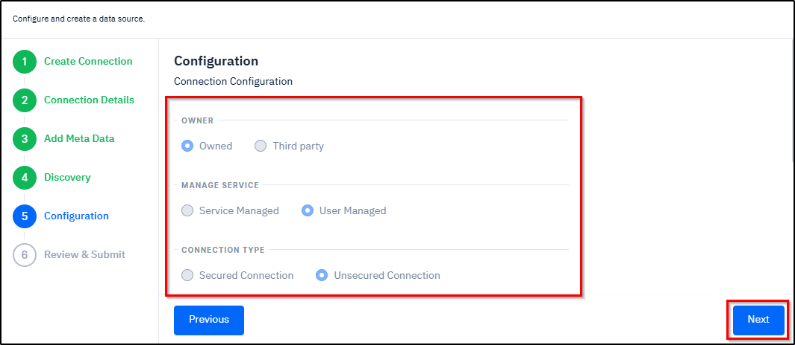

# Connection Setup Examples

***

### Instructions for Using this Page

* Click on an image to view it in a larger and clearer format. The inputs shown in the images are for example purposes only. You must enter the correct and actual data.
* At any time during the workflow, you can return to the previous section by clicking the **Previous** button.

***

### Overview

SCIKIQ offers robust support for multiple diverse data sources, facilitating seamless integration across both traditional and modern data environments. This extensive range ensures that organizations can unify data from legacy systems and contemporary cloud platforms to meet their specific business requirements.&#x20;

The datasource examples included in this page are **PostgreSQL, MySQL with SSL, Vertica (ScikIQ DnA Hub), SFTP/FTP, Azure Blob, AWS S3 & Glue, CSV/Excel, MongoDB, SAP ECC, Kafka, OneDrive, SharePoint, Web Client HTTP API, API Write, Azure** **Key, AWS Secret Manager,** and **Snowflake.**

***

### Procedure

The procedure involves a series of steps, which includes **navigating to the required data source page, selecting a new or existing data source, configuring the connection details, adding metadata, setting the discovery options, specifying owner, managed service,** **and connection type, reviewing the settings,** and **submitting the connection**.

Once the connection is successfully established, the data source will appear on the **Connected Data Sources** page.&#x20;

***

### Connection Setup Examples



**Procedure**

The expandable panels below guide you through the process of connecting PostgreSQL. Follow each step in sequence while configuring the connection. The system enables the next step only after the current step is completed.

<details>

<summary>1.<strong>Navigate to PostgreSQ</strong>L</summary>

A. On the **Left Navigation Bar** of **SCIKIQ** , expand **Connect to Data Source** under **SCIKIQ CONNECT**, and then click **Manage** **Data Source**.

<figure><figcaption><p>Manage Data Source Menu Item</p></figcaption></figure>

The All Data Sources page is displayed.

B. On the **All Data Sources** page, click **Relational Database** in the **left pane**.&#x20;

<figure><figcaption><p>Relational Database Menu Item</p></figcaption></figure>

The available relational databases appear on the right pane.&#x20;

C. On the **Right Pane,** click **PostGreSQL**.

<figure><figcaption><p>Selecting PostGreSQL Data Source</p></figcaption></figure>

The **PostGreSQL** page is displayed.&#x20;

</details>

<details>

<summary><strong>2.Create Connection</strong></summary>

* On the **PostGreSQL** page, in the **Create Connection** section, select either a **new data source** or an **existing data source**, and then click the **Next** button. See the below example image.&#x20;

<figure><figcaption><p>Selecting Data Source </p></figcaption></figure>

The Connection Details section is highlighted.

</details>

<details>

<summary>3.<strong>Configure Connection Details</strong></summary>

**Purpose:**

When connecting a software application to a database, the system needs specific details to locate, identify, and authenticate the database. Each parameter plays a unique role.

**Procedure:**

The below step-by-step instructions help you understand how to configure connection details:


**Tip:** The field names and their corresponding options in the below instructions are annotated with relevant descriptions. To view the description of a field or an option, simply hover your cursor over it. &#x20;


**Step-by-Step instructions**

A. In the **Connection Details** section, enter the [<mark style="color:blue;">**Host Name**</mark>](#user-content-fn-1)[^1]<mark style="color:blue;">**,**</mark> [<mark style="color:blue;">**Port,**</mark>](#user-content-fn-2)[^2] [<mark style="color:blue;">**Database Name,**</mark>](#user-content-fn-3)[^3] [<mark style="color:blue;">**Service**</mark>](#user-content-fn-4)[^4]<mark style="color:blue;">**,**</mark> [<mark style="color:blue;">**Database Schema,**</mark>](#user-content-fn-5)[^5] **Database User,** and **Database Password.** See the below example image.

B. Click the **Next** button.

<figure><figcaption><p>Configuring Connection Details</p></figcaption></figure>

The Add Metadata section is activated.

</details>

<details>

<summary>4.<strong>Add Metadata</strong></summary>

**Purpose:**

While connecting the application to a database, adding **metadata** provides the application with important information about the data it will interact with. This metadata helps the system understand, organize, and manage the data correctly.

**Procedure:**

As part of the procedure, you need to specify catalogue, connectivity mechanism, store, source system, connection type, supporting email ID, and service type. Once done, you need to test by clicking the Test Connection button to check whether everything is correct.


**Tip:** To assist with your setup, fields and options shown in blue are equipped with tooltips. Hovering your mouse over these items will reveal a detailed description of their function.


**Step-by-Step Instructions:**

The below step-by-step instructions help you understand how to add meta data.

In the **Add Meta Data** section:

* Specify [<mark style="color:blue;">**Catalogue,**</mark>](#user-content-fn-6)[^6] [<mark style="color:blue;">**Business Owner**</mark>](#user-content-fn-7)[^7]**,** and [<mark style="color:blue;">**Technical Owner**</mark>](#user-content-fn-8)[^8]**.**
* From the [<mark style="color:blue;">**Connectivity Mechanism**</mark>](#user-content-fn-9)[^9] options, select [<mark style="color:blue;">**Secured**</mark>](#user-content-fn-10)[^10]<mark style="color:blue;">**,**</mark> [<mark style="color:blue;">**Unsecured**</mark>](#user-content-fn-11)[^11], or [<mark style="color:blue;">**SSH Tunnelling**</mark>](#user-content-fn-12)[^12]**.**
* From the [<mark style="color:blue;">**Store**</mark>](#user-content-fn-13)[^13] options, select either [<mark style="color:blue;">**Is Feature Store**</mark>](#user-content-fn-14)[^14] or [<mark style="color:blue;">**Is Analytical Store**</mark>](#user-content-fn-15)[^15].
* From the [<mark style="color:blue;">**Source System**</mark>](#user-content-fn-16)[^16] drop-down box, select [<mark style="color:blue;">**Internal**</mark>](#user-content-fn-17)[^17] or [<mark style="color:blue;">**Third Party**</mark>](#user-content-fn-18)[^18].
* From the [<mark style="color:blue;">**Connection Type**</mark>](#user-content-fn-19)[^19] drop-down box, select [<mark style="color:blue;">**Access Layer**</mark>](#user-content-fn-20)[^20]<mark style="color:blue;">**,**</mark> [<mark style="color:blue;">**Source System**</mark>](#user-content-fn-21)[^21]<mark style="color:blue;">**,**</mark> [<mark style="color:blue;">**Reference System,**</mark>](#user-content-fn-22)[^22] or [<mark style="color:blue;">**Master Database**</mark>](#user-content-fn-23)[^23]<mark style="color:blue;">**.**</mark>
* In the **Supporting Email ID** field, specify the **supporting email ID** to contact when something goes wrong or when help is needed.
* From the **Service Type** drop-down box, select the **category of service** the data source provides.
* Specify [<mark style="color:blue;">**Service Id**</mark>](#user-content-fn-24)[^24] and [<mark style="color:blue;">**Application Id**</mark>](#user-content-fn-25)[^25]**.**
* Finally, click the **Test Connection** button to check everything is correct.

The **Connection tested successfully** message is displayed.

* Click the **Next** button.

<figure><figcaption><p>Adding Meta Data</p></figcaption></figure>

The Discovery section is activated.

</details>

<details>

<summary>5.<strong>Discovery</strong></summary>

**Purpose:**

Selecting **Source Tables** tells the system **which specific tables from the source database or application should be extracted and included in the connection setup.** This step defines the exact dataset that will be moved to the target system.

**Procedure:**&#x20;

As part of the table selection step, select the required tables from the left box and move them to the right box in the Discovery section. You can choose a single table, multiple tables, or all tables, as required.

**Step-by-Step Instructions:**

The following step-by-step instructions help you understand the process of discovery:


**Tip:** In the below mentioned instructions, the field names and their corresponding options are annotated with relevant descriptions. To view the description of a field or an option, simply hover your cursor over it.&#x20;


* In the **Discovery** section, select the **Discovery Settings** choosing from [<mark style="color:blue;">**Identify PII,**</mark>](#user-content-fn-26)[^26] [<mark style="color:blue;">**Data Profiling**</mark>](#user-content-fn-27)[^27], and [<mark style="color:blue;">**Data Summary**</mark>](#user-content-fn-28)[^28].
* From the **left box**, select the the **required tables**, and then click the **Forward Arrow** button to move those files to the adjacent box.


**Tip:**&#x20;

* You can migrate **multiple files** by selecting in the left side box and moving them to the right side box by clicking the .png>) button.
* You can also migrate **all** the files by clicking the .png>)button.
* If you wish to **move back either a single or multiple** files from the right box, then select them, and click the .png>) button.&#x20;
* If you wish to **move all the files** from the right box, then select all of them , and click the .png>) button.&#x20;


* Finally, click the **Next** button.

<figure><figcaption><p>Selecting Tables for Discovery</p></figcaption></figure>

The files are discovered and the Configuration section is activated.

</details>

<details>

<summary>6<strong>.Configuration</strong></summary>

* In the **Configuration** section, select the **owner** choosing from **Owner** or **Third Party**.
* Select the [<mark style="color:blue;">**Manage Service**</mark>](#user-content-fn-29)[^29] choosing from [<mark style="color:blue;">**Service Managed**</mark>](#user-content-fn-30)[^30] or [<mark style="color:blue;">**User Managed**</mark>](#user-content-fn-31)[^31].
* Select the **Connection type** choosing from **Secured Connection** or **Unsecured Connection.**
* Click the **Next** button.

<figure><figcaption><p>Configuring Additional Details</p></figcaption></figure>

* Click the **Next** button.

The Review & Submit section is activated.

</details>

<details>

<summary>7.<strong>Review &#x26; Submit</strong></summary>

* In the **Review & Submit** section, enter a **name** and **description** for the connection, and then click the **Finish** button to submit it.

<figure><figcaption><p>Review and Submit</p></figcaption></figure>

The connection is created and the [Connected Data Sources](/broken/pages/dgiZ3ktrQlmTnR2Pq3nV) page is displayed.

</details>



**Procedure**

The expandable panels below guide you through the process of creating a MySQL connection with SSL Connection. Follow each step in sequence while configuring the connection. The system nables the next step only after the current step is completed.

<details>

<summary>1.<strong>Navigate to Data Source</strong></summary>

A. On the **Left Navigation Bar**, expand **Connect to Data Source** under **SCIKIQ CONNECT**, and then click **Manage** **Data Source**.

<figure><figcaption><p>Manage Data Source Menu Item</p></figcaption></figure>

The All Data Sources page is displayed.

B. On the **All Data Sources** page, click **Relational Database** in the **left pane**.&#x20;

<figure><figcaption><p>Relational Database Menu Item</p></figcaption></figure>

The available relational databases appear on the right pane.&#x20;

C. On the **Right Pane,** click **MySQL**.

<figure><figcaption><p>MySQL Data Source</p></figcaption></figure>

The **MySQL** page is displayed.&#x20;

</details>

<details>

<summary>2.<strong>Create Connection</strong></summary>

* On the **MySQL** page, in the **Create Connection** section, select either a **new data source** or **an existing data source**, and then click the **Next** button. See the below example image.&#x20;

<figure><figcaption><p>Selecting Data Source</p></figcaption></figure>

The Connection Details section is highlighted.

</details>

<details>

<summary>3.<strong>Configure Connection Details</strong></summary>

**Purpose:**&#x20;

When connecting a software application to a database, the system needs specific details to **locate**, **identify**, and **authenticate** the database. Each parameter plays a unique role.

**Procedure:**

The below instructions help you understand how to configure connection details:


**Tip:** The field names and their corresponding options in the below instructions are annotated with relevant descriptions. To view the description of a field or an option, simply hover your cursor over it.&#x20;


**Step-by-Step Instructions:**

A. In the **Connection Details** section, enter the [<mark style="color:blue;">**Host Name**</mark>](#user-content-fn-1)[^1]<mark style="color:blue;">**,**</mark> [<mark style="color:blue;">**Port,**</mark>](#user-content-fn-2)[^2] [<mark style="color:blue;">**Database Name,**</mark>](#user-content-fn-3)[^3] [<mark style="color:blue;">**Service**</mark>](#user-content-fn-4)[^4]<mark style="color:blue;">**,**</mark> [<mark style="color:blue;">**Database Schema,**</mark>](#user-content-fn-5)[^5] **Database User,** and **Database Password.** See the below example image.

<figure><figcaption><p>Configuring Connection Details</p></figcaption></figure>

B. Click the **Next** button.

The Add Metadata section is activated.

</details>

<details>

<summary>4.<strong>Add Metadata</strong></summary>

**Purpose:**

While connecting the application to a database, adding **metadata** provides the application with important information about the data it will interact with. This metadata helps the system understand, organize, and manage the data correctly.

**Procedure:**

The below instructions help you understand how to add meta data:


**Tip:** The field names and their corresponding options in the below instructions are annotated with relevant descriptions. To view the description of a field or an option, simply hover your cursor over it.&#x20;


In the **Add Meta Data** section:

* Specify [<mark style="color:blue;">**Catalogue**</mark>](#user-content-fn-32)[^32]<mark style="color:blue;">**,**</mark> [<mark style="color:blue;">**Business Owner**</mark>](#user-content-fn-7)[^7]**,** and [<mark style="color:blue;">**Technical Owner**</mark>](#user-content-fn-33)[^33]**.**
* From the [<mark style="color:blue;">**Connectivity Mechanism**</mark>](#user-content-fn-34)[^34] options, select [<mark style="color:blue;">**Secured**</mark>](#user-content-fn-35)[^35]<mark style="color:blue;">**,**</mark> and then specify the [<mark style="color:blue;">**SSL Key File**</mark>**,**](#user-content-fn-36)[^36] [<mark style="color:blue;">**SSL CERT File**</mark>](#user-content-fn-37)[^37]**,** and [<mark style="color:blue;">**SSL CA File**</mark>**.**](#user-content-fn-38)[^38]
* From the [<mark style="color:blue;">**Store**</mark>](#user-content-fn-39)[^39] options, select either [<mark style="color:blue;">**Is Feature Store**</mark>](#user-content-fn-40)[^40] or [<mark style="color:blue;">**Is Analytical Store**</mark>](#user-content-fn-41)[^41].
* From the [<mark style="color:blue;">**Source System**</mark>](#user-content-fn-42)[^42] drop-down box, select [<mark style="color:blue;">**Internal**</mark>](#user-content-fn-43)[^43] or [<mark style="color:blue;">**Third Party**</mark>](#user-content-fn-44)[^44].
* From the [<mark style="color:blue;">**Connection Type**</mark>](#user-content-fn-45)[^45] drop-down box, select [<mark style="color:blue;">**Access Layer**</mark>](#user-content-fn-46)[^46]<mark style="color:blue;">**,**</mark> [<mark style="color:blue;">**Source System**</mark>](#user-content-fn-47)[^47]<mark style="color:blue;">**,**</mark> [<mark style="color:blue;">**Reference System**</mark>](#user-content-fn-48)[^48]<mark style="color:blue;">**,**</mark> or [<mark style="color:blue;">**Master Database**</mark>](#user-content-fn-49)[^49]<mark style="color:blue;">**.**</mark>
* In the **Supporting Email ID** field, specify the **supporting email ID** to contact when something goes wrong or when help is needed.
* From the **Service Type** drop-down box, select the **category of service** the data source provides.
* Specify [<mark style="color:blue;">**Service Id**</mark>](#user-content-fn-50)[^50] and [<mark style="color:blue;">**Application Id**</mark>](#user-content-fn-51)[^51]**.**
* Finally, click the **Test Connection** button to check everything is correct.

<figure><figcaption><p>Adding Meta Data</p></figcaption></figure>

* Click the **Test Connection** button at the bottom to check if the connection is correct.

The **Connection tested successfully** message is displayed.

* Click the **Next** button.

The Discovery section is activated.

</details>

<details>

<summary>5.<strong>Discovery</strong></summary>

_**Purpose**_

Selecting **Source Tables** tells the system **which specific tables from the source database or application should be extracted and included in the connection setup.** This step defines the exact dataset that will be moved to the target system.

_**Procedure Overview**_

As part of the table selection step, select the required tables from the left box and move them to the right box in the Discovery section. You can choose a single table, multiple tables, or all tables, as required.

**Step-by-Step Instructions**

The following step-by-step instructions help you understand the process of discovery:


**Tip:** In the below mentioned instructions, the field names and their corresponding options are annotated with relevant descriptions. To view the description of a field or an option, simply hover your cursor over it.&#x20;


* In the **Discovery** section, select the **Discovery Settings** choosing from [<mark style="color:blue;">**Identify PII,**</mark>](#user-content-fn-52)[^52] [<mark style="color:blue;">**Data Profiling**</mark>](#user-content-fn-53)[^53], and [<mark style="color:blue;">**Data Summary**</mark>](#user-content-fn-28)[^28].
* From the **left box**, select the the **required tables**, and then click the **Forward Arrow** button to move those files to the adjacent box.


**Tip:**&#x20;

* You can migrate **multiple files** by selecting in the left side box and moving them to the right side box by clicking the .png>) button.
* You can also migrate **all** the files by clicking the .png>)button.
* If you wish to **move back either a single or multiple** files from the right box, then select them, and click the .png>) button.&#x20;
* If you wish to **move all the files** from the right box, then select all of them , and click the .png>) button.&#x20;


* Finally, click the **Next** button.

<figure><figcaption><p>Selecting Tables for Discovery</p></figcaption></figure>

The files are discovered.

The Configuration section is activated.

</details>

<details>

<summary>6<strong>.Configuration</strong></summary>

* In the **Configuration** section, select the **owner** choosing from **Owner** or **Third Party**.
* Select the [<mark style="color:blue;">**Manage Service**</mark>](#user-content-fn-29)[^29] choosing from [<mark style="color:blue;">**Service Managed**</mark>](#user-content-fn-30)[^30] or [<mark style="color:blue;">**User Managed**</mark>](#user-content-fn-54)[^54].
* Select the **Connection type** choosing from **Secured Connection** or **Unsecured Connection.**
* Specify [<mark style="color:blue;">**DR**</mark>](#user-content-fn-55)[^55] availability choosing from **Yes** or **No**.
* Specify [<mark style="color:blue;">**RBAC**</mark>](#user-content-fn-56)[^56]  implementation choosing from **Yes** or **No**.
* Click the **Next** button.

<figure><figcaption><p>Configuring Additional Details</p></figcaption></figure>

The Review & Submit section is activated.

</details>

<details>

<summary>7.<strong>Review &#x26; Submit</strong></summary>

* In the **Review & Submit** section, enter a **name** and **description** for the connection, and then click the **Finish** button to submit it.

<figure><figcaption><p>Review and Submit</p></figcaption></figure>

The connection is created and the [**Connected Data Sources**](managing-connected-data-sources.md#viewing-connected-data-sources) page is displayed.

</details>



**Procedure**

The expandable panels below guide you through the process of creating a Vertica (ScikIQ DnA Hub) connection. Follow each step in sequence while configuring the connection. The system enables the next step only after the current step is completed.

<details>

<summary>1.<strong>Navigate to Vertica (ScikIQ DnA Hub)</strong></summary>

A. On the **Left Navigation Bar**, expand **Connect to Data Source** under **SCIKIQ CONNECT**, and then click **Manage** **Data Source**.

<figure><figcaption><p>Manage Data Source Menu Item</p></figcaption></figure>

The All Data Sources page is displayed.

B. On the **All Data Sources** page, click **Relational Database** in the **left pane,** and then click **ScikIQ DnA Hub** on the **Right Pane**.

<figure><figcaption><p>Selecting SciKiq DNA Hub</p></figcaption></figure>

The **ScikIQ DnA Hub** page is displayed.&#x20;

</details>

<details>

<summary>2.<strong>Create Connection</strong></summary>

* On the **ScikIQ DnA Hub** page, in the **Create Connection** section, select either a **new data source** or **an existing data source**, and then click the **Next** button. See the below example image.&#x20;

<figure><figcaption><p>Selecting a Data Source</p></figcaption></figure>

The Connection Details section is highlighted.

</details>

<details>

<summary>3.<strong>Configure Connection Details</strong></summary>

**Purpose:**

When connecting a software application to a database, the system needs specific details to locate, identify, and authenticate the database. Each parameter plays a unique role.

**Procedure:**

The below instructions help you understand how to configure connection details:


**Tip:** The field names and their corresponding options in the below instructions are annotated with relevant descriptions. To view the description of a field or an option, simply hover your cursor over it.&#x20;


* A. In the **Connection Details** section, enter the [<mark style="color:blue;">**Host Name**</mark>](#user-content-fn-1)[^1]<mark style="color:blue;">**,**</mark> [<mark style="color:blue;">**Port,**</mark>](#user-content-fn-2)[^2] [<mark style="color:blue;">**Database Name,**</mark>](#user-content-fn-3)[^3] [<mark style="color:blue;">**Service**</mark>](#user-content-fn-4)[^4]<mark style="color:blue;">**,**</mark> [<mark style="color:blue;">**Database Schema,**</mark>](#user-content-fn-5)[^5] **Database User,** and **Database Password.** See the below example image.

<figure><figcaption><p>Configuring Connection Details</p></figcaption></figure>

* Click the **Next** button.

The Add Metadata section is activated.

</details>

<details>

<summary>4.<strong>Add Metadata</strong></summary>

**Purpose:**

While connecting the application to a database, adding **metadata** provides the application with important information about the data it will interact with. This metadata helps the system understand, organize, and manage the data correctly.

**Procedure:**

The below instructions help you understand how to add meta data:


**Tip:** The field names and their corresponding options in the below instructions are annotated with relevant descriptions. To view the description of a field or an option, simply hover your cursor over it.&#x20;


**Step-by-Step Instructions:**

In the **Add Meta Data** section:

* Specify [<mark style="color:blue;">**Catalogue,**</mark>](#user-content-fn-6)[^6] [<mark style="color:blue;">**Business Owner**</mark>](#user-content-fn-7)[^7]**,** and [<mark style="color:blue;">**Technical Owner**</mark>](#user-content-fn-8)[^8]**.**
* From the [<mark style="color:blue;">**Connectivity Mechanism**</mark>](#user-content-fn-9)[^9] options, select [<mark style="color:blue;">**Secured**</mark>](#user-content-fn-10)[^10]<mark style="color:blue;">**,**</mark> [<mark style="color:blue;">**Unsecured**</mark>](#user-content-fn-11)[^11], or [<mark style="color:blue;">**SSH Tunnelling**</mark>](#user-content-fn-12)[^12]**.**
* From the [<mark style="color:blue;">**Store**</mark>](#user-content-fn-13)[^13] options, select either [<mark style="color:blue;">**Is Feature Store**</mark>](#user-content-fn-14)[^14] or [<mark style="color:blue;">**Is Analytical Store**</mark>](#user-content-fn-15)[^15].
* From the [<mark style="color:blue;">**Source System**</mark>](#user-content-fn-16)[^16] drop-down box, select [<mark style="color:blue;">**Internal**</mark>](#user-content-fn-17)[^17] or [<mark style="color:blue;">**Third Party**</mark>](#user-content-fn-18)[^18].
* From the [<mark style="color:blue;">**Connection Type**</mark>](#user-content-fn-19)[^19] drop-down box, select [<mark style="color:blue;">**Access Layer**</mark>](#user-content-fn-20)[^20]<mark style="color:blue;">**,**</mark> [<mark style="color:blue;">**Source System**</mark>](#user-content-fn-21)[^21]<mark style="color:blue;">**,**</mark> [<mark style="color:blue;">**Reference System,**</mark>](#user-content-fn-22)[^22] or [<mark style="color:blue;">**Master Database**</mark>](#user-content-fn-23)[^23]<mark style="color:blue;">**.**</mark>
* In the **Supporting Email ID** field, specify the **supporting email ID** to contact when something goes wrong or when help is needed.
* From the **Service Type** drop-down box, select the **category of service** the data source provides.
* Specify [<mark style="color:blue;">**Service Id**</mark>](#user-content-fn-24)[^24] and [<mark style="color:blue;">**Application Id**</mark>](#user-content-fn-25)[^25]**.**
* Finally, click the **Test Connection** button to check everything is correct.

The **Connection tested successfully** message is displayed.

* Click the **Next** button.

<figure><figcaption><p>Adding Meta Data</p></figcaption></figure>

The Discovery section is activated.

</details>

<details>

<summary>5.<strong>Discovery</strong></summary>

**Purpose:**

Selecting **Source Tables** tells the system **which specific tables from the source database or application should be extracted and included in the connection setup.** This step defines the exact dataset that will be moved to the target system.

**Procedure:**&#x20;

As part of the table selection step, select the required tables from the left box and move them to the right box in the Discovery section. You can choose a single table, multiple tables, or all tables, as required.

**Step-by-Step Instructions:**

The following step-by-step instructions help you understand the process of discovery:


**Tip:** In the below mentioned instructions, the field names and their corresponding options are annotated with relevant descriptions. To view the description of a field or an option, simply hover your cursor over it.&#x20;


* In the **Discovery** section, select the **Discovery Settings** choosing from [<mark style="color:blue;">**Identify PII,**</mark>](#user-content-fn-26)[^26] [<mark style="color:blue;">**Data Profiling**</mark>](#user-content-fn-27)[^27], and [<mark style="color:blue;">**Data Summary**</mark>](#user-content-fn-28)[^28].
* From the **left box**, select the the **required tables**, and then click the **Forward Arrow** button to move the files to the adjacent box.


**Tip:**&#x20;

* You can migrate **multiple files** by selecting in the left side box and moving them to the right side box by clicking the .png>) button.
* You can also migrate **all** the files by clicking the .png>)button.
* If you wish to **move back either a single or multiple** files from the right box, then select them, and click the .png>) button.&#x20;
* If you wish to **move all the files** from the right box, then select all of them , and click the .png>) button.&#x20;


* Finally, click the **Next** button.

The files are discovered and the Configuration section is activated.

</details>

<details>

<summary>6<strong>.Configuration</strong></summary>

* In the **Configuration** section, select the **owner** choosing from **Owner** or **Third Party**.
* Select the [<mark style="color:blue;">**Manage Service**</mark>](#user-content-fn-29)[^29] choosing from [<mark style="color:blue;">**Service Managed**</mark>](#user-content-fn-30)[^30] or [<mark style="color:blue;">**User Managed**</mark>](#user-content-fn-54)[^54]..
* Select the **Connection type** choosing from **Secured Connection** or **Unsecured Connection.**
* Click the **Next** button.

<figure><figcaption><p>Configuring Additional Details</p></figcaption></figure>

* Click the **Next** button.

The Review & Submit section is activated.

</details>

<details>

<summary>7.<strong>Review &#x26; Submit</strong></summary>

* In the **Review & Submit** section, enter a **name** and **description** for the connection, and then click the **Finish** button to submit it.

<figure><figcaption><p>Review and Submit</p></figcaption></figure>

The connection is created and the [Connected Data Sources](/broken/pages/dgiZ3ktrQlmTnR2Pq3nV) page is displayed.

</details>



**Procedure**

The expandable panels below guide you through the process of creating a SFTP connection in SCIKIQ. Follow each step in sequence while configuring the connection. The system enables the next step only after the current step is completed.

<details>

<summary>1.<strong>Navigate to SFTP</strong></summary>

A. On the **Left Navigation Bar**, expand **Connect to Data Source** under **SCIKIQ CONNECT**, and then click **Manage** **Data Source**.

<figure><figcaption><p>Manage Data Source Menu Item</p></figcaption></figure>

The All Data Sources page is displayed.

B. On the **All Data Sources** page, click **Files** in the **left pane.**

<figure><figcaption><p>Files Menu Item</p></figcaption></figure>

The data sources related to files are displayed on the right pane.

C. Now, on the **Right Pane,** click **SFTP.**

<figure><figcaption><p>SFTP Data Source</p></figcaption></figure>

The FTP/SFTP page is displayed.&#x20;

</details>

<details>

<summary>2.<strong>Create Connection</strong></summary>

* On the **FTP/SFTP** page, in the **Create Connection** section, select either a **new data source** or an **existing data source** depending on the requirement, and then click the **Next** button. See the below example image.&#x20;

<figure><figcaption><p>Selecting a Data Source</p></figcaption></figure>

The Connection Details section is highlighted.

</details>

<details>

<summary>3.<strong>Configure Connection Details</strong></summary>

**Purpose:**

When connecting a software application to a database, the system needs specific details to **locate**, **identify**, and **authenticate** the database. Each parameter plays a unique role.

**Procedure:**

The below instructions help you understand how to configure connection details:


**Tip:** The blue dotted texts in the below instructions are annotations, which provides description about the field options. To view an annotation, simply hover your cursor over it. &#x20;


In the **Connection Details** section:

* From the **Source Type** drop-down box, select [<mark style="color:blue;">**SFTP**</mark>](#user-content-fn-57)[^57] or [<mark style="color:blue;">**FTP**</mark>](#user-content-fn-58)[^58].
* From the **Logon Type** drop-down box, select [<mark style="color:blue;">**Normal**</mark>](#user-content-fn-59)[^59] or [<mark style="color:blue;">**Key File**</mark>](#user-content-fn-60)[^60].

> <mark style="color:red;">**Note:**</mark> The **Logon Type** drop-down box is displayed only when SFTP is selected.

* Enter the [<mark style="color:blue;">**Host Name**</mark>](#user-content-fn-61)[^61]<mark style="color:blue;">**,**</mark> [<mark style="color:blue;">**Port**</mark>](#user-content-fn-62)[^62]<mark style="color:blue;">**,**</mark>**&#x20;Database User** and **Database Password.** See the below example screenshot.

<figure><figcaption><p>Configuring Connection Details</p></figcaption></figure>

* Click the **Next** button.

The Add Metadata section is activated.

</details>

<details>

<summary>4.<strong>Add Metadata</strong></summary>

**Purpose:**

While connecting the application to a database, adding **metadata** provides the application with important information about the data it will interact with. This metadata helps the system understand, organize, and manage the data correctly.

**Procedure**

The below instructions help you understand how to add meta data.


**Tip:** The field names and their corresponding options in the below instructions are annotated with relevant descriptions. To view the description of a field or an option, simply hover your cursor over it.&#x20;


In the **Add Meta Data** section:

* Specify [<mark style="color:blue;">**Catalogue,**</mark>](#user-content-fn-6)[^6] [<mark style="color:blue;">**Business Owner**</mark>](#user-content-fn-7)[^7]**,** and [<mark style="color:blue;">**Technical Owner**</mark>](#user-content-fn-8)[^8]**.**
* From the [<mark style="color:blue;">**Connectivity Mechanism**</mark>](#user-content-fn-9)[^9] options, select [<mark style="color:blue;">**Secured**</mark>](#user-content-fn-10)[^10]<mark style="color:blue;">**,**</mark> [<mark style="color:blue;">**Unsecured**</mark>](#user-content-fn-11)[^11], or [<mark style="color:blue;">**SSH Tunnelling**</mark>](#user-content-fn-12)[^12]**.**
* From the [<mark style="color:blue;">**Store**</mark>](#user-content-fn-13)[^13] options, select either [<mark style="color:blue;">**Is Feature Store**</mark>](#user-content-fn-14)[^14] or [<mark style="color:blue;">**Is Analytical Store**</mark>](#user-content-fn-15)[^15].
* From the [<mark style="color:blue;">**Source System**</mark>](#user-content-fn-16)[^16] drop-down box, select [<mark style="color:blue;">**Internal**</mark>](#user-content-fn-17)[^17] or [<mark style="color:blue;">**Third Party**</mark>](#user-content-fn-18)[^18].
* From the [<mark style="color:blue;">**Connection Type**</mark>](#user-content-fn-19)[^19] drop-down box, select [<mark style="color:blue;">**Access Layer**</mark>](#user-content-fn-20)[^20]<mark style="color:blue;">**,**</mark> [<mark style="color:blue;">**Source System**</mark>](#user-content-fn-21)[^21]<mark style="color:blue;">**,**</mark> [<mark style="color:blue;">**Reference System,**</mark>](#user-content-fn-22)[^22] or [<mark style="color:blue;">**Master Database**</mark>](#user-content-fn-23)[^23]<mark style="color:blue;">**.**</mark>
* In the **Supporting Email ID** field, specify the **supporting email ID** to contact when something goes wrong or when help is needed.
* From the **Service Type** drop-down box, select the **category of service** the data source provides.
* Specify [<mark style="color:blue;">**Service Id**</mark>](#user-content-fn-24)[^24] and [<mark style="color:blue;">**Application Id**</mark>](#user-content-fn-25)[^25]**.**
* Finally, click the **Test Connection** button to check everything is correct.

<figure><figcaption><p>Adding Meta Data</p></figcaption></figure>

The **Connection tested successfully** message is displayed.

* Click the **Next** button.

The Configuration section is activated.

</details>

<details>

<summary>5<strong>.Configuration</strong></summary>

* In the **Configuration** section, select the **owner** choosing from **Owner** or **Third Party**.
* Select the [<mark style="color:blue;">**Manage Service**</mark>](#user-content-fn-29)[^29] choosing from [<mark style="color:blue;">**Service Managed**</mark>](#user-content-fn-30)[^30] or [<mark style="color:blue;">**User Managed**</mark>](#user-content-fn-31)[^31].
* Select the **Connection type** choosing from **Secured Connection** or **Unsecured Connection.**
* Click the **Next** button.

<figure><figcaption><p>Configuring Additional Details</p></figcaption></figure>

The Review & Submit section is activated.

</details>

<details>

<summary>6.<strong>Review &#x26; Submit</strong></summary>

* In the **Review & Submit** section, enter a **name** and **description** for the connection, and then click the **Finish** button to submit it.

<figure><figcaption><p>Review and Submit</p></figcaption></figure>

The connection is created and the [Connected Data Sources](/broken/pages/dgiZ3ktrQlmTnR2Pq3nV) page is displayed.

</details>



**Procedure**

The expandable panels below guide you through the process of creating an **Azure Blob** connection in SCIKIQ. Follow each step in sequence while configuring the connection. The system enables the next step only after the current step is completed.

<details>

<summary>1.<strong>Navigate to Azure Blob</strong></summary>

A. On the **Left Navigation Bar**, expand **Connect to Data Source** under **SCIKIQ CONNECT**, and then click **Manage** **Data Source**.

<figure><figcaption><p>Manage Data Source Menu Item</p></figcaption></figure>

The All Data Sources page is displayed.

B. On the **All Data Sources** page, click **Files** in the **left menu**, and then click **Azure Blob** in the right pane.

<figure><figcaption><p>Navigating to Azure Blob Data </p></figcaption></figure>

The Azure Blob page is displayed.&#x20;

</details>

<details>

<summary>2.<strong>Create Connection</strong></summary>

* On the **Azure Blob** page, in the **Create Connection** section, select either a **new data source** or an **existing data source** depending on the requirement, and then click the **Next** button. See the below example image.&#x20;

<figure><figcaption><p>Selecting the Data Source</p></figcaption></figure>

The Connection Details section is highlighted.

</details>

<details>

<summary>3.<strong>Configure Connection Details</strong></summary>

**Purpose:**

When connecting a software application to a database, the system needs specific details to locate, identify, and authenticate the database. Each parameter plays a unique role.

**Procedure:**

The below instructions help you understand how to configure connection details:


**Tip:** The field names in the below instructions are annotated with relevant descriptions. To view the description of a field or an option, simply hover your cursor over it.


In the **Connection Details** section:

* In the [<mark style="color:blue;">**Container Name**</mark>](#user-content-fn-63)[^63] field, enter the **container name**. For example, demo3\_blob.
* In the [<mark style="color:blue;">**Connection String**</mark>](#user-content-fn-64)[^64] box, enter the connection string.


Tip: To create a connection string for your Azure storage account, click the **Down Arrow** as shown in the below image and follow the format mentioned.


<figure><figcaption><p>Configuring Connection Details</p></figcaption></figure>

* Click the **Next** button.

The Add Metadata section is activated.

</details>

<details>

<summary>4.<strong>Add Metadata</strong></summary>

**Purpose:**&#x20;

While connecting the application to a database, adding **metadata** provides the application with important information about the data it will interact with. This metadata helps the system understand, organize, and manage the data correctly.

**Procedure:**

As part of the procedure, you need to specify catalogue, connectivity mechanism, store, source system, connection type, supporting email ID, and service type. Once done, you need to test by clicking the Test Connection button to check whether everything is correct.


**Tip:** To assist with your setup, fields and options shown in blue are equipped with tooltips. Hovering your mouse over these items will reveal a detailed description of their function.


**Step-by-Step Instructions:**

The below step-by-step instructions help you understand how to add meta data.

In the **Add Meta Data** section:

* Specify [<mark style="color:blue;">**Catalogue,**</mark>](#user-content-fn-6)[^6] [<mark style="color:blue;">**Business Owner**</mark>](#user-content-fn-7)[^7]**,** and [<mark style="color:blue;">**Technical Owner**</mark>](#user-content-fn-8)[^8]**.**
* From the [<mark style="color:blue;">**Connectivity Mechanism**</mark>](#user-content-fn-9)[^9] options, select [<mark style="color:blue;">**Secured**</mark>](#user-content-fn-10)[^10]<mark style="color:blue;">**,**</mark> [<mark style="color:blue;">**Unsecured**</mark>](#user-content-fn-11)[^11], or [<mark style="color:blue;">**SSH Tunnelling**</mark>](#user-content-fn-12)[^12]**.**
* From the [<mark style="color:blue;">**Store**</mark>](#user-content-fn-13)[^13] options, select either [<mark style="color:blue;">**Is Feature Store**</mark>](#user-content-fn-14)[^14] or [<mark style="color:blue;">**Is Analytical Store**</mark>](#user-content-fn-15)[^15].
* From the [<mark style="color:blue;">**Source System**</mark>](#user-content-fn-16)[^16] drop-down box, select [<mark style="color:blue;">**Internal**</mark>](#user-content-fn-17)[^17] or [<mark style="color:blue;">**Third Party**</mark>](#user-content-fn-18)[^18].
* From the [<mark style="color:blue;">**Connection Type**</mark>](#user-content-fn-19)[^19] drop-down box, select [<mark style="color:blue;">**Access Layer**</mark>](#user-content-fn-20)[^20]<mark style="color:blue;">**,**</mark> [<mark style="color:blue;">**Source System**</mark>](#user-content-fn-21)[^21]<mark style="color:blue;">**,**</mark> [<mark style="color:blue;">**Reference System,**</mark>](#user-content-fn-22)[^22] or [<mark style="color:blue;">**Master Database**</mark>](#user-content-fn-23)[^23]<mark style="color:blue;">**.**</mark>
* In the **Supporting Email ID** field, specify the **supporting email ID** to contact when something goes wrong or when help is needed.
* From the **Service Type** drop-down box, select the **category of service** the data source provides.
* Specify [<mark style="color:blue;">**Service Id**</mark>](#user-content-fn-24)[^24] and [<mark style="color:blue;">**Application Id**</mark>](#user-content-fn-25)[^25]**.**
* Finally, click the **Test Connection** button to check everything is correct.

<figure><figcaption><p>Adding Meta Data</p></figcaption></figure>

The **Connection tested successfully** message is displayed.

* Click the **Next** button.

The Configuration section is activated.

</details>

<details>

<summary>5<strong>.Configuration</strong></summary>

* In the **Configuration** section, select the **owner** choosing from **Owner** or **Third Party**.
* Select the [<mark style="color:blue;">**Manage Service**</mark>](#user-content-fn-65)[^65] choosing from [<mark style="color:blue;">**Service Managed**</mark>](#user-content-fn-66)[^66] or[ <mark style="color:blue;">**User Managed**</mark>](#user-content-fn-67)[^67].
* Select the **Connection type** choosing from **Secured Connection** or **Unsecured Connection.**
* Specify the [<mark style="color:blue;">**DR**</mark>](#user-content-fn-68)[^68] **availability** and [<mark style="color:blue;">**RBAC**</mark>](#user-content-fn-56)[^56] **implementation** choosing from **Yes** or **No**.
* Click the **Next** button.

<figure><figcaption><p>Configuring Additional Details</p></figcaption></figure>

The Review & Submit section is activated.

</details>



**Procedure**

The expandable panels below guide you through the process of creating an **AWS S3 & Glue** connection in SCIKIQ. Follow each step in sequence while configuring the connection. The system enables the next step only after the current step is completed.

<details>

<summary>1.<strong>Navigate to Amazon S3</strong></summary>

A. On the **Left Navigation Bar**, expand **Connect to Data Source** under **SCIKIQ CONNECT**, and then click **Manage** **Data Source**.

<figure><figcaption><p>Manage Data Source Menu Item</p></figcaption></figure>

The All Data Sources page is displayed.

B. On the **All Data Sources** page, click **Files** in the **left menu**, and then click **Amazon S3** in the right pane.

> <mark style="color:red;">**Note:**</mark> If you want to create an **Amazon Glue** connection, then click **Glue** .

<figure><figcaption><p>Navigating to Amazon S3</p></figcaption></figure>

The Amazon S3 page is displayed.&#x20;

</details>

<details>

<summary>2.<strong>Create Connection</strong></summary>

* On the **Amazon S3** page, in the **Create Connection** section, select either a **new data source** or an **existing data source** depending on the requirement, and then click the **Next** button. See the below example image.&#x20;

<figure><figcaption><p>Selecting Data Source</p></figcaption></figure>

The Connection Details section is highlighted.

</details>

<details>

<summary>3.<strong>Configure Connection Details</strong></summary>

**Purpose:**

When connecting a software application to a database, the system needs specific details to **locate**, **identify**, and **authenticate** the database. Each parameter plays a unique role.

**Procedure:**

The below instructions help you understand how to configure connection details:


**Tip:** The blue dotted texts in the below instructions are annotations, which provides description about the field options. To view an annotation, simply hover your cursor over it.&#x20;


A. In the **Connection Details** section:

* Specify [<mark style="color:blue;">**AWS Access key,**</mark>](#user-content-fn-69)[^69] [<mark style="color:blue;">**AWS Secret Access Key**</mark>](#user-content-fn-70)[^70]<mark style="color:blue;">**,**</mark> and [<mark style="color:blue;">**Region**</mark>](#user-content-fn-71)[^71]<mark style="color:blue;">**.**</mark>


**Tip:** To securely connect to your Amazon S3 bucket, ensure that your AWS credentials (Access Key ID and Secret Access Key) are stored securely and never hardcoded in the application. For improved security and access control, it is recommended to use AWS IAM roles and policies.

For more detailed information on connecting and managing access to your S3 bucket, refer to the documentation on [AWS S3 Access and Management](https://docs.aws.amazon.com/AmazonS3/latest/userguide/ways-to-manage-access.html).


* From the [<mark style="color:blue;">**Bucket Name**</mark>](#user-content-fn-72)[^72] drop-down box, specify the **bucket name**.


**Tip:** Click the **Down Arrow** next to the **Bucket Name** drop-down box to load the bucket names.

.png>)


B. Click the **Next** button.

<figure><figcaption><p>Configuring Connection Details</p></figcaption></figure>

The Add Metadata section is activated.

</details>

<details>

<summary>4.<strong>Add Metadata</strong></summary>

**Purpose**

While connecting the application to a database, adding **metadata** provides the application with important information about the data it will interact with. This metadata helps the system understand, organize, and manage the data correctly.

**Procedure:**

As part of the procedure, you need to specify catalogue, connectivity mechanism, store, source system, connection type, supporting email ID, and service type. Once done, you need to test by clicking the Test Connection button to check whether everything is correct.


**Tip:** To assist with your setup, fields and options shown in blue are equipped with tooltips. Hovering your mouse over these items will reveal a detailed description of their function.


**Step-by-Step Instructions:**

The below step-by-step instructions help you understand how to add meta data.

In the **Add Meta Data** section:

* Specify [<mark style="color:blue;">**Catalogue,**</mark>](#user-content-fn-6)[^6] [<mark style="color:blue;">**Business Owner**</mark>](#user-content-fn-7)[^7]**,** and [<mark style="color:blue;">**Technical Owner**</mark>](#user-content-fn-8)[^8]**.**
* From the [<mark style="color:blue;">**Connectivity Mechanism**</mark>](#user-content-fn-9)[^9] options, select [<mark style="color:blue;">**Secured**</mark>](#user-content-fn-10)[^10]<mark style="color:blue;">**,**</mark> [<mark style="color:blue;">**Unsecured**</mark>](#user-content-fn-11)[^11], or [<mark style="color:blue;">**SSH Tunnelling**</mark>](#user-content-fn-12)[^12]**.**
* From the [<mark style="color:blue;">**Store**</mark>](#user-content-fn-13)[^13] options, select either [<mark style="color:blue;">**Is Feature Store**</mark>](#user-content-fn-14)[^14] or [<mark style="color:blue;">**Is Analytical Store**</mark>](#user-content-fn-15)[^15].
* From the [<mark style="color:blue;">**Source System**</mark>](#user-content-fn-16)[^16] drop-down box, select [<mark style="color:blue;">**Internal**</mark>](#user-content-fn-17)[^17] or [<mark style="color:blue;">**Third Party**</mark>](#user-content-fn-18)[^18].
* From the [<mark style="color:blue;">**Connection Type**</mark>](#user-content-fn-19)[^19] drop-down box, select [<mark style="color:blue;">**Access Layer**</mark>](#user-content-fn-20)[^20]<mark style="color:blue;">**,**</mark> [<mark style="color:blue;">**Source System**</mark>](#user-content-fn-21)[^21]<mark style="color:blue;">**,**</mark> [<mark style="color:blue;">**Reference System,**</mark>](#user-content-fn-22)[^22] or [<mark style="color:blue;">**Master Database**</mark>](#user-content-fn-23)[^23]<mark style="color:blue;">**.**</mark>
* In the **Supporting Email ID** field, specify the **supporting email ID** to contact when something goes wrong or when help is needed.
* From the **Service Type** drop-down box, select the **category of service** the data source provides.
* Specify [<mark style="color:blue;">**Service Id**</mark>](#user-content-fn-24)[^24] and [<mark style="color:blue;">**Application Id**</mark>](#user-content-fn-25)[^25]**.**
* Finally, click the **Test Connection** button to check everything is correct.&#x20;

<figure><figcaption><p>Adding Meta Data</p></figcaption></figure>

The **Connection tested successfully** message is displayed.

* Click the **Next** button.

The Discovery section is activated.

</details>

<details>

<summary>5.<strong>Discovery</strong></summary>

**Purpose**

Selecting **Source Tables** tells the system **which specific tables from the source database or application should be extracted and included in the connection setup.** This step defines the exact dataset that will be moved to the target system.

**Procedure**

As part of the table selection step, select the required tables from the left box and move them to the right box in the Discovery section. You can choose a single table, multiple tables, or all tables, as required.

**Step-by-Step Instructions**

The following step-by-step instructions help you understand the process of discovery:


**Tip:** In the below mentioned instructions, the field names and their corresponding options are annotated with relevant descriptions. To view the description of a field or an option, simply hover your cursor over it.&#x20;


A. In the **Discovery** section, select the **Discovery Settings** choosing from [<mark style="color:blue;">**Identify PII**</mark>](#user-content-fn-73)[^73]<mark style="color:blue;">**,**</mark> [<mark style="color:blue;">**Data Profiling**</mark>](#user-content-fn-74)[^74], and [<mark style="color:blue;">**Data Summary**</mark>](#user-content-fn-75)[^75].

B. Next, click the **Search Storage** filter.

<figure><figcaption><p>Search Storage Filter</p></figcaption></figure>

The Storage dialogue box is displayed.

C. On the **Storage** dialogue box, select the required **file extension**, and then click the **Search** button.

<figure><figcaption><p>Selecting File Extension</p></figcaption></figure>

The Storage dialogue box is extended displaying a group of folders and files.

D. Now, from the **Storage** dialogue box, select the **required folder** or **file.**&#x20;

3. Select the [<mark style="color:blue;">**Delimited Text File**</mark>](#user-content-fn-76)[^76] option choosing from **Comma, Tab, Semicolon, Space, or Other**.
4. Enable the **First row is column header** option if required.
5. Enable the **Skip Row(s)** option if required.

> <mark style="color:red;">**Note:**</mark> When the **Skip Row(s)** option is chosen while selecting a file for migration, the system **ignores (does not import) the specified number of rows from the top of the file** during data extraction.&#x20;
>
> This option is usually needed when the beginning of the file contains Extra header lines, Metadata information, Notes or comments, Blank rows, and Titles or descriptions, etc.

7. Click the **Save** button.

<figure><figcaption><p>Folder Selection for Discovery</p></figcaption></figure>

The files are displayed on the left box (See the below **Selecting Files for Discovery** image).

* Now, from the **left box**, select the the **required files**, and then click the **Forward Arrow** button to move the files to the adjacent box.


**Tip:**&#x20;

* You can move **multiple files** by selecting in the left side box and moving them to the right side box by clicking the .png>) button.
* You can also move **all** the files by clicking the .png>)button.
* If you wish to **move back either a single or multiple** files from the right box, then select them, and click the .png>) button.&#x20;
* If you wish to **move all the files** from the right box, then select all of them , and click the .png>) button.&#x20;


* Finally, click the **Next** button.

<figure><figcaption><p>Selecting Files for Discovery </p></figcaption></figure>

The files are discovered and the Configuration section is activated.

</details>

<details>

<summary>6<strong>.Configuration</strong></summary>

In the **Configuration** section:&#x20;

* Select the [<mark style="color:blue;">**Owner**</mark>](#user-content-fn-77)[^77] choosing from [<mark style="color:blue;">**Owned**</mark>](#user-content-fn-78)[^78] or [<mark style="color:blue;">**Third Party**</mark>](#user-content-fn-79)[^79].
* Select the [<mark style="color:blue;">**Manage Service**</mark>](#user-content-fn-29)[^29] choosing from [<mark style="color:blue;">**Service Managed**</mark>](#user-content-fn-30)[^30] or [<mark style="color:blue;">**User Managed**</mark>](#user-content-fn-54)[^54].
* Select the **Connection type** choosing from **Secured Connection** or **Unsecured Connection.**
* Specify the [<mark style="color:blue;">**DR**</mark>](#user-content-fn-68)[^68] **availability** and [<mark style="color:blue;">**RBAC**</mark>](#user-content-fn-56)[^56] **implementation** choosing from **Yes** or **No**.
* Click the **Next** button.

<figure><figcaption><p>Configuring Additional Details</p></figcaption></figure>

The Review & Submit section is activated.

</details>



**Procedure**

The expandable panels below guide you through the process of creating a **CSV/Excel** connection in SCIKIQ. Follow each step in sequence while configuring the connection. The system enables the next step only after the current step is completed.

<details>

<summary>1.<strong>Navigate to CSV/Excel Page</strong></summary>

A. On the **Left Navigation Bar**, expand **Connect to Data Source** under **SCIKIQ CONNECT**, and then click **Manage** **Data Source**.

<figure><figcaption><p>Manage Data Source Menu Item</p></figcaption></figure>

The All Data Sources page is displayed.

B. On the **All Data Sources** page, click **Files** in the **left menu**, and then click either **CSV** or **XLSX** in the right pane.

<figure><figcaption><p>Navigating to CSV/XLSX</p></figcaption></figure>

The CSV/Excel page is displayed.&#x20;

</details>

<details>

<summary>2.<strong>Create Connection</strong></summary>

* On the **CSV/Excel** page, in the **Create Connection** section, select either a **new data source** or an **existing data source** depending on the requirement, and then click the **Next** button. See the below example image.&#x20;

<figure><figcaption><p>Selecting Data Source</p></figcaption></figure>

The Connection Details section is highlighted.

</details>

<details>

<summary>3.<strong>Configure Connection Details</strong></summary>

**Purpose**

The **purpose of configuring connection details** when connecting an **Excel or CSV file** to an application is to ensure the file is **identified correctly, read accurately, and processed securely**.

**Procedure**

The below instructions help you understand how to configure connection details:


**Tip:** The field names and their corresponding options in the below instructions are annotated with relevant descriptions. To view the description of a field or an option, simply hover your cursor over it. &#x20;


A. In the **Connection Details** section:

**To connect Excel:**

* From the **Select Type** options, choose **Excel**.
* Click the **Browse** button to upload the **file**.
* In the **Name** field, enter a **name** for the **file.**
* From the[ <mark style="color:blue;">**Dataset**</mark>](#user-content-fn-80)[^80] option, select either [<mark style="color:blue;">**With Dataset**</mark>](#user-content-fn-81)[^81] or [<mark style="color:blue;">**Without Dataset**</mark>](#user-content-fn-82)[^82].
* Select the [<mark style="color:blue;">**File contains header as first row**</mark>](#user-content-fn-83)[^83] option based on the requirement.
* In the **Description box**, enter the **required description**.
* Click the **Next** button.

<figure><figcaption><p>Configuring Connection Details for Excel</p></figcaption></figure>

**To connect CSV:**

* From the **Select Type** options, choose **CSV**.
* Click the **Browse** button to upload the **file**.
* In the **Name** field, enter a **name** for the **file.**
* From the [<mark style="color:blue;">**Dataset**</mark> ](#user-content-fn-84)[^84]option, select either [<mark style="color:blue;">**With Dataset**</mark>](#user-content-fn-85)[^85] or [<mark style="color:blue;">**Without Dataset**</mark>](#user-content-fn-82)[^82].
* Select the [<mark style="color:blue;">**File contains header as first row**</mark>](#user-content-fn-86)[^86] option based on the requirement.
* In the **Description box**, enter the **required description**.
* Click the **Next** button.

<figure><figcaption><p>Configuring Connection Details for CSV</p></figcaption></figure>

The Add Metadata section is activated.

</details>

<details>

<summary>4.<strong>Add Metadata</strong></summary>

**Purpose**

While connecting the application to a database, adding **metadata** provides the application with important information about the data it will interact with. This metadata helps the system understand, organize, and manage the data correctly.

**Procedure:**

As part of the procedure, you need to specify catalogue, connectivity mechanism, store, source system, connection type, supporting email ID, and service type. Once done, you need to test by clicking the Test Connection button to check whether everything is correct.

**Step-by-Step Instructions:**

The below step-by-step instructions help you understand how to add meta data.

* In the **Add Meta Data** section:


**Tip:** The field names and their corresponding options in the below instructions are annotated with relevant descriptions. To view the description of a field or an option, simply hover your cursor over it.&#x20;


* Specify [<mark style="color:blue;">**Catalogue,**</mark>](#user-content-fn-6)[^6] [<mark style="color:blue;">**Business Owner**</mark>](#user-content-fn-7)[^7]**,** and [<mark style="color:blue;">**Technical Owner**</mark>](#user-content-fn-8)[^8]**.**
* From the [<mark style="color:blue;">**Connectivity Mechanism**</mark>](#user-content-fn-9)[^9] options, select [<mark style="color:blue;">**Secured**</mark>](#user-content-fn-10)[^10]<mark style="color:blue;">**,**</mark> [<mark style="color:blue;">**Unsecured**</mark>](#user-content-fn-11)[^11], or [<mark style="color:blue;">**SSH Tunnelling**</mark>](#user-content-fn-12)[^12]**.**
* From the [<mark style="color:blue;">**Store**</mark>](#user-content-fn-13)[^13] options, select either [<mark style="color:blue;">**Is Feature Store**</mark>](#user-content-fn-14)[^14] or [<mark style="color:blue;">**Is Analytical Store**</mark>](#user-content-fn-15)[^15].
* From the [<mark style="color:blue;">**Source System**</mark>](#user-content-fn-16)[^16] drop-down box, select [<mark style="color:blue;">**Internal**</mark>](#user-content-fn-17)[^17] or [<mark style="color:blue;">**Third Party**</mark>](#user-content-fn-18)[^18].
* From the [<mark style="color:blue;">**Connection Type**</mark>](#user-content-fn-19)[^19] drop-down box, select [<mark style="color:blue;">**Access Layer**</mark>](#user-content-fn-20)[^20]<mark style="color:blue;">**,**</mark> [<mark style="color:blue;">**Source System**</mark>](#user-content-fn-21)[^21]<mark style="color:blue;">**,**</mark> [<mark style="color:blue;">**Reference System,**</mark>](#user-content-fn-22)[^22] or [<mark style="color:blue;">**Master Database**</mark>](#user-content-fn-23)[^23]<mark style="color:blue;">**.**</mark>
* In the **Supporting Email ID** field, specify the **supporting email ID** to contact when something goes wrong or when help is needed.
* From the **Service Type** drop-down box, select the **category of service** the data source provides.
* Specify [<mark style="color:blue;">**Service Id**</mark>](#user-content-fn-24)[^24] and [<mark style="color:blue;">**Application Id**</mark>](#user-content-fn-25)[^25]**.**
* Finally, click the **Test Connection** button to check everything is correct.

The **Connection tested successfully** message is displayed.

* Click the **Next** button.

<figure><figcaption><p>Adding Meta Data</p></figcaption></figure>

The Preview section is activated.

</details>

<details>

<summary>5.<strong>Preview</strong></summary>

* In the **Preview** section, click the **Finish** button to submit it.

<figure><figcaption></figcaption></figure>

The connection is created and the [Connected Data Sources](/broken/pages/dgiZ3ktrQlmTnR2Pq3nV) page is displayed.

</details>



**Procedure**

The expandable panels below guide you through the process of creating a **MongoDB** connection in SCIKIQ. Follow each step in sequence while configuring the connection. The system enables the next step only after the current step is completed.

<details>

<summary>1.<strong>Navigate to MongoDB Page</strong></summary>

A. On the **Left Navigation Bar**, expand **Connect to Data Source** under **SCIKIQ CONNECT**, and then click **Manage** **Data Source**.

<figure><figcaption><p>Manage Data Source Menu Item</p></figcaption></figure>

The All Data Sources page is displayed.

B. On the **All Data Sources** page, click **Files** in the **left menu**, and then click **MongoDB** in the right pane.

<figure><figcaption><p>Navigating to Mongo DB</p></figcaption></figure>

The MongoDB page is displayed.&#x20;

</details>

<details>

<summary>2.<strong>Create Connection</strong></summary>

* On the **MongoDB** page, in the **Create Connection** section, select either a **new data source** or an **existing data source** depending on the requirement, and then click the **Next** button. See the below example image.&#x20;

<figure><figcaption><p>Selecting Data Source</p></figcaption></figure>

The Connection Details section is highlighted.

</details>

<details>

<summary>3.<strong>Configure Connection Details</strong></summary>

**Overview:**

MongoDB supports the two connection types: [<mark style="color:blue;">**Standalone Connection**</mark>](#user-content-fn-87)[^87] and [<mark style="color:blue;">**Replica Set Connection**</mark>](#user-content-fn-88)[^88]<mark style="color:blue;">**.**</mark> The below mentioned procedure helps you understand how to configure these connection types.

**Procedure:**


**Tip:** The blue dotted texts in the below headings and instructions are annotations, which provides description about the field options. To view an annotation, simply hover your cursor over it.&#x20;


**A. Standalone Connection**

a. In the **Connection Details** section, enter the [<mark style="color:blue;">**Host Name**</mark>](#user-content-fn-89)[^89]<mark style="color:blue;">**,**</mark> [<mark style="color:blue;">**Port,**</mark>](#user-content-fn-62)[^62] [<mark style="color:blue;">**Database Name**</mark>](#user-content-fn-90)[^90]<mark style="color:blue;">**,**</mark>**&#x20;Database User,** and **Database Password.** See the below example screenshot.

b. Click the **Next** button.

<figure><figcaption><p>Configuring Standalone Connection</p></figcaption></figure>

The Add Metadata section is activated.

**B. Replica Set Connection**:


**Tip:** The blue dotted texts in the below headings and instructions are annotations, which provides description about the field options. To view an annotation, simply hover your cursor over it.&#x20;


a. In the **Connection Details** section, select [<mark style="color:blue;">**Debezium CDC**</mark>](#user-content-fn-91)[^91] option.

The Replica 1 field is displayed along with the other fields including Database Name, Database User, and Database Password.

b. Click the **Add** .png>)button to add more Replica fields. If you want to remove a Replica field, then click the **Delete** .png>)button.

c. In the **Replica** fields, enter the **host:port number**.

Here is the format:


`mongodb://<host1>:<port1>,<host2>:<port2>,<host3>:<port3>/?replicaSet=<replicaSetName>`


Here is an example for the format:

```
mongodb://103.178.248.128:60711,103.178.248.128:60712,103.178.248.128:60710/?replicaSet=rs0
```

d. Enter the [<mark style="color:blue;">**Host Name**</mark>](#user-content-fn-89)[^89]<mark style="color:blue;">**,**</mark> [<mark style="color:blue;">**Port,**</mark>](#user-content-fn-62)[^62] [<mark style="color:blue;">**Database Name**</mark>](#user-content-fn-90)[^90]<mark style="color:blue;">**,**</mark>**&#x20;Database User,** and **Database Password.**&#x20;

&#x65;**.** Click the **Next** button.

<figure><figcaption><p>Configuring Replica Connection</p></figcaption></figure>

The Add Metadata section is activated.

</details>

<details>

<summary>4.<strong>Add Metadata</strong></summary>

**Purpose**

While connecting the application to a database, adding **metadata** provides the application with important information about the data it will interact with. This metadata helps the system understand, organize, and manage the data correctly.

**Procedure:**

As part of the procedure, you need to specify catalogue, connectivity mechanism, store, source system, connection type, supporting email ID, and service type. Once done, you need to test by clicking the Test Connection button to check whether everything is correct.

**Step-by-Step Instructions:**

The below step-by-step instructions help you understand how to add meta data.


**Tip:** The field names and their corresponding options in the below instructions are annotated with relevant descriptions. To view the description of a field or an option, simply hover your cursor over it.&#x20;


In the **Add Meta Data** section:

* Specify [<mark style="color:blue;">**Catalogue,**</mark>](#user-content-fn-6)[^6] [<mark style="color:blue;">**Business Owner**</mark>](#user-content-fn-7)[^7]**,** and [<mark style="color:blue;">**Technical Owner**</mark>](#user-content-fn-8)[^8]**.**
* From the [<mark style="color:blue;">**Connectivity Mechanism**</mark>](#user-content-fn-9)[^9] options, select [<mark style="color:blue;">**Secured**</mark>](#user-content-fn-10)[^10]<mark style="color:blue;">**,**</mark> [<mark style="color:blue;">**Unsecured**</mark>](#user-content-fn-11)[^11], or [<mark style="color:blue;">**SSH Tunnelling**</mark>](#user-content-fn-12)[^12]**.**
* From the [<mark style="color:blue;">**Store**</mark>](#user-content-fn-13)[^13] options, select either [<mark style="color:blue;">**Is Feature Store**</mark>](#user-content-fn-14)[^14] or [<mark style="color:blue;">**Is Analytical Store**</mark>](#user-content-fn-15)[^15].
* From the [<mark style="color:blue;">**Source System**</mark>](#user-content-fn-16)[^16] drop-down box, select [<mark style="color:blue;">**Internal**</mark>](#user-content-fn-17)[^17] or [<mark style="color:blue;">**Third Party**</mark>](#user-content-fn-18)[^18].
* From the [<mark style="color:blue;">**Connection Type**</mark>](#user-content-fn-19)[^19] drop-down box, select [<mark style="color:blue;">**Access Layer**</mark>](#user-content-fn-20)[^20]<mark style="color:blue;">**,**</mark> [<mark style="color:blue;">**Source System**</mark>](#user-content-fn-21)[^21]<mark style="color:blue;">**,**</mark> [<mark style="color:blue;">**Reference System,**</mark>](#user-content-fn-22)[^22] or [<mark style="color:blue;">**Master Database**</mark>](#user-content-fn-23)[^23]<mark style="color:blue;">**.**</mark>
* In the **Supporting Email ID** field, specify the **supporting email ID** to contact when something goes wrong or when help is needed.
* From the **Service Type** drop-down box, select the **category of service** the data source provides.
* Specify [<mark style="color:blue;">**Service Id**</mark>](#user-content-fn-24)[^24] and [<mark style="color:blue;">**Application Id**</mark>](#user-content-fn-25)[^25]**.**
* Finally, click the **Test Connection** button to check everything is correct.

The **Connection tested successfully** message is displayed.

* Click the **Next** button.

<figure><figcaption><p>Adding Meta Data</p></figcaption></figure>

The Discovery section is activated.

</details>

<details>

<summary>5.<strong>Discovery</strong></summary>

**Purpose**

Selecting **Source Tables** tells the system **which specific tables from the source database or application should be extracted and included in the connection setup.** This step defines the exact dataset that will be moved to the target system.

**Procedure Overview**

As part of the table selection step, select the required tables from the left box and move them to the right box in the Discovery section. You can choose a single table, multiple tables, or all tables, as required.

**Step-by-Step Instructions**

The following step-by-step instructions help you understand the process of discovery:


**Tip:** In the below mentioned instructions, the field names and their corresponding options are annotated with relevant descriptions. To view the description of a field or an option, simply hover your cursor over it.&#x20;


A. In the **Discovery** section, select the **Discovery Settings** choosing from [<mark style="color:blue;">**Identify PII,**</mark>](#user-content-fn-26)[^26] [<mark style="color:blue;">**Data Profiling**</mark>](#user-content-fn-27)[^27], and [<mark style="color:blue;">**Data Summary**</mark>](#user-content-fn-28)[^28].

B. Now, from the **left box**, select the the **required files**, and then click the **Forward Arrow** button to move the files to the adjacent box.


**Tip:**&#x20;

* You can move **multiple files** by selecting in the left side box and moving them to the right side box by clicking the .png>) button.
* You can also move **all** the files by clicking the .png>)button.
* If you wish to **move back either a single or multiple** files from the right box, then select them, and click the .png>) button.&#x20;
* If you wish to **move all the files** from the right box, then select all of them , and click the .png>) button.&#x20;


* Finally, click the **Next** button.

<figure><figcaption><p>Selecting Tables for Discovery</p></figcaption></figure>

The files are discovered and the Configuration section is activated.

</details>

<details>

<summary>6<strong>.Configuration</strong></summary>

In the **Configuration** section:&#x20;

* Select the [<mark style="color:blue;">**Manage Service**</mark>](#user-content-fn-29)[^29] choosing from [<mark style="color:blue;">**Service Managed**</mark>](#user-content-fn-30)[^30] or [<mark style="color:blue;">**User Managed**</mark>](#user-content-fn-92)[^92].
* Select the **Connection type** choosing from **Secured Connection** or **Unsecured Connection.**
* Specify the [<mark style="color:blue;">**DR**</mark>](#user-content-fn-93)[^93] **availability** and [<mark style="color:blue;">**RBAC**</mark>](#user-content-fn-56)[^56] **implementation** choosing from **Yes** or **No**.
* Click the **Next** button.

<figure><figcaption><p>Configuring Additional Details</p></figcaption></figure>

The Review & Submit section is activated.

</details>

<details>

<summary>7.<strong>Review &#x26; Submit</strong></summary>

* In the **Review & Submit** section, enter a **name** and **description** for the connection, and then click the **Finish** button to submit it.

<figure><figcaption><p>Specifying Connection Name and Description</p></figcaption></figure>

The connection is created and the [Connected Data Sources](/broken/pages/0TC6MbGLpx4paxnAfBNX) page is displayed.

</details>



**Procedure**

The expandable panels below guide you through the process of creating a **SAP ECC** connection in SCIKIQ. Follow each step in sequence while configuring the connection. The system enables the next step only after the current step is completed.

<details>

<summary>1.<strong>Navigate to SAP ECC Page</strong></summary>

A. On the **Left Navigation Bar**, expand **Connect to Data Source** under **SCIKIQ CONNECT**, and then click **Manage** **Data Source**.

<figure><figcaption><p>Manage Data Source Menu Item</p></figcaption></figure>

The All Data Sources page is displayed.

B. On the **All Data Sources** page, click **App Server** in the **left menu**, and then click **SAP ECC** in the right pane.

<figure><figcaption><p>Navigating to SAP ECC</p></figcaption></figure>

The SAP ECC page is displayed.&#x20;

</details>

<details>

<summary>2.<strong>Create Connection</strong></summary>

* On the **SAP ECC** page, in the **Create Connection** section, select either a **new data source** or an **existing data source** depending on the requirement, and then click the **Next** button. See the below example image.&#x20;

<figure><figcaption><p>Selecting Data Source</p></figcaption></figure>

The Connection Details section is highlighted.

</details>

<details>

<summary>3.<strong>Configure Connection Details</strong></summary>

**Purpose:**

When connecting a software application to a database, the system needs specific details to locate, identify, and authenticate the database. Each parameter plays a unique role.

**Procedure:**

The below step-by-step instructions help you understand how to configure connection details:


**Tip:** The field names and their corresponding options in the below instructions are annotated with relevant descriptions. To view the description of a field or an option, simply hover your cursor over it. &#x20;


**Step-by-Step instructions**

A. In the **Connection Details** section, from the **Connection Type** drop-down, select [<mark style="color:blue;">**Custom Application Server**</mark>](#user-content-fn-94)[^94] or [<mark style="color:blue;">**Group/Server Connection**</mark>](#user-content-fn-95)[^95].

C. In the [<mark style="color:blue;">**Application Server**</mark>](#user-content-fn-96)[^96] field, enter the [<mark style="color:blue;">**Host Name**</mark>](#user-content-fn-1)[^1] or [<mark style="color:blue;">**IP**</mark>](#user-content-fn-97)[^97] of the SAP Application Server.

D. In the [<mark style="color:blue;">**Instance No**</mark>](#user-content-fn-98)[^98] field, enter the **instance number** assigned to SAP.

E. In the [<mark style="color:blue;">**System ID**</mark>](#user-content-fn-99)[^99] field, enter the **SAP** **System ID (SID).**

F. Enter [<mark style="color:blue;">**SAP Router String**</mark>](#user-content-fn-100)[^100] <mark style="color:blue;">**(**</mark>based on the requirement), [<mark style="color:blue;">**Client ID**</mark>](#user-content-fn-101)[^101]<mark style="color:blue;">**,**</mark> **User Name,** and **Password.**

G. Enter the **Description** and then click the **Next** button.

<figure><figcaption><p>Configuring Connection Details</p></figcaption></figure>

The Add Metadata section is activated.

</details>

<details>

<summary>4.<strong>Add Metadata</strong></summary>

**Purpose:**

While connecting the application to a database, adding **metadata** provides the application with important information about the data it will interact with. This metadata helps the system understand, organize, and manage the data correctly.

**Procedure:**

As part of the procedure, you need to specify catalogue, connectivity mechanism, store, source system, connection type, supporting email ID, and service type. Once done, you need to test by clicking the Test Connection button to check whether everything is correct.


**Tip:** To assist with your setup, fields and options shown in blue are equipped with tooltips. Hovering your mouse over these items will reveal a detailed description of their function.


**Step-by-Step Instructions:**

The below step-by-step instructions help you understand how to add meta data.


**Tip:** The field names and their corresponding options in the below instructions are annotated with relevant descriptions. To view the description of a field or an option, simply hover your cursor over it.&#x20;


In the **Add Meta Data** section:

* Specify [<mark style="color:blue;">**Catalogue,**</mark>](#user-content-fn-6)[^6] [<mark style="color:blue;">**Business Owner**</mark>](#user-content-fn-7)[^7]**,** and [<mark style="color:blue;">**Technical Owner**</mark>](#user-content-fn-8)[^8]**.**
* From the [<mark style="color:blue;">**Connectivity Mechanism**</mark>](#user-content-fn-9)[^9] options, select [<mark style="color:blue;">**Secured**</mark>](#user-content-fn-10)[^10]<mark style="color:blue;">**,**</mark> [<mark style="color:blue;">**Unsecured**</mark>](#user-content-fn-11)[^11], or [<mark style="color:blue;">**SSH Tunnelling**</mark>](#user-content-fn-12)[^12]**.**
* From the [<mark style="color:blue;">**Store**</mark>](#user-content-fn-13)[^13] options, select either [<mark style="color:blue;">**Is Feature Store**</mark>](#user-content-fn-14)[^14] or [<mark style="color:blue;">**Is Analytical Store**</mark>](#user-content-fn-15)[^15].
* From the [<mark style="color:blue;">**Source System**</mark>](#user-content-fn-16)[^16] drop-down box, select [<mark style="color:blue;">**Internal**</mark>](#user-content-fn-17)[^17] or [<mark style="color:blue;">**Third Party**</mark>](#user-content-fn-18)[^18].
* From the [<mark style="color:blue;">**Connection Type**</mark>](#user-content-fn-19)[^19] drop-down box, select [<mark style="color:blue;">**Access Layer**</mark>](#user-content-fn-20)[^20]<mark style="color:blue;">**,**</mark> [<mark style="color:blue;">**Source System**</mark>](#user-content-fn-21)[^21]<mark style="color:blue;">**,**</mark> [<mark style="color:blue;">**Reference System,**</mark>](#user-content-fn-22)[^22] or [<mark style="color:blue;">**Master Database**</mark>](#user-content-fn-23)[^23]<mark style="color:blue;">**.**</mark>
* In the **Supporting Email ID** field, specify the **supporting email ID** to contact when something goes wrong or when help is needed.
* From the **Service Type** drop-down box, select the **category of service** the data source provides.
* Specify [<mark style="color:blue;">**Service Id**</mark>](#user-content-fn-24)[^24] and [<mark style="color:blue;">**Application Id**</mark>](#user-content-fn-25)[^25]**.**
* Finally, click the **Test Connection** button to check everything is correct.

The **Connection tested successfully** message is displayed.

* Click the **Next** button.

<figure><figcaption><p>Adding Meta Data</p></figcaption></figure>

The Discovery section is activated.

</details>

<details>

<summary>5.<strong>Discovery</strong></summary>

**Purpose**

Selecting **Source Tables** tells the system **which specific tables from the source database or application should be extracted and included in the connection setup.** This step defines the exact dataset that will be moved to the target system.

**Procedure**

As part of the table selection step, select the required tables from the left box and move them to the right box in the Discovery section. You can choose a single table, multiple tables, or all tables, as required.

**Step-by-Step Instructions**

The following step-by-step instructions help you understand the process of discovery:


**Tip:** In the below mentioned instructions, the field names and their corresponding options are annotated with relevant descriptions. To view the description of a field or an option, simply hover your cursor over it.&#x20;


A. In the **Discovery** section, select the **Discovery Settings** choosing from [<mark style="color:blue;">**Identify PII**</mark>](#user-content-fn-73)[^73]<mark style="color:blue;">**,**</mark> [<mark style="color:blue;">**Data Profiling**</mark>](#user-content-fn-74)[^74], and [<mark style="color:blue;">**Data Summary**</mark>](#user-content-fn-75)[^75].

B. Next, click the **Search Table** button.

<figure><figcaption><p>Search Table Filter</p></figcaption></figure>

The Advanced Search dialogue box is displayed.

C. In the **Search Advanced Search** dialogue box, search by **Tables, CDS Views**, or **BAPI Functions.** Refer to the below tabs to know more about these.



D. Now, from the **left box**, select the the **required files**, and then click the **Forward Arrow** button to move the files to the adjacent box.


**Tip:**&#x20;

* You can move **multiple files** by selecting in the left side box and moving them to the right side box by clicking the .png>) button.
* You can also move **all** the files by clicking the .png>)button.
* If you wish to **move back either a single or multiple** files from the right box, then select them, and click the .png>) button.&#x20;
* If you wish to **move all the files** from the right box, then select all of them , and click the .png>) button.&#x20;


* Finally, click the **Next** button.

The files are discovered and the Configuration section is activated.

</details>

<details>

<summary>6<strong>.Configuration</strong></summary>

In the **Configuration** section:&#x20;

* Select the [<mark style="color:blue;">**Manage Service**</mark>](#user-content-fn-29)[^29] choosing from [<mark style="color:blue;">**Service Managed**</mark>](#user-content-fn-30)[^30] or [<mark style="color:blue;">**User Managed**</mark>](#user-content-fn-54)[^54].
* Select the **Connection type** choosing from **Secured Connection** or **Unsecured Connection.**
* Specify the [<mark style="color:blue;">**DR**</mark>](#user-content-fn-93)[^93] **availability** and [<mark style="color:blue;">**RBAC**</mark>](#user-content-fn-56)[^56] **implementation** choosing from **Yes** or **No**.
* Click the **Next** button.

<figure><figcaption><p>Configuring Additional Details</p></figcaption></figure>

The Review & Submit section is activated.

</details>

<details>

<summary>7.<strong>Review &#x26; Submit</strong></summary>

* In the **Review & Submit** section, enter a **name** and **description** for the connection, and then click the **Finish** button to submit it.

<figure><figcaption><p>Review and Submit</p></figcaption></figure>

The connection is created and the [Connected Data Sources](/broken/pages/dgiZ3ktrQlmTnR2Pq3nV) page is displayed.

</details>



**Procedure**

The expandable panels below guide you through the process of creating a **Kafka** connection in SCIKIQ. Follow each step in sequence while configuring the connection. The system enables the next step only after the current step is completed.

<details>

<summary>1.<strong>Navigate to Kafka</strong></summary>

A. On the **Left Navigation Bar**, expand **Connect to Data Source** under **SCIKIQ CONNECT**, and then click **Manage** **Data Source**.

<figure><figcaption><p>Manage Data Source Menu Item</p></figcaption></figure>

The All Data Sources page is displayed.

B. On the **All Data Sources** page, click **Real Time Data** in the **left menu**, and then click **Kafka** in the right pane.

<figure><figcaption><p>Navigating to KAFKA</p></figcaption></figure>

The KAFKA page is displayed.&#x20;

</details>

<details>

<summary>2.<strong>Create Connection</strong></summary>

* On the **KAFKA** page, in the **Create Connection** section, select either a **new data source** or an **existing data source** depending on the requirement, and then click the **Next** button. See the below example image.&#x20;

<figure><figcaption><p>Selecting Data Source</p></figcaption></figure>

The Connection Details section is highlighted.

</details>

<details>

<summary>3.<strong>Configure Connection Details</strong></summary>


**Tip:** The blue dotted texts in the below headings and instructions are annotations, which provides description about the field options. To view an annotation, simply hover your cursor over it.&#x20;


a. In the **Connection Details** section, enter . (e.g., `localhost:9092` (local setup).

b. Next, enter the [<mark style="color:blue;">**Connect URL**</mark>](#user-content-fn-102)[^102] (e.g., `localhost:8083)`, [<mark style="color:blue;">**Schema Registry URL**</mark>](#user-content-fn-103)[^103] (e.g., `localhost:8081,` , [<mark style="color:blue;">**Zoolker URL**</mark>](#user-content-fn-104)[^104] (e.g., localhost:2181), [<mark style="color:blue;">**Rest Proxy URL**</mark>](#user-content-fn-105)[^105] (e.g., `localhost:8082`), and [<mark style="color:blue;">**Prefix**</mark>](#user-content-fn-106)[^106].

b. Click the **Next** button.&#x20;

The Add Metadata section is activated.

<figure><figcaption><p>Configuring Connection Details</p></figcaption></figure>

</details>

<details>

<summary>4.<strong>Add Metadata</strong></summary>

**Purpose:**

While connecting the application to a database, adding **metadata** provides the application with important information about the data it will interact with. This metadata helps the system understand, organize, and manage the data correctly.

**Procedure:**

As part of the procedure, you need to specify catalogue, connectivity mechanism, store, source system, connection type, supporting email ID, and service type. Once done, you need to test by clicking the Test Connection button to check whether everything is correct.


**Tip:** To assist with your setup, fields and options shown in blue are equipped with tooltips. Hovering your mouse over these items will reveal a detailed description of their function.


**Step-by-Step Instructions:**

The below step-by-step instructions help you understand how to add meta data.

In the **Add Meta Data** section:

* Specify [<mark style="color:blue;">**Catalogue,**</mark>](#user-content-fn-6)[^6] [<mark style="color:blue;">**Business Owner**</mark>](#user-content-fn-7)[^7]**,** and [<mark style="color:blue;">**Technical Owner**</mark>](#user-content-fn-8)[^8]**.**
* From the [<mark style="color:blue;">**Connectivity Mechanism**</mark>](#user-content-fn-9)[^9] options, select [<mark style="color:blue;">**Secured**</mark>](#user-content-fn-10)[^10]<mark style="color:blue;">**,**</mark> [<mark style="color:blue;">**Unsecured**</mark>](#user-content-fn-11)[^11], or [<mark style="color:blue;">**SSH Tunnelling**</mark>](#user-content-fn-12)[^12]**.**
* From the [<mark style="color:blue;">**Store**</mark>](#user-content-fn-13)[^13] options, select either [<mark style="color:blue;">**Is Feature Store**</mark>](#user-content-fn-14)[^14] or [<mark style="color:blue;">**Is Analytical Store**</mark>](#user-content-fn-15)[^15].
* From the [<mark style="color:blue;">**Source System**</mark>](#user-content-fn-16)[^16] drop-down box, select [<mark style="color:blue;">**Internal**</mark>](#user-content-fn-17)[^17] or [<mark style="color:blue;">**Third Party**</mark>](#user-content-fn-18)[^18].
* From the [<mark style="color:blue;">**Connection Type**</mark>](#user-content-fn-19)[^19] drop-down box, select [<mark style="color:blue;">**Access Layer**</mark>](#user-content-fn-20)[^20]<mark style="color:blue;">**,**</mark> [<mark style="color:blue;">**Source System**</mark>](#user-content-fn-21)[^21]<mark style="color:blue;">**,**</mark> [<mark style="color:blue;">**Reference System,**</mark>](#user-content-fn-22)[^22] or [<mark style="color:blue;">**Master Database**</mark>](#user-content-fn-23)[^23]<mark style="color:blue;">**.**</mark>
* In the **Supporting Email ID** field, specify the **supporting email ID** to contact when something goes wrong or when help is needed.
* From the **Service Type** drop-down box, select the **category of service** the data source provides.
* Specify [<mark style="color:blue;">**Service Id**</mark>](#user-content-fn-24)[^24] and [<mark style="color:blue;">**Application Id**</mark>](#user-content-fn-25)[^25]**.**
* Finally, click the **Test Connection** button to check everything is correct.

The **Connection tested successfully** message is displayed.

* Click the **Next** button.

<figure><figcaption><p>Adding Meta Data</p></figcaption></figure>

The Configuration section is activated.

</details>

<details>

<summary>5<strong>.Configuration</strong></summary>

In the **Configuration** section:&#x20;

* Select the [<mark style="color:blue;">**Manage Service**</mark>](#user-content-fn-29)[^29] choosing from [<mark style="color:blue;">**Service Managed**</mark>](#user-content-fn-30)[^30] or [<mark style="color:blue;">**User Managed**</mark>](#user-content-fn-54)[^54]..
* Select the **Connection type** choosing from **Secured Connection** or **Unsecured Connection.**
* Specify the [<mark style="color:blue;">**DR**</mark>](#user-content-fn-93)[^93] **availability** and [<mark style="color:blue;">**RBAC**</mark>](#user-content-fn-56)[^56] **implementation** choosing from **Yes** or **No**.
* Click the **Next** button.

<figure><figcaption><p>Configuring Additional Details</p></figcaption></figure>

The Review & Submit section is activated.

</details>

<details>

<summary>6.<strong>Review &#x26; Submit</strong></summary>

* In the **Review & Submit** section, enter a **name** and **description** for the connection, and then click the **Finish** button to submit it.

<figure><figcaption><p>Review and Submit</p></figcaption></figure>

The connection is created and the [Connected Data Sources](/broken/pages/dgiZ3ktrQlmTnR2Pq3nV) page is displayed.

</details>



**Procedure**

The expandable panels below guide you through the process of creating a **OneDrive** connection in SCIKIQ. Follow each step in sequence while configuring the connection. The system enables the next step only after the current step is completed.

<details>

<summary>1.<strong>Prepare Azure Active Directory (Azure AD)</strong></summary>

**Purpose:**&#x20;

Preparing **Azure Active Directory (Azure AD)** is required before creating a **OneDrive connection in SCIKIQ** because Azure AD is responsible for **authentication, authorization, and secure access** to Microsoft services such as OneDrive. In simple terms, Azure AD ensures that SCIKIQ can securely log in to OneDrive and access only the data it is permitted to use.

**Procedure:**

The process of preparing Azure Active Directory (Azure AD) consists of four steps, which includes **Login to Azure Portal, Register a New App, Configure API Permissions.**

**Step-by-Step Instructions:**

A. **Login to Azure Portal**

* Open **Azure Portal,** and then login with your **admin credentials.**

B. **Register a New App**:

* In the left sidebar, click **Azure Active Directory**.
* Next, click on **App registrations** > **New registration**.

The New registration page displayed.

* On the **New registration** page:
  * In the **Name** field, Enter a **name**. For example, SCIKIQ Integration.
  * From the **Supported account type,** choose **Accounts in this organizational directory only**.
  * Leave the **Redirect URL** empty unless you need it for specific use cases.
  * Click **Register**.

C. **Configure API Permissions**

Next, assign the correct permissions to allow SCIKIQ to access SharePoint and OneDrive data.

**a. Go to API Permissions**:

* Click on **API permissions** > **Add a permission**.
* Select **Microsoft Graph** and choose **Delegated permissions** (to access data on behalf of users).

**b. Add SharePoint and OneDrive Permissions**:

* For **OneDrive**, add:
  * `Files.Read`
  * `Files.ReadWrite`
* For **SharePoint**, add:
  * `Sites.Read.All`
  * `Sites.FullControl.All`

**c**. Click **Add permissions**.

1. **Grant Admin Consent**:
   * Click **Grant admin consent for \[Your Organization]** to ensure these permissions are applied.

**D. Generate Client Secret**

A **Client Secret** is required to authenticate SCIKIQ to access your Azure AD data.

1. In **Certificates & Secrets**, click **New client secret**.
2. **Description**: Enter something like "SCIKIQ Integration Secret".
3. Choose the **Expiration** period (e.g., 1 year).
4. Click **Add** and **copy the secret** immediately. You’ll need this later.

**D. Obtain Client ID and Tenant ID**

You will need two IDs from Azure:

1. **Tenant ID**: Go to **Azure Active Directory > Properties** to find the **Tenant ID**.
2. **Client ID**: In the **Overview** section of your app registration, copy the **Application (client) ID**.

</details>

<details>

<summary>2.<strong>Navigate to OneDrive</strong></summary>

A. On the **Left Navigation Bar**, expand **Connect to Data Source** under **SCIKIQ CONNECT**, and then click **Manage** **Data Source**.

<figure><figcaption><p>Manage Data Source Menu Item</p></figcaption></figure>

The All Data Sources page is displayed.

B. On the **All Data Sources** page, click **Files** in the **left menu**, and then click **OneDrive** in the right pane.

<figure><figcaption><p>Navigating to OneDrive</p></figcaption></figure>

The OneDrive page is displayed.&#x20;

</details>

<details>

<summary>3.<strong>Create Connection</strong></summary>

* On the **OneDrive** page, in the **Create Connection** section, select either a **new data source** or an **existing data source** depending on the requirement, and then click the **Next** button. See the below example image.&#x20;

<figure><figcaption><p>Selecting Data Source</p></figcaption></figure>

The Connection Details section is highlighted.

</details>

<details>

<summary>4.<strong>Configure Connection Details</strong></summary>

**Purpose:**

When connecting a software application to a database, the system needs specific details to locate, identify, and authenticate the database. Each parameter plays a unique role.

**Procedure:**

The below step-by-step instructions help you understand how to configure connection details:


**Tip:** The field names and their corresponding options in the below instructions are annotated with relevant descriptions. To view the description of a field or an option, simply hover your cursor over it. &#x20;


**Step-by-Step instructions**

A. On the **Connection Details page**, enter [<mark style="color:blue;">**Client ID**</mark>](#user-content-fn-107)[^107], [<mark style="color:blue;">**Tenant ID**</mark>](#user-content-fn-108)[^108]**,** and [<mark style="color:blue;">**Password**</mark>](#user-content-fn-109)[^109]. See the below image.


**Tip:** Client Secret and Username are populated by default.


B. Click the **Next** button.

<figure><figcaption><p>Configuring Connection Details</p></figcaption></figure>

</details>

<details>

<summary>5.<strong>Add Metadata</strong></summary>

_**Purpose of adding metadata**_

While connecting the application to a database, adding **metadata** provides the application with important information about the data it will interact with. This metadata helps the system understand, organize, and manage the data correctly.

**Procedure:**

As part of the procedure, you need to specify catalogue, connectivity mechanism, store, source system, connection type, supporting email ID, and service type. Once done, you need to test by clicking the Test Connection button to check whether everything is correct.


**Tip:** To assist with your setup, fields and options shown in blue are equipped with tooltips. Hovering your mouse over these items will reveal a detailed description of their function.


**Step-by-Step Instructions:**

The below step-by-step instructions help you understand how to add meta data.

In the **Add Meta Data** section:

* Specify [<mark style="color:blue;">**Catalogue,**</mark>](#user-content-fn-6)[^6] [<mark style="color:blue;">**Business Owner**</mark>](#user-content-fn-7)[^7]**,** and [<mark style="color:blue;">**Technical Owner**</mark>](#user-content-fn-8)[^8]**.**
* From the [<mark style="color:blue;">**Connectivity Mechanism**</mark>](#user-content-fn-9)[^9] options, select [<mark style="color:blue;">**Secured**</mark>](#user-content-fn-10)[^10]<mark style="color:blue;">**,**</mark> [<mark style="color:blue;">**Unsecured**</mark>](#user-content-fn-11)[^11], or [<mark style="color:blue;">**SSH Tunnelling**</mark>](#user-content-fn-12)[^12]**.**
* From the [<mark style="color:blue;">**Store**</mark>](#user-content-fn-13)[^13] options, select either [<mark style="color:blue;">**Is Feature Store**</mark>](#user-content-fn-14)[^14] or [<mark style="color:blue;">**Is Analytical Store**</mark>](#user-content-fn-15)[^15].
* From the [<mark style="color:blue;">**Source System**</mark>](#user-content-fn-16)[^16] drop-down box, select [<mark style="color:blue;">**Internal**</mark>](#user-content-fn-17)[^17] or [<mark style="color:blue;">**Third Party**</mark>](#user-content-fn-18)[^18].
* From the [<mark style="color:blue;">**Connection Type**</mark>](#user-content-fn-19)[^19] drop-down box, select [<mark style="color:blue;">**Access Layer**</mark>](#user-content-fn-20)[^20]<mark style="color:blue;">**,**</mark> [<mark style="color:blue;">**Source System**</mark>](#user-content-fn-21)[^21]<mark style="color:blue;">**,**</mark> [<mark style="color:blue;">**Reference System,**</mark>](#user-content-fn-22)[^22] or [<mark style="color:blue;">**Master Database**</mark>](#user-content-fn-23)[^23]<mark style="color:blue;">**.**</mark>
* In the **Supporting Email ID** field, specify the **supporting email ID** to contact when something goes wrong or when help is needed.
* From the **Service Type** drop-down box, select the **category of service** the data source provides.
* Specify [<mark style="color:blue;">**Service Id**</mark>](#user-content-fn-24)[^24] and [<mark style="color:blue;">**Application Id**</mark>](#user-content-fn-25)[^25]**.**
* Finally, click the **Test Connection** button to check everything is correct.

The **Connection tested successfully** message is displayed.

* Click the **Next** button.

<figure><figcaption><p>Adding Meta Data</p></figcaption></figure>

The Discovery section is activated.

</details>

<details>

<summary>6.<strong>Discovery</strong></summary>

**Purpose:**

Selecting **Source Tables** tells the system **which specific tables from the source database or application should be extracted and included in the connection setup.** This step defines the exact dataset that will be moved to the target system.

**Procedure:**

As part of the table selection step, select the required tables from the left box and move them to the right box in the Discovery section. You can choose a single table, multiple tables, or all tables, as required.

**Step-by-Step Instructions**

The following step-by-step instructions help you understand the process of discovery:


**Tip:** In the below mentioned instructions, the field names and their corresponding options are annotated with relevant descriptions. To view the description of a field or an option, simply hover your cursor over it.&#x20;


A. In the **Discovery** section, select the **Discovery Settings** choosing from [<mark style="color:blue;">**Identify PII,**</mark>](#user-content-fn-26)[^26] [<mark style="color:blue;">**Data Profiling**</mark>](#user-content-fn-27)[^27], and [<mark style="color:blue;">**Data Summary**</mark>](#user-content-fn-28)[^28].

B. Next, click the **Search Storage** filter.

<figure><figcaption><p>Search Storage Filter</p></figcaption></figure>

The Storage dialogue box is displayed.

C. On the **Storage** dialogue box, select the required **file extension**, and then click the **Search** button.

<figure><figcaption><p>Selecting File Extension</p></figcaption></figure>

The Storage dialogue box is extended displaying a group of folders and files.

D. Now, from the **Storage** dialogue box, select the **required folder** or **file.**&#x20;

3. Select the [<mark style="color:blue;">**Delimited Text File**</mark>](#user-content-fn-110)[^110] option choosing from **Comma, Tab, Semicolon, Space, or Other**.
4. Enable the **First row is column header** option if required.
5. Enable the [<mark style="color:blue;">**Skip Row(s)**</mark>](#user-content-fn-111)[^111] option if required.
6. Click the **Save** button.

<figure><figcaption><p>Folder Selection for Discovery</p></figcaption></figure>

The files are displayed on the left box (See the below **Selecting Files for Discovery** image).

* Now, from the **left box**, select the the **required files**, and then click the **Forward Arrow** button to move them to the adjacent box.


**Tip:**&#x20;

* You can move **multiple files** by selecting in the left side box and moving them to the right side box by clicking the .png>) button.
* You can also move **all** the files by clicking the .png>)button.
* If you wish to **move back either a single or multiple** files from the right box, then select them, and click the .png>) button.&#x20;
* If you wish to **move all the files** from the right box, then select all of them , and click the .png>) button.&#x20;


* Finally, click the **Next** button.

<figure><figcaption><p>Selecting Files for Discovery </p></figcaption></figure>

The files are discovered and the Configuration section is activated.

</details>

<details>

<summary>7<strong>.Configuration</strong></summary>

In the **Configuration** section:

* Select the [<mark style="color:blue;">**Manage Service**</mark>](#user-content-fn-29)[^29] choosing from [<mark style="color:blue;">**Service Managed**</mark>](#user-content-fn-30)[^30] or [<mark style="color:blue;">**User Managed**</mark>](#user-content-fn-54)[^54]..
* Select the **Connection type** choosing from **Secured Connection** or **Unsecured Connection.**
* Specify the [<mark style="color:blue;">**DR**</mark>](#user-content-fn-93)[^93] **availability** and [<mark style="color:blue;">**RBAC**</mark>](#user-content-fn-56)[^56] **implementation** choosing from **Yes** or **No**.
* Click the **Next** button.

<figure><figcaption><p>Configuring Additional Details</p></figcaption></figure>

The Review & Submit section is activated.

</details>

<details>

<summary>8<strong>.Review &#x26; Submit</strong></summary>

* In the **Review & Submit** section, enter a **name** and **description** for the connection, and then click the **Finish** button to submit it.

<figure><figcaption><p>Review and Submit</p></figcaption></figure>

The connection is created and the [Connected Data Sources](/broken/pages/dgiZ3ktrQlmTnR2Pq3nV) page is displayed.

</details>



**Procedure**

The expandable panels below guide you through the process of creating a **SharePoint** connection in SCIKIQ. Follow each step in sequence while configuring the connection. The system enables the next step only after the current step is completed.

<details>

<summary>1.<strong>Navigate to SharePoint</strong> </summary>

A. On the **Left Navigation Bar**, expand **Connect to Data Source** under **SCIKIQ CONNECT**, and then click **Manage** **Data Source**.

<figure><figcaption><p>Manage Data Source Menu Item</p></figcaption></figure>

The All Data Sources page is displayed.

B. On the **All Data Sources** page, click **Files** in the **left menu**, and then click **SharePoint** in the right pane.

<figure><figcaption><p>Navigating to SharePoint</p></figcaption></figure>

The SharePoint page is displayed.&#x20;

</details>

<details>

<summary>2.<strong>Create Connection</strong></summary>

* On the **SharePoint** page, in the **Create Connection** section, select either a **new data source** or an **existing data source** depending on the requirement, and then click the **Next** button. See the below example image.&#x20;

<figure><figcaption><p>Selecting Data Source</p></figcaption></figure>

The Connection Details section is highlighted.

</details>

<details>

<summary>3.<strong>Configure Connection Details</strong></summary>

**Purpose:**

When connecting a software application to a database, the system needs specific details to locate, identify, and authenticate the database. Each parameter plays a unique role.

**Procedure:**

The below step-by-step instructions help you understand how to configure connection details:


**Tip:** The field names and their corresponding options in the below instructions are annotated with relevant descriptions. To view the description of a field or an option, simply hover your cursor over it. &#x20;


**Step-by-Step instructions**

A. On the **Connection Details page**, enter [<mark style="color:blue;">**URL**</mark>](#user-content-fn-112)[^112], [<mark style="color:blue;">**Tenant ID**</mark>](#user-content-fn-108)[^108]**,** and [<mark style="color:blue;">**Site Name**</mark>](#user-content-fn-113)[^113].&#x20;


**Tip:** Client ID and Client Secret are populated by default.


B. Click the **Next** button. See the below example image.

<figure><figcaption><p>Configuring Connection Details</p></figcaption></figure>

</details>

<details>

<summary>4.<strong>Add Metadata</strong></summary>

_**Purpose of adding metadata**_

While connecting the application to a database, adding **metadata** provides the application with important information about the data it will interact with. This metadata helps the system understand, organize, and manage the data correctly.

**Procedure:**

As part of the procedure, you need to specify catalogue, connectivity mechanism, store, source system, connection type, supporting email ID, and service type. Once done, you need to test by clicking the Test Connection button to check whether everything is correct.


**Tip:** To assist with your setup, fields and options shown in blue are equipped with tooltips. Hovering your mouse over these items will reveal a detailed description of their function.


**Step-by-Step Instructions:**

The below step-by-step instructions help you understand how to add meta data.

In the **Add Meta Data** section:

* Specify [<mark style="color:blue;">**Catalogue,**</mark>](#user-content-fn-6)[^6] [<mark style="color:blue;">**Business Owner**</mark>](#user-content-fn-7)[^7]**,** and [<mark style="color:blue;">**Technical Owner**</mark>](#user-content-fn-8)[^8]**.**
* From the [<mark style="color:blue;">**Connectivity Mechanism**</mark>](#user-content-fn-9)[^9] options, select [<mark style="color:blue;">**Secured**</mark>](#user-content-fn-10)[^10]<mark style="color:blue;">**,**</mark> [<mark style="color:blue;">**Unsecured**</mark>](#user-content-fn-11)[^11], or [<mark style="color:blue;">**SSH Tunnelling**</mark>](#user-content-fn-12)[^12]**.**
* From the [<mark style="color:blue;">**Store**</mark>](#user-content-fn-13)[^13] options, select either [<mark style="color:blue;">**Is Feature Store**</mark>](#user-content-fn-14)[^14] or [<mark style="color:blue;">**Is Analytical Store**</mark>](#user-content-fn-15)[^15].
* From the [<mark style="color:blue;">**Source System**</mark>](#user-content-fn-16)[^16] drop-down box, select [<mark style="color:blue;">**Internal**</mark>](#user-content-fn-17)[^17] or [<mark style="color:blue;">**Third Party**</mark>](#user-content-fn-18)[^18].
* From the [<mark style="color:blue;">**Connection Type**</mark>](#user-content-fn-19)[^19] drop-down box, select [<mark style="color:blue;">**Access Layer**</mark>](#user-content-fn-20)[^20]<mark style="color:blue;">**,**</mark> [<mark style="color:blue;">**Source System**</mark>](#user-content-fn-21)[^21]<mark style="color:blue;">**,**</mark> [<mark style="color:blue;">**Reference System,**</mark>](#user-content-fn-22)[^22] or [<mark style="color:blue;">**Master Database**</mark>](#user-content-fn-23)[^23]<mark style="color:blue;">**.**</mark>
* In the **Supporting Email ID** field, specify the **supporting email ID** to contact when something goes wrong or when help is needed.
* From the **Service Type** drop-down box, select the **category of service** the data source provides.
* Specify [<mark style="color:blue;">**Service Id**</mark>](#user-content-fn-24)[^24] and [<mark style="color:blue;">**Application Id**</mark>](#user-content-fn-25)[^25]**.**
* Finally, click the **Test Connection** button to check everything is correct.

The **Connection tested successfully** message is displayed.

* Click the **Next** button.

<figure><figcaption><p>Adding Meta Data</p></figcaption></figure>

The Discovery section is activated.

</details>

<details>

<summary>5.<strong>Discovery</strong></summary>

**Purpose**

Selecting **Source Tables** tells the system **which specific tables from the source database or application should be extracted and included in the connection setup.** This step defines the exact dataset that will be moved to the target system.

**Procedure Overview**

As part of the table selection step, select the required tables from the left box and move them to the right box in the Discovery section. You can choose a single table, multiple tables, or all tables, as required.

**Step-by-Step Instructions**

The following step-by-step instructions help you understand the process of discovery:


**Tip:** In the below mentioned instructions, the field names and their corresponding options are annotated with relevant descriptions. To view the description of a field or an option, simply hover your cursor over it.&#x20;


A. In the **Discovery** section, select the **Discovery Settings** choosing from [<mark style="color:blue;">**Identify PII,**</mark>](#user-content-fn-26)[^26] [<mark style="color:blue;">**Data Profiling**</mark>](#user-content-fn-27)[^27], and [<mark style="color:blue;">**Data Summary**</mark>](#user-content-fn-28)[^28].

B. Next, click the **Search Storage** filter button.

<figure><figcaption></figcaption></figure>

The Storage dialogue box is displayed.

C. On the **Storage** dialogue box, select the required **file extension**, and then click the **Search** button.

<figure><figcaption><p>Selecting File Extension</p></figcaption></figure>

The Storage dialogue box is extended displaying a group of folders and files.

D. Now, from the **Storage** dialogue box, select the **required folder** or **file.**&#x20;

* Select the [<mark style="color:blue;">**Delimited Text File**</mark>](#user-content-fn-114)[^114] option choosing from **Comma, Tab, Semicolon, Space, or Other**.
* Enable the **First row is column header** option if required.
* Enable the [<mark style="color:blue;">**Skip Row(s)**</mark>](#user-content-fn-111)[^111] option if required.
* Click the **Save** button.

<figure><figcaption><p>Folder Selection for Discovery</p></figcaption></figure>

The files are displayed on the left box (See the below **Selecting Files for Discovery** image).

* Now, from the **left box**, select the the **required files**, and then click the **Forward Arrow** button to move the files to the adjacent box.


**Tip:**&#x20;

* You can move **multiple files** by selecting in the left side box and moving them to the right side box by clicking the .png>) button.
* You can also move **all** the files by clicking the .png>)button.
* If you wish to **move back either a single or multiple** files from the right box, then select them, and click the .png>) button.&#x20;
* If you wish to **move all the files** from the right box, then select all of them , and click the .png>) button.&#x20;


* Finally, click the **Next** button.

<figure><figcaption><p>Selecting Files for Discovery</p></figcaption></figure>

The files are discovered and the Configuration section is activated.

</details>

<details>

<summary>6<strong>.Configuration</strong></summary>

* In the **Configuration** section:&#x20;
* Select the [<mark style="color:blue;">**Manage Service**</mark>](#user-content-fn-29)[^29] choosing from [<mark style="color:blue;">**Service Managed**</mark>](#user-content-fn-30)[^30] or [<mark style="color:blue;">**User Managed**</mark>](#user-content-fn-54)[^54].
* Select the **Connection type** choosing from **Secured Connection** or **Unsecured Connection.**
* Specify the [<mark style="color:blue;">**DR**</mark>](#user-content-fn-93)[^93] **availability** and [<mark style="color:blue;">**RBAC**</mark>](#user-content-fn-56)[^56] **implementation** choosing from **Yes** or **No**.
* Click the **Next** button.

<figure><figcaption><p>Configuring Additional Details</p></figcaption></figure>

The Review & Submit section is activated.

</details>

<details>

<summary>7<strong>.Review &#x26; Submit</strong></summary>

* In the **Review & Submit** section, enter a **name** and **description** for the connection, and then click the **Finish** button to submit it.

<figure><figcaption><p>Review and Submit</p></figcaption></figure>

The connection is created and the Connected Data Sources page is displayed.

</details>



**Procedure**

The expandable panels below guide you through the process of creating a **Web Client HTTP API** connection in SCIKIQ. Follow each step in sequence while configuring the connection. The system enables the next step only after the current step is completed.

<details>

<summary>1.<strong>Navigate to Web Client HTTP API</strong></summary>

A. On the **Left Navigation Bar**, expand **Connect to Data Source** under **SCIKIQ CONNECT**, and then click **Manage** **Data Source**.

<figure><figcaption><p>Manage Data Source Menu Item</p></figcaption></figure>

The All Data Sources page is displayed.

B. On the **All Data Sources** page, click **Files** in the **left menu**, and then click **Web Client HTTP API** in the right pane.

<figure><figcaption><p>Navigating to Web Client HTTP API</p></figcaption></figure>

The HTTP API page is displayed.&#x20;

</details>

<details>

<summary>2.<strong>Create Connection</strong></summary>

* On the **HTTP API** page, in the **Create Connection** section, select either a **new data source** or an **existing data source** depending on the requirement, and then click the **Next** button. See the below example image.&#x20;

<figure><figcaption><p>Selecting Data Source</p></figcaption></figure>

The Connection Details section is highlighted.

</details>

<details>

<summary>3.<strong>Configure Connection Details</strong></summary>


**Tip:** The blue dotted texts in the below headings and instructions are annotations, which provides description about the field options. To view an annotation, simply hover your cursor over it.&#x20;


**Overview**

The purpose of configuring connection details ensures that your data reaches the correct destination securely, is accepted by the server, and is easily manageable within your system.

**Procedure**&#x20;

As part of configuring details, you need to input **Base URL, End Point, Display Name, Header, Body, Authorization, Param,** and **SSL Certificate.**  The below step-by-step instructions help you understand the process.

**Step-by-Step Instructions**


**Tip:** **How you can get the configuration details**

After an API connection is created, you can copy the Base URL, End Point, Header Key and Value from the  Publish (SCIKIQ Curate>Business Data Models>Publish Icon) window. See the below image.


<p align="center"></p>

&#x20;


A. On the **Connection Details page**, from the drop-down box, select the **Post** option.

B. In the [<mark style="color:blue;">**Base URL**</mark>](#user-content-fn-115)[^115] field, enter the **Base URL.** For example, [https://qa4-rtr.scikiq.com/scikiq/](https://qa4-rtr.scikiq.com/scikiq/).

C. In the [<mark style="color:blue;">**End Point**</mark>](#user-content-fn-116)[^116] field, enter the **End Point.**  For example, dataset/DSETCLNT0007000015

D. In the [<mark style="color:blue;">**Display Name**</mark>](#user-content-fn-117)[^117] field, enter the **display name**. For example, Fm\_pro\_LDM.

<figure><figcaption><p>Specifying Base URL, End Point, and Display Name</p></figcaption></figure>

E. In the [<mark style="color:blue;">**Header**</mark>](#user-content-fn-118)[^118], enter [<mark style="color:blue;">**Key**</mark>](#user-content-fn-119)[^119] and [<mark style="color:blue;">**Value**</mark>](#user-content-fn-120)[^120]. See the following image.

F. In the **Body** section, select the required option choosing from [<mark style="color:blue;">**form-data**</mark>](#user-content-fn-121)[^121]<mark style="color:blue;">,</mark> [<mark style="color:blue;">**x-www-form-urlencoded**</mark>](#user-content-fn-122)[^122]<mark style="color:blue;">,</mark> and [<mark style="color:blue;">**raw**</mark>](#user-content-fn-123)[^123]**.**


**Tip:**&#x20;

* If you choose either **form-data** or **x-www-form-urlencoded**, then you will have to specify the key and value.
* If you want to select **raw** option, then you will have to choose an option from **Text, JSON,** or **XML**.


G. From the [<mark style="color:blue;">**Authorization**</mark>](#user-content-fn-124)[^124] drop-down box, select [<mark style="color:blue;">**API Key**</mark>](#user-content-fn-125)[^125], [<mark style="color:blue;">**Bearer Token**</mark>](#user-content-fn-126)[^126], [<mark style="color:blue;">**Basic Auth**</mark>](#user-content-fn-127)[^127], [<mark style="color:blue;">**OAuth1**</mark>](#user-content-fn-128)[^128], or [<mark style="color:blue;">**OAuth2**</mark>](#user-content-fn-129)[^129].

H. In the [<mark style="color:blue;">**Param**</mark>](#user-content-fn-130)[^130] section, click the **+** button, and then enter Key and Value.

I. In the [<mark style="color:blue;">**SSL Certificate**</mark> ](#user-content-fn-131)[^131]section, click the **Browse** button and, then upload the **SSL Certificate**.

J. Click the **Test** button.&#x20;

<figure><figcaption></figcaption></figure>

The **Connection tested successfully message box** is displayed and the data is displayed in the Response box. See the below image.

K. Click the **Save** butto&#x6E;**.**&#x20;

<figure><figcaption></figcaption></figure>

The Mapper section is activated.

</details>

<details>

<summary>4.<strong>Mapper</strong></summary>

_**Purpose**_&#x20;

The purpose of **mapping** while creating a **Web Client (HTTP API) connection** is to define **how the data received from the API should be understood and used by the system**.&#x20;

_**Procedure**_

Using mapping, you can create data frame (table format). As part of it, you need to select the code and click the Forward arrow button to move it to the right box, and save it.

**Step-by-Step Instructions**

A. In the **Mapper** section, select the **code**, and then click the **Forward** arrow button.

&#x20;   The data frame is created in the right pane.

B. Click the **Save** button.

<figure><figcaption><p>Mapping for Creating a Data Frame</p></figcaption></figure>

The Save/Update Data Frame dialogue box is displayed.

C. On the **Save/Update Data Frame** dialogue box, enter a **name** and **description** for the data frame, and then click the **Save** button.

<figure><figcaption><p>Saving Data Frame</p></figcaption></figure>

* Click the **Next** button.

The Meta Data section is activated.

</details>

<details>

<summary>5.<strong>Add</strong> <strong>Meta data</strong></summary>

**Purpose**

While connecting the application to a database, adding **metadata** provides the application with important information about the data it will interact with. This metadata helps the system understand, organize, and manage the data correctly.

**Procedure**

As part of the procedure, you need to specify catalogue, connectivity mechanism, store, source system, connection type, supporting email ID, and service type. Once done, you need to test by clicking the Test Connection button to check whether everything is correct.


**Tip:** To assist with your setup, fields and options shown in blue are equipped with tooltips. Hovering your mouse over these items will reveal a detailed description of their function.


**Step-by-Step Instructions:**

The below step-by-step instructions help you understand how to add meta data.

In the **Add Meta Data** section:

* Specify [<mark style="color:blue;">**Catalogue,**</mark>](#user-content-fn-6)[^6] [<mark style="color:blue;">**Business Owner**</mark>](#user-content-fn-7)[^7]**,** and [<mark style="color:blue;">**Technical Owner**</mark>](#user-content-fn-8)[^8]**.**
* From the [<mark style="color:blue;">**Connectivity Mechanism**</mark>](#user-content-fn-9)[^9] options, select [<mark style="color:blue;">**Secured**</mark>](#user-content-fn-10)[^10]<mark style="color:blue;">**,**</mark> [<mark style="color:blue;">**Unsecured**</mark>](#user-content-fn-11)[^11], or [<mark style="color:blue;">**SSH Tunnelling**</mark>](#user-content-fn-12)[^12]**.**
* From the [<mark style="color:blue;">**Store**</mark>](#user-content-fn-13)[^13] options, select either [<mark style="color:blue;">**Is Feature Store**</mark>](#user-content-fn-14)[^14] or [<mark style="color:blue;">**Is Analytical Store**</mark>](#user-content-fn-15)[^15].
* From the [<mark style="color:blue;">**Source System**</mark>](#user-content-fn-16)[^16] drop-down box, select [<mark style="color:blue;">**Internal**</mark>](#user-content-fn-17)[^17] or [<mark style="color:blue;">**Third Party**</mark>](#user-content-fn-18)[^18].
* From the [<mark style="color:blue;">**Connection Type**</mark>](#user-content-fn-19)[^19] drop-down box, select [<mark style="color:blue;">**Access Layer**</mark>](#user-content-fn-20)[^20]<mark style="color:blue;">**,**</mark> [<mark style="color:blue;">**Source System**</mark>](#user-content-fn-21)[^21]<mark style="color:blue;">**,**</mark> [<mark style="color:blue;">**Reference System,**</mark>](#user-content-fn-22)[^22] or [<mark style="color:blue;">**Master Database**</mark>](#user-content-fn-23)[^23]<mark style="color:blue;">**.**</mark>
* In the **Supporting Email ID** field, specify the **supporting email ID** to contact when something goes wrong or when help is needed.
* From the **Service Type** drop-down box, select the **category of service** the data source provides.
* Specify [<mark style="color:blue;">**Service Id**</mark>](#user-content-fn-24)[^24] and [<mark style="color:blue;">**Application Id**</mark>](#user-content-fn-25)[^25]**.**
* Finally, click the **Test Connection** button to check everything is correct.

The **Connection tested successfully** message is displayed.

* Click the **Next** button.

<figure><figcaption><p>Adding Meta Data</p></figcaption></figure>

The Review & Submit section is activated.

</details>

<details>

<summary>6<strong>.Review &#x26; Submit</strong></summary>

* In the **Review & Submit** section, review the **connection summary**, and then click the **Finish** button to submit it.

<figure><figcaption></figcaption></figure>

The connection is created and the [Connected Data Sources](/broken/pages/dgiZ3ktrQlmTnR2Pq3nV) page is displayed.

</details>



**Procedure**

The expandable panels below guide you through the process of creating an **API Write** connection in SCIKIQ. Follow each step in sequence while configuring the connection. The system enables the next step only after the current step is completed.

<details>

<summary>1.<strong>Navigate to API-Write (SaaS)</strong> </summary>

A. On the **Left Navigation Bar**, expand **Connect to Data Source** under **SCIKIQ CONNECT**, and then click **Manage** **Data Source**.

<figure><figcaption><p>Manage Data Source Menu Item</p></figcaption></figure>

The All Data Sources page is displayed.

B. On the **All Data Sources** page, click **Files** in the **left menu**, and then click **API-Write** in the right pane.

<figure><figcaption><p>Navigating to API-Write</p></figcaption></figure>

The Connection page is displayed.&#x20;

</details>

<details>

<summary>2.<strong>Create Connection</strong></summary>

* On the Connection page, in the **Create Connection** section, select either a **new data source** or an **existing data source** depending on the requirement, and then click the **Next** button. See the below example image.&#x20;

<figure><figcaption><p>Selecting a Data Source</p></figcaption></figure>

The Connection Details section is highlighted.

</details>

<details>

<summary>3.<strong>Configure Connection Details</strong></summary>


**Tip:** The blue dotted texts in the below headings and instructions are annotations, which provides description about the field options. To view an annotation, simply hover your cursor over it.&#x20;


**Overview**

The purpose of configuring connection details ensures that your data reaches the correct destination securely, is accepted by the server, and is easily manageable within your system.

**Procedure**&#x20;

As part of configuring details, you need to input **Base URL, End Point, Display Name, Header, Body, Authorization, Param,** and **SSL Certificate.**  The below step-by-step instructions help you understand the process.

**Step-by-Step Instructions**


**Tip:** **How you can get the configuration details**

After an API connection is created, you can copy the Base URL, End Point, Header Key and Value from the Publish (SCIKIQ Curate>Business Data Models>Publish Icon) window. See the below image.


<p align="center"></p>

&#x20;


A. On the **Connection Details page**, from the drop-down box, select the **Post** option.

B. In the [<mark style="color:blue;">**Base URL**</mark>](#user-content-fn-115)[^115] field, enter the **Base URL.** For example, [https://demo4-rtr.scikiq.com](https://demo4-rtr.scikiq.com).

C. In the [<mark style="color:blue;">**End Point**</mark>](#user-content-fn-116)[^116] field, enter the **End Point.**  For example, /scikiq/pipeline/ETLJCLNT0051000003

D. In the [<mark style="color:blue;">**Display Name**</mark>](#user-content-fn-117)[^117] field, enter the **display name**. For example, customerorder\_demo

<figure><figcaption><p>Specifying Base URL, End Point, and Display Name</p></figcaption></figure>

E. In the [<mark style="color:blue;">**Header**</mark>](#user-content-fn-118)[^118], enter [<mark style="color:blue;">**Key**</mark>](#user-content-fn-119)[^119] and [<mark style="color:blue;">**Value**</mark>](#user-content-fn-120)[^120].

F. In the **Body** section, select the required option choosing from [<mark style="color:blue;">**form-data**</mark>](#user-content-fn-121)[^121]<mark style="color:blue;">,</mark> [<mark style="color:blue;">**x-www-form-urlencoded**</mark>](#user-content-fn-122)[^122]<mark style="color:blue;">,</mark> and [<mark style="color:blue;">**raw**</mark>](#user-content-fn-123)[^123]**.**


**Tip:**&#x20;

* If you choose either **form-data** or **x-www-form-urlencoded**, then you will have to specify the key and value.
* If you want to select **raw** option, then you will have to choose an option from Text, JSON, or XML.


G. From the [<mark style="color:blue;">**Authorization**</mark>](#user-content-fn-124)[^124] drop-down box, select [<mark style="color:blue;">**API Key**</mark>](#user-content-fn-125)[^125], [<mark style="color:blue;">**Bearer Token**</mark>](#user-content-fn-126)[^126], [<mark style="color:blue;">**Basic Auth**</mark>](#user-content-fn-127)[^127], [<mark style="color:blue;">**OAuth1**</mark>](#user-content-fn-128)[^128], or [<mark style="color:blue;">**OAuth2**</mark>](#user-content-fn-129)[^129].

H. In the [<mark style="color:blue;">**Param**</mark>](#user-content-fn-130)[^130] section, click the **+** button, and then enter Key and Value.

I. In the [<mark style="color:blue;">**SSL Certificate**</mark> ](#user-content-fn-131)[^131]section, click the Browse button and, then upload the SSL Certificate.

J. Click the **Test** button.&#x20;

<figure><figcaption></figcaption></figure>

The data is displayed in the Response box.

K. Click the **Save** butto&#x6E;**.**&#x20;

The Mapper section is activated.

</details>

<details>

<summary>4.<strong>Add</strong> <strong>Meta data</strong></summary>

**Purpose**

While connecting the application to a database, adding **metadata** provides the application with important information about the data it will interact with. This metadata helps the system understand, organize, and manage the data correctly.

**Procedure**

As part of the procedure, you need to specify catalogue, connectivity mechanism, store, source system, connection type, supporting email ID, and service type. Once done, you need to test by clicking the Test Connection button to check whether everything is correct.


**Tip:** To assist with your setup, fields and options shown in blue are equipped with tooltips. Hovering your mouse over these items will reveal a detailed description of their function.


**Step-by-Step Instructions:**

The below step-by-step instructions help you understand how to add meta data.

In the **Add Meta Data** section:

* Specify [<mark style="color:blue;">**Catalogue,**</mark>](#user-content-fn-6)[^6] [<mark style="color:blue;">**Business Owner**</mark>](#user-content-fn-7)[^7]**,** and [<mark style="color:blue;">**Technical Owner**</mark>](#user-content-fn-8)[^8]**.**
* From the [<mark style="color:blue;">**Connectivity Mechanism**</mark>](#user-content-fn-9)[^9] options, select [<mark style="color:blue;">**Secured**</mark>](#user-content-fn-10)[^10]<mark style="color:blue;">**,**</mark> [<mark style="color:blue;">**Unsecured**</mark>](#user-content-fn-11)[^11], or [<mark style="color:blue;">**SSH Tunnelling**</mark>](#user-content-fn-12)[^12]**.**
* From the [<mark style="color:blue;">**Store**</mark>](#user-content-fn-13)[^13] options, select either [<mark style="color:blue;">**Is Feature Store**</mark>](#user-content-fn-14)[^14] or [<mark style="color:blue;">**Is Analytical Store**</mark>](#user-content-fn-15)[^15].
* From the [<mark style="color:blue;">**Source System**</mark>](#user-content-fn-16)[^16] drop-down box, select [<mark style="color:blue;">**Internal**</mark>](#user-content-fn-17)[^17] or [<mark style="color:blue;">**Third Party**</mark>](#user-content-fn-18)[^18].
* From the [<mark style="color:blue;">**Connection Type**</mark>](#user-content-fn-19)[^19] drop-down box, select [<mark style="color:blue;">**Access Layer**</mark>](#user-content-fn-20)[^20]<mark style="color:blue;">**,**</mark> [<mark style="color:blue;">**Source System**</mark>](#user-content-fn-21)[^21]<mark style="color:blue;">**,**</mark> [<mark style="color:blue;">**Reference System,**</mark>](#user-content-fn-22)[^22] or [<mark style="color:blue;">**Master Database**</mark>](#user-content-fn-23)[^23]<mark style="color:blue;">**.**</mark>
* In the **Supporting Email ID** field, specify the **supporting email ID** to contact when something goes wrong or when help is needed.
* From the **Service Type** drop-down box, select the **category of service** the data source provides.
* Specify [<mark style="color:blue;">**Service Id**</mark>](#user-content-fn-24)[^24] and [<mark style="color:blue;">**Application Id**</mark>](#user-content-fn-25)[^25]**.**
* Finally, click the **Test Connection** button to check everything is correct.

The **Connection tested successfully** message is displayed.

* Click the **Next** button.

<figure><figcaption><p>Adding Meta Data</p></figcaption></figure>

The **Connection tested successfully** message is displayed.

* Click the **Next** button.

The Review & Submit section is activated.

</details>



**Procedure**

The expandable panels below guide you through the process of creating an **Azure** **Key** connection in SCIKIQ. Follow each step in sequence while configuring the connection. The system enables the next step only after the current step is completed.

Expand the panels below to view step-by-step instructions.

<details>

<summary><strong>Navigate to Azure Key Vault Page</strong></summary>

1. On the **Left Navigation Bar**, expand **Connect to Data Source** under **SCIKIQ CONNECT**, and then click **Manage** **Data Source**.

<figure><figcaption></figcaption></figure>

The All Data Sources page is displayed.

2. On the **All Data Sources** page:

A. In the **Search** field, enter **Azure Key Vault.**

The Azure Key Vault is displayed.

B. Next, click **Azure Key Vault.**

<figure><figcaption></figcaption></figure>

The **Azure Key Vault** page is displayed. See the next panel.

</details>

<details>

<summary><strong>Select New Data Source Option</strong></summary>

* On the **Azure Key Vault** page, select the **No. I'd like to create a new data source** option, and then click the **Next** button.

<figure><figcaption></figcaption></figure>

The Connection Details section is displayed.

</details>

<details>

<summary><strong>Configure Connection Details</strong></summary>

**Purpose**

Configuring the connection details is an essential step in creating an Azure Key Vault connection. It specifies the connection and authentication information required to identify the target Key Vault and authenticate the application. Providing these details enables the application to securely retrieve and manage secrets stored in the Azure Key Vault.

**Procedure**

The below step-by-step instructions help you understand how to configure connection details:

_**Step-by-Step Instructions:**_

1. On the **Connection Details** section, specify **Vault Name, Display Name, Vault URL, Authentication Mode, Tenant ID, Client ID,** and **Client Secret.** See the below example table.

> <mark style="color:red;">**Note:**</mark> Refer to the below table for the description of above fields.

2. Click the **Next** button.

<figure><figcaption></figcaption></figure>

**Field Description**

<table><thead><tr><th width="135.22222900390625" valign="top">Field Name</th><th valign="top">Description</th><th valign="top">Instruction</th></tr></thead><tbody><tr><td valign="top">Vault Name</td><td valign="top">Refers to the <strong>name of the Azure Key Vault</strong> to which you want to connect.</td><td valign="top">Enter the <strong>exact name</strong> of the Key Vault created in your Azure subscription.</td></tr><tr><td valign="top">Display Name</td><td valign="top">Refers to the <strong>name</strong> is displayed in the application.</td><td valign="top">Enter a user-friendly name for the connection.</td></tr><tr><td valign="top">Vault URL</td><td valign="top">Refers to the <strong>URL (endpoint)</strong> of the Azure Key Vault.</td><td valign="top">Enter the <strong>complete Key Vault URL</strong> provided by Azure.</td></tr><tr><td valign="top">Authentication Mode</td><td valign="top">Refers to the <strong>authentication method used to connect</strong> to the Azure Key Vault.</td><td valign="top">Select the <strong>appropriate authentication</strong> mode based on your Azure configuration.</td></tr><tr><td valign="top">Tenant ID</td><td valign="top">Refers to  the <strong>Microsoft Entra ID (Azure Active Directory) Tenant ID</strong> associated with the Azure subscription. This identifies the Azure tenant used for authentication.</td><td valign="top">Enter the <strong>Microsoft Entra ID (Azure Active Directory) Tenant ID</strong> associated with the Azure subscription.</td></tr><tr><td valign="top">Client ID</td><td valign="top">Refers to the <strong>Application (Client) ID of the registered Azure application</strong> (Service Principal) used to authenticate the connection</td><td valign="top">Enter the <strong>Application (Client) ID.</strong></td></tr><tr><td valign="top">Client Secret</td><td valign="top">Refers to the <strong>secret value associated with the Azure App Registration</strong> (Service Principal).</td><td valign="top">Enter the <strong>secret value</strong> generated for the Azure App Registration (Service Principal) in the Microsoft Entra admin center.</td></tr></tbody></table>


</details>

<details>

<summary><strong>Add Meta data</strong></summary>

**Purpose**

While creating a connection, adding **metadata** provides the application with important information about the data it will interact with. This metadata helps the system understand, organize, and manage the data correctly.

**Procedure:**

As part of the procedure, you need to specify catalogue, connectivity mechanism, store, source system, connection type, supporting email ID, and service type. Once done, you need to test by clicking the Test Connection button to check whether everything is correct.


**Tip:** To assist with your setup, fields and options shown in blue are equipped with tooltips. Hovering your mouse over these items will reveal a detailed description of their function.


_**Step-by-Step Instructions:**_

The below step-by-step instructions help you understand how to add meta data.

In the **Add Meta Data** section:

* Specify [<mark style="color:blue;">**Catalogue,**</mark>](#user-content-fn-6)[^6] [<mark style="color:blue;">**Business Owner**</mark>](#user-content-fn-7)[^7]**,** and [<mark style="color:blue;">**Technical Owner**</mark>](#user-content-fn-8)[^8]**.**
* From the [<mark style="color:blue;">**Connectivity Mechanism**</mark>](#user-content-fn-9)[^9] options, select [<mark style="color:blue;">**Secured**</mark>](#user-content-fn-10)[^10]<mark style="color:blue;">**,**</mark> [<mark style="color:blue;">**Unsecured**</mark>](#user-content-fn-11)[^11], or [<mark style="color:blue;">**SSH Tunnelling**</mark>](#user-content-fn-12)[^12]**.**
* From the [<mark style="color:blue;">**Store**</mark>](#user-content-fn-13)[^13] options, select either [<mark style="color:blue;">**Is Feature Store**</mark>](#user-content-fn-14)[^14] or [<mark style="color:blue;">**Is Analytical Store**</mark>](#user-content-fn-15)[^15].
* From the [<mark style="color:blue;">**Source System**</mark>](#user-content-fn-16)[^16] drop-down box, select [<mark style="color:blue;">**Internal**</mark>](#user-content-fn-17)[^17] or [<mark style="color:blue;">**Third Party**</mark>](#user-content-fn-18)[^18].
* From the [<mark style="color:blue;">**Connection Type**</mark>](#user-content-fn-19)[^19] drop-down box, select [<mark style="color:blue;">**Access Layer**</mark>](#user-content-fn-20)[^20]<mark style="color:blue;">**,**</mark> [<mark style="color:blue;">**Source System**</mark>](#user-content-fn-21)[^21]<mark style="color:blue;">**,**</mark> [<mark style="color:blue;">**Reference System,**</mark>](#user-content-fn-22)[^22] or [<mark style="color:blue;">**Master Database**</mark>](#user-content-fn-23)[^23]<mark style="color:blue;">**.**</mark>
* In the **Supporting Email ID** field, specify the **supporting email ID** to contact when something goes wrong or when help is needed.
* From the **Service Type** drop-down box, select the **category of service** the data source provides.
* Specify [<mark style="color:blue;">**Service Id**</mark>](#user-content-fn-24)[^24] and [<mark style="color:blue;">**Application Id**</mark>](#user-content-fn-25)[^25]**.**
* Finally, click the **Test Connection** button to check everything is correct.

The **Connection tested successfully** message is displayed.

* Click the **Next** button.

</details>

<details>

<summary><strong>Specify Owner, Managed Service, and Connection Type</strong></summary>

**Purpose**

The purpose of configuring the Owner, Managed Service, and Connection Type is to define the ownership, service context, and connection method for the Azure Key Vault connection. These settings ensure that the connection is properly managed, associated with the appropriate service, and configured using the correct connection type.

The below step-by-step instructions help you understand the procedure:

_**Step-by-Step Instructions:**_

* In the **Configuration** section, select the **owner** choosing from **Owner** or **Third Party**.
* Select the [<mark style="color:blue;">**Manage Service**</mark>](#user-content-fn-29)[^29] choosing from [<mark style="color:blue;">**Service Managed**</mark>](#user-content-fn-30)[^30] or [<mark style="color:blue;">**User Managed**</mark>](#user-content-fn-54)[^54].
* Select the **Connection type** choosing from **Secured Connection** or **Unsecured Connection.**
* In the [<mark style="color:blue;">**DR**</mark>](#user-content-fn-132)[^132] Available section, select **Yes** or **No**.&#x20;
* In the [<mark style="color:blue;">**RBAC**</mark>](#user-content-fn-133)[^133] Implemented section, select **Yes** or **No**.
* Click the **Next** button.

<figure><figcaption></figcaption></figure>

The Review & Submit section is displayed. See the next panel.

</details>

<details>

<summary><strong>Review and Submit</strong></summary>

* As the final step, review the details, and then click the **Finish** button to submit it.

<figure><figcaption></figcaption></figure>

The connection is created and the [**Connected Data Sources**](managing-connected-data-sources.md) page is displayed.

</details>



**Procedure**

The expandable panels below guide you through the process of creating an **AWS Secret Manager** connection in SCIKIQ. Follow each step in sequence while configuring the connection. The system enables the next step only after the current step is completed.

Expand the panels below to view step-by-step instructions.

<details>

<summary><strong>Navigate to AWS Secret Manager Page</strong></summary>

1. On the **Left Navigation Bar**, expand **Connect to Data Source** under **SCIKIQ CONNECT**, and then click **Manage** **Data Source**.

<figure><figcaption></figcaption></figure>

The All Data Sources page is displayed.

2. On the **All Data Sources** page:

A. In the **Search** field, enter **AWS Secret Manager.**

The **AWS Secret Manager** is displayed.

B. Next, click **AWS Secret Manager.**

<figure><figcaption></figcaption></figure>

The **AWS Secret Manager** page is displayed. See the next panel.

</details>

<details>

<summary><strong>Select New Data Source Option</strong></summary>

* On the **AWS Secret Manager** page, select the **No. I'd like to create a new data source** option, and then click the **Next** button.

<figure><figcaption></figcaption></figure>

The Connection Details section is displayed.

</details>

<details>

<summary><strong>Configure Connection Details</strong></summary>

**Purpose**

As part of creating an **AWS Secrets Manager** connection, you need to configure the connection and authentication settings required to securely access AWS Secrets Manager. This involves specifying the authentication mode, AWS region, and security credentials, such as the AWS Access Key and AWS Secret Access Key.&#x20;

These settings enable the application to authenticate with AWS, connect to the appropriate AWS region, and securely retrieve the secrets required for the connection.

**Procedure**

The below step-by-step instructions help you understand how to configure connection details:

_**Step-by-Step Instructions:**_

1. On the **Connection Details** section:

A. From the **Authentication Mode** drop-down box, select the required mode choosing from **IAM User (Access Key), Service Principal (Assume Role),** and **Managed Identity (Instance Role).**

> <mark style="color:red;">**Note:**</mark> Here is the description for the **Authentication Mode** drop-down box options:
>
>

specify **Authentication Mode, Region, AWS Access Key,** and **AWS Secret Access Key.** See the below example table.

> <mark style="color:red;">**Note:**</mark> Refer to the below table for the description of above fields.

2. Click the **Next** button.

<figure><figcaption></figcaption></figure>

The **Add** **Meta data** section is displayed.

</details>

<details>

<summary><strong>Add Meta data</strong></summary>

**Purpose**

While creating a connection, adding **metadata** provides the application with important information about the data it will interact with. This metadata helps the system understand, organize, and manage the data correctly.

**Procedure:**

As part of the procedure, you need to specify catalogue, connectivity mechanism, store, source system, connection type, supporting email ID, and service type. Once done, you need to test by clicking the Test Connection button to check whether everything is correct.


**Tip:** To assist with your setup, fields and options shown in blue are equipped with tooltips. Hovering your mouse over these items will reveal a detailed description of their function.


_**Step-by-Step Instructions:**_

The below step-by-step instructions help you understand how to add meta data.

In the **Add Meta Data** section:

* Specify [<mark style="color:blue;">**Catalogue,**</mark>](#user-content-fn-6)[^6] [<mark style="color:blue;">**Business Owner**</mark>](#user-content-fn-7)[^7]**,** and [<mark style="color:blue;">**Technical Owner**</mark>](#user-content-fn-8)[^8]**.**
* From the [<mark style="color:blue;">**Connectivity Mechanism**</mark>](#user-content-fn-9)[^9] options, select [<mark style="color:blue;">**Secured**</mark>](#user-content-fn-10)[^10]<mark style="color:blue;">**,**</mark> [<mark style="color:blue;">**Unsecured**</mark>](#user-content-fn-11)[^11], or [<mark style="color:blue;">**SSH Tunnelling**</mark>](#user-content-fn-12)[^12]**.**
* From the [<mark style="color:blue;">**Store**</mark>](#user-content-fn-13)[^13] options, select either [<mark style="color:blue;">**Is Feature Store**</mark>](#user-content-fn-14)[^14] or [<mark style="color:blue;">**Is Analytical Store**</mark>](#user-content-fn-15)[^15].
* From the [<mark style="color:blue;">**Source System**</mark>](#user-content-fn-16)[^16] drop-down box, select [<mark style="color:blue;">**Internal**</mark>](#user-content-fn-17)[^17] or [<mark style="color:blue;">**Third Party**</mark>](#user-content-fn-18)[^18].
* From the [<mark style="color:blue;">**Connection Type**</mark>](#user-content-fn-19)[^19] drop-down box, select [<mark style="color:blue;">**Access Layer**</mark>](#user-content-fn-20)[^20]<mark style="color:blue;">**,**</mark> [<mark style="color:blue;">**Source System**</mark>](#user-content-fn-21)[^21]<mark style="color:blue;">**,**</mark> [<mark style="color:blue;">**Reference System,**</mark>](#user-content-fn-22)[^22] or [<mark style="color:blue;">**Master Database**</mark>](#user-content-fn-23)[^23]<mark style="color:blue;">**.**</mark>
* In the **Supporting Email ID** field, specify the **supporting email ID** to contact when something goes wrong or when help is needed.
* From the **Service Type** drop-down box, select the **category of service** the data source provides.
* Specify [<mark style="color:blue;">**Service Id**</mark>](#user-content-fn-24)[^24] and [<mark style="color:blue;">**Application Id**</mark>](#user-content-fn-25)[^25]**.**
* Finally, click the **Test Connection** button to check everything is correct.

The **Connection tested successfully** message is displayed.

* Click the **Next** button.

<figure><figcaption></figcaption></figure>

The **Configuration** section is displayed.

</details>

<details>

<summary><strong>Specify Owner, Managed Service, and Connection Type</strong></summary>

**Purpose**

The purpose of configuring the Owner, Managed Service, and Connection Type is to define the ownership, service context, and connection method for the AWS Secret Manager connection. These settings ensure that the connection is properly managed, associated with the appropriate service, and configured using the correct connection type.

The below step-by-step instructions help you understand the procedure:

_**Step-by-Step Instructions:**_

* In the **Configuration** section, select the **owner** choosing from **Owner** or **Third Party**.
* Select the [<mark style="color:blue;">**Manage Service**</mark>](#user-content-fn-29)[^29] choosing from [<mark style="color:blue;">**Service Managed**</mark>](#user-content-fn-30)[^30] or [<mark style="color:blue;">**User Managed**</mark>](#user-content-fn-54)[^54].
* Select the **Connection type** choosing from **Secured Connection** or **Unsecured Connection.**
* In the [<mark style="color:blue;">**DR**</mark>](#user-content-fn-132)[^132] Available section, select **Yes** or **No**.&#x20;
* In the [<mark style="color:blue;">**RBAC**</mark>](#user-content-fn-133)[^133] Implemented section, select **Yes** or **No**.
* Click the **Next** button.

<figure><figcaption></figcaption></figure>

The **Review & Submit** section is displayed. See the next panel.

</details>



**Procedure**

The expandable panels below guide you through the process of creating an **Snowflake** connection in SCIKIQ. Follow each step in sequence while configuring the connection. The system enables the next step only after the current step is completed.

Expand the panels below to view step-by-step instructions.

<details>

<summary><strong>Navigate to Snowflake Page</strong></summary>

1. On the **Left Navigation Bar**, expand **Connect to Data Source** under **SCIKIQ CONNECT**, and then click **Manage** **Data Source**.

<figure><figcaption></figcaption></figure>

The All Data Sources page is displayed.

2. On the **All Data Sources** page:

A. In the **Search** field, enter **Snowflake.**

The **Snowflake** icon is displayed.

B. Next, click on the **Snowflake** ico&#x6E;**.**

<figure><figcaption></figcaption></figure>

The **Snowflake** page is displayed. See the next panel.

</details>

<details>

<summary><strong>Select New Data Source Option</strong></summary>

* On the **Snowflake** page, select the **No. I'd like to create a new data source** option, and then click the **Next** button.

<figure><figcaption></figcaption></figure>

The **Connection Details** section is displayed.

</details>

<details>

<summary><strong>Configure Connection Details</strong></summary>

**Purpose**

While creating a connection, the system needs specific details to **locate**, **identify**, and **authenticate** the database. Each parameter plays a unique role.

**Procedure**

The below step-by-step instructions help you understand how to configure connection details:

_**Step-by-Step Instructions:**_

1. In the **Connection Details** section, enter the [<mark style="color:blue;">**Host Name**</mark>](#user-content-fn-134)[^134]<mark style="color:blue;">**,**</mark> [<mark style="color:blue;">**Port,**</mark>](#user-content-fn-62)[^62] [<mark style="color:blue;">**Database Name,**</mark>](#user-content-fn-135)[^135] [<mark style="color:blue;">**Database Schema,**</mark>](#user-content-fn-136)[^136] **Database User,** and **Database Password.**&#x20;
2. Select **Fetch credential (Password/PAT) from key vault** option if you want to enable the application to retrieve the database password or **Personal Access Token (PAT)** securely from a configured **Key Vault** instead of requiring you to enter the credential manually.
3. From the **PAT Authentication** options, select **Yes** or **No**.

> <mark style="color:red;">**Note:**</mark> **PAT** stands for **Personal Access Token**.
>
> A **Personal Access Token (PAT)** is a secure, randomly generated token that acts as an alternative to a password for authenticating a user or application. Instead of using a username and password, the application uses the PAT to securely access services such as Snowflake.

4. In the **Warehouse** field, enter the **name of the Snowflake Virtual Warehouse** that the application should use to execute queries and process data.
5. In the **Role** field, enter the **name of the Snowflake Role** assigned to the user. For example, SYSADMIN.

> <mark style="color:red;">**Note:**</mark> The role determines the permissions available during the connection.

B. Click the **Next** button.

The **Add Meta Data** section is displayed.

</details>

<details>

<summary><strong>Add Meta Data</strong></summary>

**Purpose**

While creating a connection, adding **metadata** provides the application with important information about the data it will interact with. This metadata helps the system understand, organize, and manage the data correctly.

**Procedure:**

As part of the procedure, you need to specify catalogue, connectivity mechanism, store, source system, connection type, supporting email ID, and service type. Once done, you need to test by clicking the Test Connection button to check whether everything is correct.


**Tip:** To assist with your setup, fields and options shown in blue are equipped with tooltips. Hovering your mouse over these items will reveal a detailed description of their function.


_**Step-by-Step Instructions:**_

The below step-by-step instructions help you understand how to add meta data.

In the **Add Meta Data** section:

* Specify [<mark style="color:blue;">**Catalogue,**</mark>](#user-content-fn-6)[^6] [<mark style="color:blue;">**Business Owner**</mark>](#user-content-fn-7)[^7]**,** and [<mark style="color:blue;">**Technical Owner**</mark>](#user-content-fn-8)[^8]**.**
* From the [<mark style="color:blue;">**Connectivity Mechanism**</mark>](#user-content-fn-9)[^9] options, select [<mark style="color:blue;">**Secured**</mark>](#user-content-fn-10)[^10]<mark style="color:blue;">**,**</mark> [<mark style="color:blue;">**Unsecured**</mark>](#user-content-fn-11)[^11], or [<mark style="color:blue;">**SSH Tunnelling**</mark>](#user-content-fn-12)[^12]**.**
* From the [<mark style="color:blue;">**Store**</mark>](#user-content-fn-13)[^13] options, select either [<mark style="color:blue;">**Is Feature Store**</mark>](#user-content-fn-14)[^14] or [<mark style="color:blue;">**Is Analytical Store**</mark>](#user-content-fn-15)[^15].
* From the [<mark style="color:blue;">**Source System**</mark>](#user-content-fn-16)[^16] drop-down box, select [<mark style="color:blue;">**Internal**</mark>](#user-content-fn-17)[^17] or [<mark style="color:blue;">**Third Party**</mark>](#user-content-fn-18)[^18].
* From the [<mark style="color:blue;">**Connection Type**</mark>](#user-content-fn-19)[^19] drop-down box, select [<mark style="color:blue;">**Access Layer**</mark>](#user-content-fn-20)[^20]<mark style="color:blue;">**,**</mark> [<mark style="color:blue;">**Source System**</mark>](#user-content-fn-21)[^21]<mark style="color:blue;">**,**</mark> [<mark style="color:blue;">**Reference System,**</mark>](#user-content-fn-22)[^22] or [<mark style="color:blue;">**Master Database**</mark>](#user-content-fn-23)[^23]<mark style="color:blue;">**.**</mark>
* In the **Supporting Email ID** field, specify the **supporting email ID** to contact when something goes wrong or when help is needed.
* From the **Service Type** drop-down box, select the **category of service** the data source provides.
* Specify [<mark style="color:blue;">**Service Id**</mark>](#user-content-fn-24)[^24] and [<mark style="color:blue;">**Application Id**</mark>](#user-content-fn-25)[^25]**.**
* Finally, click the **Test Connection** button to check everything is correct.

The **Connection tested successfully** message is displayed.

* Click the **Next** button.

<figure><figcaption></figcaption></figure>

The **Discovery** section is displayed.

</details>

<details>

<summary><strong>Discovery</strong></summary>

**Purpose:**

During the Discovery step, the system displays the tables based on the schema provided in the connection details. For each table, it shows the schema name along with the number of rows and columns. If no schema is specified, the system displays tables from all schemas available in the database.

**Procedure:**&#x20;

Selecting **Source Tables** tells the system **which specific tables from the source database or application should be extracted and included in the connection setup.** This step defines the exact dataset that will be moved to the target system.

As part of the table selection step, you need to select the required tables from the left pane Discovery section and move them to the right pane. You can choose a single table, multiple tables, or all tables, as required.

**Step-by-Step Instructions:**

The following step-by-step instructions help you understand the process of discovery:


**Tip:** In the below mentioned instructions, the field names and their corresponding options are annotated with relevant descriptions. To view the description of a field or an option, simply hover your cursor over it.&#x20;


1. In the **Discovery** section, select the **Discovery Settings** choosing from [<mark style="color:blue;">**Identify PII,**</mark>](#user-content-fn-26)[^26] [<mark style="color:blue;">**Data Profiling**</mark>](#user-content-fn-27)[^27], and [<mark style="color:blue;">**Data Summary**</mark>](#user-content-fn-28)[^28].
2. From the **left box**, select the **required tables**, and then click the **Forward Arrow** button to move those files to the adjacent box.


**Tip:**&#x20;

* You can migrate **multiple files** by selecting in the left side box and moving them to the right side box by clicking the .png>) button.
* You can also migrate **all** the files by clicking the .png>)button.
* If you wish to **move back either a single or multiple** files from the right box, then select them, and click the .png>) button.&#x20;
* If you wish to **move all the files** from the right box, then select all of them , and click the .png>) button.&#x20;


3. Click the **Next** button. See the below example image.

<figure><figcaption></figcaption></figure>

The Warning message is displayed.

4. Review the **Warning** message, and then click the **Yes** button.

<figure><figcaption></figcaption></figure>

The Configuration section is displayed.

</details>

<details>

<summary><strong>Specify Owner, Managed Service, and Connection Type</strong></summary>

1. In the **Configuration** section, select the **owner** choosing from **Owner** or **Third Party**.
2. Select the [<mark style="color:blue;">**Manage Service**</mark>](#user-content-fn-29)[^29] choosing from [<mark style="color:blue;">**Service Managed**</mark>](#user-content-fn-30)[^30] or [<mark style="color:blue;">**User Managed**</mark>](#user-content-fn-54)[^54].
3. Select the **Connection type** choosing from **Secured Connection** or **Unsecured Connection.**
4. From the [<mark style="color:blue;">**DR**</mark>](#user-content-fn-132)[^132] Available options, select **Yes** or **No**.&#x20;
5. From the [<mark style="color:blue;">**RBAC**</mark>](#user-content-fn-133)[^133] Implemented options, select **Yes** or **No**.
6. Click the **Next** button.

<figure><figcaption></figcaption></figure>

The **Review & Submit** section is activated.

</details>

<details>

<summary><strong>Review and Submit</strong></summary>

* As the final step, review the details, and then click the **Finish** button to submit it.

<figure><figcaption></figcaption></figure>

The connection is created and the [**Connected Data Sources**](managing-connected-data-sources.md) page is displayed.

</details>



***

### Related Topics

* [**Managing Connected Data Sources**](managing-connected-data-sources-1.md)

[^1]: This refers to the **address** of the computer/server where your database is located.

[^2]: Port refers to the number on the server used to talk to the database. Different services use different ports.

[^3]: Database name refers to the **name of the database** you need to connect to on the server.

[^4]: Service refers to the predefined **connection name** used by the database to identify the database service running on the server.

[^5]: Database Schema refers to the folder inside the database that organizes tables and other objects.

[^6]: **Catalogue** refers to the group of related data sources.

[^7]: **Business Owner** refers to the person or team responsible for a data source from a business perspective. Assigning a Business Owner grants the necessary permissions (such as **Contributor** access) to manage the data source, including updating and deleting it.

[^8]: **Technical Owner** refers to the **person or IT team** responsible for the technical side of the data.

[^9]: Connectivity Mechanism refers to the method used to connect to the data source.

[^10]: **Secured** option refers to the connection where data is encrypted, making it safe from hackers and unauthorized access.

[^11]: **Unsecured** option refers to the connection where data is sent without encryption.

[^12]: SSH Tunneling: SSH refers to Secure Shell. SSH is a secure way to connect to another computer or server over a network.

[^13]: This refers to how the data will be used.

[^14]: Select **Is Feature Store** if the data source is used to store and manage machine learning features.

[^15]: Select **Is Analytical Store** if the data source is primarily used for analytics, reporting, and business intelligence.

[^16]: This refers to the original system where the data comes from.

[^17]: An **Internal source system** is owned, managed, and maintained by your organization.

[^18]: A **Third-Party** source system is owned and managed by an external vendor or service provider.

[^19]: This refers to the kind of connection you are using to access the source.

[^20]: The **Access Layer** represents systems that are used to consume or expose data rather than originate it.

[^21]: A **Source System** is the origin of raw or transactional data.

[^22]: A Reference System stores standardized, lookup, or supporting data used across multiple systems.

[^23]: A **Master Database** stores authoritative master data for key business entities.

[^24]: This refers to the unique identifier for the service you are connecting to.

[^25]: This refers to the unique ID used to identify the application that owns, provides, or uses the data.

[^26]: **Identify PII** (Personally Identifiable Information) detects sensitive data elements that can identify an individual.

[^27]: **Data Profiling** analyzes the structure and content of data to understand its quality and patterns.

[^28]: **Data Summary** provides a high-level overview of the dataset.

[^29]: **Manage Service** refers to who is responsible for managing the connection and its configuration.

[^30]: **Service Managed** means the system automatically manages the service for you.

[^31]: User Managed means you manage the service configuration yourself.

[^32]: <mark style="color:blue;">**Catalogue**</mark> <mark style="color:blue;"></mark><mark style="color:blue;">refers to the group of related data sources.</mark>

[^33]: <mark style="color:blue;">**Technical Owner**</mark> <mark style="color:blue;"></mark><mark style="color:blue;">refers to the</mark> <mark style="color:blue;"></mark><mark style="color:blue;">**person or IT team**</mark> <mark style="color:blue;"></mark><mark style="color:blue;">responsible for the technical side of the data.</mark>

[^34]: <mark style="color:blue;">**Connectivity Mechanism**</mark> <mark style="color:blue;"></mark><mark style="color:blue;">refers to the method used to connect to the data source.</mark>

[^35]: <mark style="color:blue;">**Secured**</mark> <mark style="color:blue;"></mark><mark style="color:blue;">option refers to the connection where data is encrypted, making it safe from hackers and unauthorized access.</mark>

[^36]: It contains the **private key** of the client or server and used to encrypt data and prove the identity of the client or server. Its purpose is to authenticate the client/server and enables encrypted communication.

[^37]: It contains the **public certificate** associated with the private key and used by the server or client to verify identity. It is typically issued by a Certificate Authority (CA) or self-signed. Its purpose is to confirm the identity of the client or server.

[^38]: It contains the **Certificate Authority (CA) certificate** and used to verify that the SSL certificate is trusted. It helps prevent man-in-the-middle attacks. Its purpose is to validate the trustworthiness of the SSL certificate.

[^39]: <mark style="color:blue;">This refers to how the data will be used.</mark>

[^40]: <mark style="color:blue;">Select</mark> <mark style="color:blue;"></mark><mark style="color:blue;">**Is Feature Store**</mark> <mark style="color:blue;"></mark><mark style="color:blue;">if the data source is used to store and manage machine learning features.</mark>

[^41]: <mark style="color:blue;">Select</mark> <mark style="color:blue;"></mark><mark style="color:blue;">**Is Analytical Store**</mark> <mark style="color:blue;"></mark><mark style="color:blue;">if the data source is primarily used for analytics, reporting, and business intelligence.</mark>

[^42]: <mark style="color:blue;">This refers to the</mark> <mark style="color:blue;"></mark><mark style="color:blue;">**original system**</mark> <mark style="color:blue;"></mark><mark style="color:blue;">where the data comes from.</mark>

[^43]: <mark style="color:blue;">An</mark> <mark style="color:blue;"></mark><mark style="color:blue;">**Internal**</mark> <mark style="color:blue;"></mark><mark style="color:blue;">source system is owned, managed, and maintained by your organization.</mark>

[^44]: <mark style="color:blue;">A</mark> <mark style="color:blue;"></mark><mark style="color:blue;">**Third-Party**</mark> <mark style="color:blue;"></mark><mark style="color:blue;">source system is owned and managed by an external vendor or service provider.</mark>

[^45]: <mark style="color:blue;">This refers to the</mark> <mark style="color:blue;"></mark><mark style="color:blue;">**kind of connection**</mark> <mark style="color:blue;"></mark><mark style="color:blue;">you are using to access the source.</mark>

[^46]: <mark style="color:blue;">The</mark> <mark style="color:blue;"></mark><mark style="color:blue;">**Access Layer**</mark> <mark style="color:blue;"></mark><mark style="color:blue;">represents systems that are used to</mark> <mark style="color:blue;"></mark><mark style="color:blue;">**consume or expose data**</mark> <mark style="color:blue;"></mark><mark style="color:blue;">rather than originate it.</mark>

[^47]: <mark style="color:blue;">A</mark> <mark style="color:blue;"></mark><mark style="color:blue;">**Source System**</mark> <mark style="color:blue;"></mark><mark style="color:blue;">is the</mark> <mark style="color:blue;"></mark><mark style="color:blue;">**origin of raw or transactional data**</mark><mark style="color:blue;">.</mark>

[^48]: <mark style="color:blue;">A</mark> <mark style="color:blue;"></mark><mark style="color:blue;">**Reference System**</mark> <mark style="color:blue;"></mark><mark style="color:blue;">stores</mark> <mark style="color:blue;"></mark><mark style="color:blue;">**standardized, lookup, or supporting data**</mark> <mark style="color:blue;"></mark><mark style="color:blue;">used across multiple systems.</mark>

[^49]: <mark style="color:blue;">A</mark> <mark style="color:blue;"></mark><mark style="color:blue;">**Master Database**</mark> <mark style="color:blue;"></mark><mark style="color:blue;">stores</mark> <mark style="color:blue;"></mark><mark style="color:blue;">**authoritative master data**</mark> <mark style="color:blue;"></mark><mark style="color:blue;">for key business entities.</mark>

[^50]: <mark style="color:blue;">This refers to the</mark> <mark style="color:blue;"></mark><mark style="color:blue;">**unique identifier**</mark> <mark style="color:blue;"></mark><mark style="color:blue;">for the service you are connecting to.</mark>&#x20;

[^51]: <mark style="color:blue;">This refers to the</mark> <mark style="color:blue;"></mark><mark style="color:blue;">**unique ID used to identify the application**</mark> <mark style="color:blue;"></mark><mark style="color:blue;">that owns, provides, or uses the data.</mark>

[^52]: **Identify PII** (Personally Identifiable Information) detects sensitive data elements that can identify an individual.

[^53]: **Data Profiling** analyzes the structure and content of data to understand its quality and patterns.

[^54]: **User Managed** means you manage the service configuration yourself.

[^55]: **Disaster Recovery (DR)** refers to the processes and systems used to **restore applications and data after a failure or disaster**.

[^56]: **Role-Based Access Control (RBAC)** is a security mechanism that **controls what users can access based on their role**.

[^57]: Secure File Transfer Protocol

[^58]: File Transfer Protocol

[^59]: **Normal** logon uses a **username and password** to authenticate the connection.&#x20;

[^60]: **Key File logon** authenticates using a private key file (such as an SSH key) instead of a password. It offers higher security and is commonly used for SFTP and other secure server connections.

[^61]: **Host Name** refers to the address of the computer/server where your database is located.

[^62]: **Port** refers to the number on the server used to talk to the database. Different services use different ports.

[^63]: The **Container Name** specifies the logical storage unit within an Azure Storage account where blobs (files) are stored. It is similar to a folder in a file system and identifies the container to access or manage files.

[^64]: The **Connection String** contains the credentials and endpoint details required to authenticate and connect to the Azure Storage account.

[^65]: <mark style="color:blue;">**Manage Service tells the system which service is responsible for this connection and how it will be used.**</mark>

[^66]: <mark style="color:blue;">**Service Managed**</mark> <mark style="color:blue;"></mark><mark style="color:blue;">means the connection or resource is</mark> <mark style="color:blue;"></mark><mark style="color:blue;">**automatically managed by the system or a platform service**</mark>

[^67]: **User Managed** means the connection or resource is **created, configured, and maintained by the user** rather than by the system.

[^68]: <mark style="color:blue;">**Disaster Recovery (DR)**</mark> <mark style="color:blue;"></mark><mark style="color:blue;">refers to the processes and systems used to</mark> <mark style="color:blue;"></mark><mark style="color:blue;">**restore applications and data after a failure or disaster.**</mark>

[^69]: **AWS Access key** is a unique identifier for an AWS user or service. It is a kind of a **username** for AWS access.

[^70]: **AWS Secret Access Key** is a  confidential key associated with the AWS Access Key. It is a kind of **password** for AWS access.

[^71]: The **Region** refers to the AWS region where your S3 bucket is located.

[^72]: The **Bucket Name** refers to the name of the **S3 bucket** where data is stored. It can be considered as a folder that holds your files.

[^73]: <mark style="color:blue;">**Identify PII (Personally Identifiable Information) detects sensitive data elements that can identify an individual.**</mark>

[^74]: <mark style="color:blue;">**Data Profiling analyzes the structure and content of data to understand its quality and patterns.**</mark>

[^75]: <mark style="color:blue;">**Data Summary provides a high-level overview of the dataset.**</mark>

[^76]: A **Delimited Text File** is a text file where information is separated by a specific character (like comma or tab) so that systems can easily understand and process the data.

[^77]: This refers to **who owns and manages the source system** you are connecting to.

[^78]: **Owned** means the system is **owned and managed by your organization**.

[^79]: **Third Party** means the system is owned and managed by an external vendor or service provider.

[^80]: The **purpose** of selecting a **dataset** while creating a connection is to **define the specific data to be accessed and managed** through that connection.

[^81]: <mark style="color:blue;">This option automatically creates the dataset for the uploaded file.</mark>

[^82]: Choosing this option does not create a dataset in SCIKIQ.

[^83]: <mark style="color:blue;">The</mark> <mark style="color:blue;"></mark><mark style="color:blue;">**File contains header as first row**</mark> <mark style="color:blue;"></mark><mark style="color:blue;">option indicates whether the</mark> <mark style="color:blue;"></mark><mark style="color:blue;">**first row of a file includes column names**</mark> <mark style="color:blue;"></mark><mark style="color:blue;">rather than actual data.</mark>

[^84]: The **purpose of selecting a dataset** while creating a connection is to define the specific data to be accessed and managed through that connection.

[^85]: This option automatically creates the dataset for the uploaded file.

[^86]: The **File contains header as first row** option indicates whether the first row of a file includes column names rather than actual data.

[^87]: 

    The **Standalone Connection** type consists of the below mentioned features:

    * Connects to a **single MongoDB server**.
    * Commonly used for **development, testing, or small applications**.
    * Easy to configure but **no high availability**.
    * If the server goes down, the application loses connectivity.

[^88]: 

    The **Replica Set Connection** type consists of the below mentioned features:

    * Connects to a **replica set**, which is a group of MongoDB servers.
    * Provides **high availability and fault tolerance**.
    * One node acts as **primary**, others as **secondary**.
    * If the primary fails, another node is automatically promoted.

[^89]: The **Host Name** refers to the address of the computer/server where your database is located.This refers to the address of the computer/server where your database is located.

[^90]: **Database Name** refers to the **name of the database** you need to connect to on the server.

[^91]: **Debezium CDC (Change Data Capture)** is a technology used to track and capture changes made to data in a database and stream those changes to other systems in real time.

[^92]: **User Managed** means you manage the service configuration yourself.

[^93]: **Disaster Recovery (DR)** refers to the processes and systems used to restore applications and data after a failure or disaster.

[^94]: A **Custom Application Server** connection allows you to connect directly to a **specific SAP application server** by providing its individual details.

[^95]: A **Group/Server Connection** uses **SAP Logon Groups** to automatically connect to an available application server. It uses **Message Server** instead of a single application server.

[^96]: **The Application Server is the runtime environment where SAP programs (ABAP) are executed.**\
    **When an external application connects to S/4HANA, it communicates with this application server, not directly with the database.**

[^97]: **IP (Internet Protocol)** refers to the unique numerical address assigned to the server hardware or virtual machine where the SAP software is running.

[^98]: In SAP, an **Instance Number** is a **two-digit numeric identifier** assigned to each SAP instance to uniquely identify it on a server.

[^99]: In SAP, the **System ID** (commonly called **SID**) is a **unique identifier** used to distinguish one SAP system from another.

[^100]: The **SAP Router String** is used to securely route a connection to an SAP system when it is **not directly accessible** due to network restrictions such as firewalls.

[^101]: A **Client ID** is a **three-digit numeric identifier** (for example, `100`, `200`, `300`) that represents a **separate business environment** within a single SAP system.

[^102]: The **Connect URL** tells the system where Kafka Connect is running so it can manage data pipelines between Kafka and other systems.

[^103]: The **Schema Registry URL** tells the system where to find the rules (schema) that define how Kafka messages should be structured.

[^104]: The **ZooKeeper URL** tells the system where Kafka’s coordination service is running so the Kafka cluster can function reliably.

[^105]: The **REST Proxy URL** tells the system where to send HTTP requests to read from and write to Kafka topics.

[^106]: **Prefix** is a label added to names so you can easily recognize and manage Kafka objects created by your application.

[^107]: **Client ID** is a unique identifier for your registered OneDrive application in Azure AD.&#x20;

    **Note:** You can locate it in the Azure portal under App registrations.

[^108]: **Tenant ID** is a unique identifier for your Azure AD organization.&#x20;

    **Note:** You can locate it in the Azure portal under Azure Active Directory > Properties.

[^109]: Password is the password for the OneDrive account provided. You can use the login password for the specified OneDrive account.

[^110]: A **Delimited Text File** is a text file where information is separated by a specific character (like comma or tab) so that systems can easily understand and process the data.

[^111]: When the **Skip Row(s)** option is chosen while selecting a file for migration, the system **ignores (does not import) the specified number of rows from the top of the file** during data extraction.&#x20;

    This option is usually needed when the beginning of the file contains Extra header lines, Metadata information, Notes or comments, Blank rows, and Titles or descriptions, etc.

[^112]: The **URL** refers to the **full address** of your SharePoint site. For example,&#x20;
    \
    https://example.sharepoint.com/sites/yoursitename

[^113]: This refers to your SharePoint Site name.

[^114]: A **Delimited Text File** is a text file where information is separated by a specific character (like comma or tab) so that systems can easily understand and process the data.

[^115]: The **Base URL** is the root address of the API service. It is the "home address" of the server where the API is hosted.

[^116]: The **Endpoint** is the specific path or sub-address appended to the Base URL to reach a particular resource or perform a specific task. While the Base URL gets you to the server, the endpoint gets you to the "specific room" or function.

[^117]: The **Display Name** is a user-friendly label you assign to this specific API connection or integration within a software interface.

[^118]: Header provides **metadata** about the request.

[^119]: This is the **key** to the API. It proves to the server that you have the permission to write data.

[^120]: This refers to the token value.

[^121]: This is primarily used for uploading files (images, PDFs, etc.) or sending complex forms that contain both text and attachments.

[^122]: This is the default format used by standard HTML forms. It is best for simple, text-only data.

[^123]: 

    The **raw** option allows you to send data in a completely custom format. You are responsible for telling the server what that format is by setting a Content-Type header. It is essential for modern APIs that exchange structured data like JSON, XML, or Plain Text.

[^124]: **Authorization** is the process of proving you have the permission to access or modify data.

[^125]: An **API Key** is a unique, long string of characters assigned to a specific user or application.

[^126]: A **Bearer Token** (often a JWT or JSON Web Token) is a security token that gives "the bearer" access to the API.

[^127]: **This is the simplest form of authorization. It uses a Username and Password, which are encoded into a single string.**

[^128]: **OAuth 1.0:** Focuses on security by requiring every request to be digitally signed.&#x20;

[^129]: **OAuth 2.0:** Focuses on developer ease. It uses "Scopes" to define exactly what data the application can see (e.g., "Read-only" vs. "Write").

[^130]: Param (Parameters): These are used to provide additional instructions or filters for the request.

[^131]: **SSL Certificate** ensures a secure, encrypted connection (HTTPS). By configuring the SSL certificate (or choosing to trust one), you protect sensitive data.

[^132]: <mark style="color:blue;">**DR**</mark> <mark style="color:blue;"></mark><mark style="color:blue;">refers to</mark> <mark style="color:blue;"></mark><mark style="color:blue;">**Disaster Recovery**</mark>

[^133]: **RBAC** refers to **Role-Based Access Control**.

[^134]: **Host Name** refers to the **address** of the computer/server where your database is located.

[^135]: **Database** name refers to the **name of the database** you need to connect to on the server.

[^136]: **Database Schema** refers to the folder inside the database that organizes tables and other objects.
