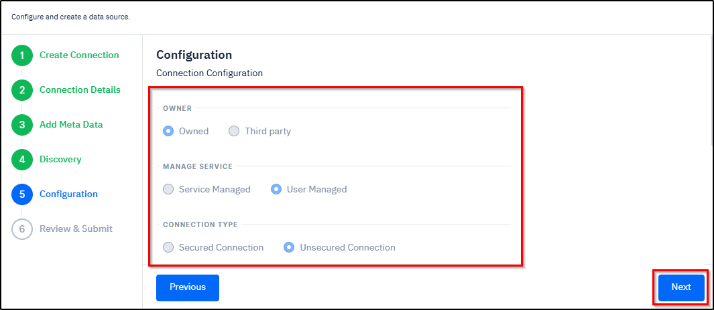

# Creating a Data Source Connection

***

### Instructions for Using this Page

* Click on an image to view it in a larger and clearer format. The inputs shown in the images are for example purposes only. You must enter the correct and actual data.
* At any time during the workflow, you can return to the previous section by clicking the **Previous** button.

***

### Overview

Creating a data source connection is the initial step in migrating data from a [<mark style="color:blue;">**Source System**</mark>](#user-content-fn-1)[^1] to a [<mark style="color:blue;">**Target System**</mark>](#user-content-fn-2)[^2]. Using SCIKIQ, you can connect to various data sources such as databases, APIs, CSV files, Excel files, and other supported formats.&#x20;

Once the connection is successfully established, the data source will appear on the **Connected Data Sources** page.&#x20;

***

### Connection Methods

You can either create a data source connectionconnection or use either an existing connection, which are described below.



#### Overview

This page explains how to create new data source connection in SCIKIQ. During the process, you will select the required data source and configure the parameters, followed by setting up the [Admin Settings](../integrations-3/admin-settings.md) and [SMTP](../integrations-3/admin-settings.md#setup-smtp).&#x20;

> <mark style="color:red;">**Note:**</mark> For illustration purposes, this page demonstrates how to create a new data source connection using Oracle. The same approach applies to other data sources such as APIs, CSV files, and Excel files; however, the required inputs may differ based on the source type. For example, a ServiceNow API connection requires field mapping, while an Oracle database connection uses a different set of configuration parameters.

Once the configurations are completed, the connection is created and displayed on the **Connected Data Sources page**. From this page, you can view the details of the connected data source. If required, you can update, rediscover, share, and delete the connected data source.

The step-by-step instructions are given in the procedure section below.

***

#### Procedure

The expandable panels below guide you through the process of creating a new data source connection in SCIKIQ. Follow each step in sequence while configuring the connection. The system enables the next step only after the current step is completed.

1.<strong>Select a New Data Source</strong>

A. On the **Left Navigation Bar**, expand **Connect to Data Source** under **SCIKIQ CONNECT**, and then click **Manage** **Data Source**.

<figure><figcaption>
Manage Data Source Menu Item
</figcaption></figure>

The All Data Sources page is displayed.

B. On the **All Data Sources** page, click the required **datasource**. For example, Oracle.

<figure><figcaption>
Selecting a Data Source
</figcaption></figure>

The Create Connection section is displayed.&#x20;

C. In the **Create Connection** section, select **No I'd like to create a new datasource**, and then click the **Next** button.

<figure><figcaption>
Selecting New Data Source Option
</figcaption></figure>

The Connection Details section is highlighted.

2.<strong>Configure Connection Details</strong>

**Purpose:**

While creating a connection, the system needs specific details to **locate**, **identify**, and **authenticate** the database. Each parameter plays a unique role.

**Procedure:**

The below step-by-step instructions help you understand how to configure connection details:


**Tip:** The field names and their corresponding options in the below instructions are annotated with relevant descriptions. To view the description of a field or an option, simply hover your cursor over it. &#x20;


**Step-by-Step instructions**

A. In the **Connection Details** section, enter the [<mark style="color:blue;">**Host Name**</mark>](#user-content-fn-3)[^3]<mark style="color:blue;">**,**</mark> [<mark style="color:blue;">**Port,**</mark>](#user-content-fn-4)[^4] [<mark style="color:blue;">**Database Name,**</mark>](#user-content-fn-5)[^5] [<mark style="color:blue;">**Service**</mark>](#user-content-fn-6)[^6]<mark style="color:blue;">**,**</mark> [<mark style="color:blue;">**Database Schema,**</mark>](#user-content-fn-7)[^7] **Database User,** and **Database Password.**&#x20;

B. Click the **Next** button.

<figure><figcaption>
Configuring Connection Details
</figcaption></figure>

The Add Metadata section is activated.

3.<strong>Add Metadata</strong>

**Purpose**

While creating a connection, adding **metadata** provides the application with important information about the data it will interact with. This metadata helps the system understand, organize, and manage the data correctly.

**Procedure:**

As part of the procedure, you need to specify catalogue, connectivity mechanism, store, source system, connection type, supporting email ID, and service type. Once done, you need to test by clicking the Test Connection button to check whether everything is correct.


**Tip:** To assist with your setup, fields and options shown in blue are equipped with tooltips. Hovering your mouse over these items will reveal a detailed description of their function.


**Step-by-Step Instructions:**

The below step-by-step instructions help you understand how to add meta data.

In the **Add Meta Data** section:

* Specify [<mark style="color:blue;">**Catalogue,**</mark>](#user-content-fn-8)[^8] [<mark style="color:blue;">**Business Owner**</mark>](#user-content-fn-9)[^9]**,** and [<mark style="color:blue;">**Technical Owner**</mark>](#user-content-fn-10)[^10]**.**
* From the [<mark style="color:blue;">**Connectivity Mechanism**</mark>](#user-content-fn-11)[^11] options, select [<mark style="color:blue;">**Secured**</mark>](#user-content-fn-12)[^12]<mark style="color:blue;">**,**</mark> [<mark style="color:blue;">**Unsecured**</mark>](#user-content-fn-13)[^13], or [<mark style="color:blue;">**SSH Tunnelling**</mark>](#user-content-fn-14)[^14]**.**
* From the [<mark style="color:blue;">**Store**</mark>](#user-content-fn-15)[^15] options, select either [<mark style="color:blue;">**Is Feature Store**</mark>](#user-content-fn-16)[^16] or [<mark style="color:blue;">**Is Analytical Store**</mark>](#user-content-fn-17)[^17].
* From the [<mark style="color:blue;">**Source System**</mark>](#user-content-fn-18)[^18] drop-down box, select [<mark style="color:blue;">**Internal**</mark>](#user-content-fn-19)[^19] or [<mark style="color:blue;">**Third Party**</mark>](#user-content-fn-20)[^20].
* From the [<mark style="color:blue;">**Connection Type**</mark>](#user-content-fn-21)[^21] drop-down box, select [<mark style="color:blue;">**Access Layer**</mark>](#user-content-fn-22)[^22]<mark style="color:blue;">**,**</mark> [<mark style="color:blue;">**Source System**</mark>](#user-content-fn-23)[^23]<mark style="color:blue;">**,**</mark> [<mark style="color:blue;">**Reference System,**</mark>](#user-content-fn-24)[^24] or [<mark style="color:blue;">**Master Database**</mark>](#user-content-fn-25)[^25]<mark style="color:blue;">**.**</mark>
* In the **Supporting Email ID** field, specify the **supporting email ID** to contact when something goes wrong or when help is needed.
* From the **Service Type** drop-down box, select the **category of service** the data source provides.
* Specify [<mark style="color:blue;">**Service Id**</mark>](#user-content-fn-26)[^26] and [<mark style="color:blue;">**Application Id**</mark>](#user-content-fn-27)[^27]**.**
* Finally, click the **Test Connection** button to check everything is correct.

The **Connection tested successfully** message is displayed.

* Click the **Next** button.

<figure><figcaption>
Adding Meta Data
</figcaption></figure>

The Discovery section is activated.

4.<strong>Discovery</strong>

**Purpose:**

During the Discovery step, the system displays the tables based on the schema provided in the connection details. For each table, it shows the schema name along with the number of rows and columns. If no schema is specified, the system displays tables from all schemas available in the database.

**Procedure:**&#x20;

Selecting **Source Tables** tells the system **which specific tables from the source database or application should be extracted and included in the connection setup.** This step defines the exact dataset that will be moved to the target system.

As part of the table selection step, you need to select the required tables from the left pane Discovery section and move them to the right pane. You can choose a single table, multiple tables, or all tables, as required.

**Step-by-Step Instructions:**

The following step-by-step instructions help you understand the process of discovery:


**Tip:** In the below mentioned instructions, the field names and their corresponding options are annotated with relevant descriptions. To view the description of a field or an option, simply hover your cursor over it.&#x20;


* In the **Discovery** section, select the **Discovery Settings** choosing from [<mark style="color:blue;">**Identify PII,**</mark>](#user-content-fn-28)[^28] [<mark style="color:blue;">**Data Profiling**</mark>](#user-content-fn-29)[^29], and [<mark style="color:blue;">**Data Summary**</mark>](#user-content-fn-30)[^30].
* From the **left box**, select the **required tables**, and then click the **Forward Arrow** button to move those files to the adjacent box.


**Tip:**&#x20;

* You can migrate **multiple files** by selecting in the left side box and moving them to the right side box by clicking the .png>) button.
* You can also migrate **all** the files by clicking the .png>)button.
* If you wish to **move back either a single or multiple** files from the right box, then select them, and click the .png>) button.&#x20;
* If you wish to **move all the files** from the right box, then select all of them , and click the .png>) button.&#x20;


* Finally, click the **Next** button.

<figure><figcaption>
Selecting Tables for Discovery
</figcaption></figure>

The files are discovered and the Configuration section is activated.

5<strong>.Configuration</strong>

* In the **Configuration** section, select the **owner** choosing from **Owner** or **Third Party**.
* Select the [<mark style="color:blue;">**Manage Service**</mark>](#user-content-fn-31)[^31] choosing from [<mark style="color:blue;">**Service Managed**</mark>](#user-content-fn-32)[^32] or [<mark style="color:blue;">**User Managed**</mark>](#user-content-fn-33)[^33].
* Select the **Connection type** choosing from **Secured Connection** or **Unsecured Connection.**
* Click the **Next** button.

<figure><figcaption>
Configuring Additional Details
</figcaption></figure>

The Review & Submit section is activated.

6.<strong>Review &#x26; Submit</strong>

* As the final step, review the details, and then click the **Finish** button to submit it.

<figure><figcaption>
Review and Submit
</figcaption></figure>

The connection is created and the **Connected Data Sources** page is displayed.




#### Overview

This page explains how to create a connection using an existing data source in SCIKIQ. As part of the process, you can make changes, if any, to the existing data source. Once the configurations are completed, the connection is created and displayed on the **Connected Data Sources** page. &#x20;

The step-by-step instructions are given in the procedure section below.

***

#### Procedure

The expandable panels below guide you through the process of creating a connection using an existing data source in SCIKIQ. Follow each step in sequence while configuring the connection. The system enables the next step only after the current step is completed.

1.<strong>Select an Existing Datasource</strong>

A. On the **Left Navigation Bar**, expand **Connect to Data Source** under **SCIKIQ CONNECT**, and then click **Manage** **Data Source**.

<figure><figcaption>
Manage Data Source Menu Item
</figcaption></figure>

The All Data Sources page is displayed.

B. On the **All Data Sources** page, click the required **datasource**. For example, Oracle.

<figure><figcaption>
Selecting a Data Source
</figcaption></figure>

The Create Connection section is displayed.&#x20;

C. In the **Create Connection** section, select **Yes, let me choose an existing datasource from the list.**

The Connection List is displayed.

D. From the **Connection List**, select the required **connection,** and then click the **Next** button.&#x20;

<figure><figcaption>
Selecting an Existing Connection
</figcaption></figure>

The Connection Details section is highlighted.

2.<strong>Configure Connection Details</strong>

**Purpose:**

While creating a connection, the system needs specific details to **locate**, **identify**, and **authenticate** the database. Each parameter plays a unique role.

**Procedure:**

The below step-by-step instructions help you understand how to configure connection details:


**Tip:** The field names and their corresponding options in the below instructions are annotated with relevant descriptions. To view the description of a field or an option, simply hover your cursor over it. &#x20;


**Step-by-Step instructions**

A. In the **Connection Details** section, **make changes (if any)** to the [<mark style="color:blue;">**Host Name**</mark>](#user-content-fn-3)[^3]<mark style="color:blue;">**,**</mark> [<mark style="color:blue;">**Port,**</mark>](#user-content-fn-4)[^4] [<mark style="color:blue;">**Database Name,**</mark>](#user-content-fn-5)[^5] [<mark style="color:blue;">**Service**</mark>](#user-content-fn-6)[^6]<mark style="color:blue;">**,**</mark> [<mark style="color:blue;">**Database Schema,**</mark>](#user-content-fn-7)[^7] **Database User,** and **Database Password.**&#x20;

B. Click the **Next** button.

<figure><figcaption>
Configuring Connection Details
</figcaption></figure>

The Add Metadata section is activated.

3.<strong>Add Metadata</strong>

**Purpose**

While creating a connection, adding **metadata** provides the application with important information about the data it will interact with. This metadata helps the system understand, organize, and manage the data correctly.

**Procedure:**

The below step-by-step instructions help you understand how to add meta data.

A. In the **Add Meta Data** section, **make** **changes (if any)** to [<mark style="color:blue;">**Catalogue**</mark>](#user-content-fn-8)[^8]<mark style="color:blue;">**,**</mark> [<mark style="color:blue;">**Business Owner**</mark>](#user-content-fn-34)[^34]<mark style="color:blue;">**,**</mark> [<mark style="color:blue;">**Technical Owner**</mark>](#user-content-fn-10)[^10]<mark style="color:blue;">**,**</mark> [<mark style="color:blue;">**Connectivity Mechanism**</mark>](#user-content-fn-11)[^11]<mark style="color:blue;">**,**</mark> [<mark style="color:blue;">**Store**</mark>](#user-content-fn-15)[^15]<mark style="color:blue;">**,**</mark> [<mark style="color:blue;">**Connection Type**</mark>](#user-content-fn-21)[^21]<mark style="color:blue;">**,**</mark>**&#x20;Supporting Email ID, Service Type,** [<mark style="color:blue;">**Service Id**</mark>](#user-content-fn-26)[^26] and [<mark style="color:blue;">**Application Id**</mark>](#user-content-fn-27)[^27]<mark style="color:blue;">**.**</mark>

B. Click the **Test Connection** button to check everything is correct.

The **Connection tested successfully** message is displayed.

C. Click the **Next** button.

<figure><figcaption>
Adding Meta Data
</figcaption></figure>

The Discovery section is activated.

4.<strong>Discovery</strong>

**Purpose:**

During the Discovery step, the system displays the tables based on the schema provided in the connection details. For each table, it shows the schema name along with the number of rows and columns. If no schema is specified, the system displays tables from all schemas available in the database.

**Procedure:**&#x20;

Selecting **Source Tables** tells the system **which specific tables from the source database or application should be extracted and included in the connection setup.** This step defines the exact dataset that will be moved to the target system.

As part of the table selection step, you need to select the required tables from the left pane in the Discovery section and move them to the right pane. You can choose a single table, multiple tables, or all tables, as required.

**Step-by-Step Instructions:**

The following step-by-step instructions help you understand the process of discovery:

A. In the **Discovery** section, **make changes ( if any)** to the selected **Discovery Settings** and T**ables**.

B. Click the **Next** button.

<figure><figcaption></figcaption></figure>

The files are discovered and the Configuration section is activated.

5<strong>.Configuration</strong>

* In the **Configuration** section, make **changes (if any)** to **owner,** [<mark style="color:blue;">**Manage Service**</mark>](#user-content-fn-31)[^31]<mark style="color:blue;">**,**</mark>**&#x20;Connection type,** and then click the **Next** button.

<figure><figcaption>
Connection Configuration
</figcaption></figure>

The Review & Submit section is activated.

6.<strong>Review &#x26; Submit</strong>

* As the final step, review the details, and then click the **Finish** button to submit it.

<figure><figcaption>
Review and Submit
</figcaption></figure>

The connection is created and the [Connected Data Sources](/broken/pages/0TC6MbGLpx4paxnAfBNX) page is displayed.




***

***

### Related Topics

* [**Connection Setup Examples**](connection-setup-examples.md)

[^1]: The **Source System** is the system **from which the data comes from**.

[^2]: The **Target System** is the system **to which data is sent or stored.**

[^3]: **Host Name** refers to the **address** of the computer/server where your database is located.

[^4]: **Port** refers to the number on the server used to talk to the database. Different services use different ports.

[^5]: **Database** name refers to the **name of the database** you need to connect to on the server.

[^6]: **Service** refers to the predefined **connection name** used by the database to identify the database service running on the server.

[^7]: **Database Schema** refers to the folder inside the database that organizes tables and other objects.

[^8]: **Catalogue** refers to the group of related data sources.

[^9]: **Business Owner** refers to the person or team responsible for a data source from a business perspective. Assigning a Business Owner grants the necessary permissions (such as **Contributor** access) to manage the data source, including updating and deleting it.

[^10]: **Technical Owner** refers to the **person or IT team** responsible for the technical side of the data.

[^11]: Connectivity Mechanism refers to the method used to connect to the data source.

[^12]: **Secured** option refers to the connection where data is encrypted, making it safe from hackers and unauthorized access.

[^13]: **Unsecured** option refers to the connection where data is sent without encryption.

[^14]: SSH Tunneling: SSH refers to Secure Shell. SSH is a secure way to connect to another computer or server over a network.

[^15]: This refers to how the data will be used.

[^16]: Select **Is Feature Store** if the data source is used to store and manage machine learning features.

[^17]: Select **Is Analytical Store** if the data source is primarily used for analytics, reporting, and business intelligence.

[^18]: This refers to the original system where the data comes from.

[^19]: An **Internal source system** is owned, managed, and maintained by your organization.

[^20]: A **Third-Party** source system is owned and managed by an external vendor or service provider.

[^21]: This refers to the kind of connection you are using to access the source.

[^22]: The **Access Layer** represents systems that are used to consume or expose data rather than originate it.

[^23]: A **Source System** is the origin of raw or transactional data.

[^24]: A Reference System stores standardized, lookup, or supporting data used across multiple systems.

[^25]: A **Master Database** stores authoritative master data for key business entities.

[^26]: This refers to the unique identifier for the service you are connecting to.

[^27]: This refers to the unique ID used to identify the application that owns, provides, or uses the data.

[^28]: **Identify PII** (Personally Identifiable Information) detects sensitive data elements that can identify an individual.

[^29]: **Data Profiling** analyzes the structure and content of data to understand its quality and patterns.

[^30]: **Data Summary** provides a high-level overview of the dataset.

[^31]: **Manage Service** refers to who is responsible for managing the connection and its configuration.

[^32]: **Service Managed** means the system automatically manages the service for you.

[^33]: **User Managed** means you manage the service configuration yourself.

[^34]: **Business Owner** refers to the person or team responsible for the data from a business point of view.
