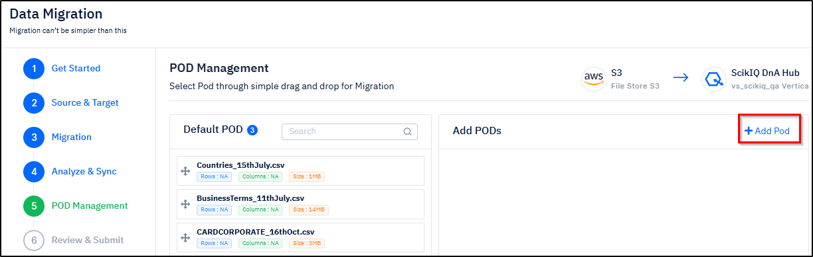
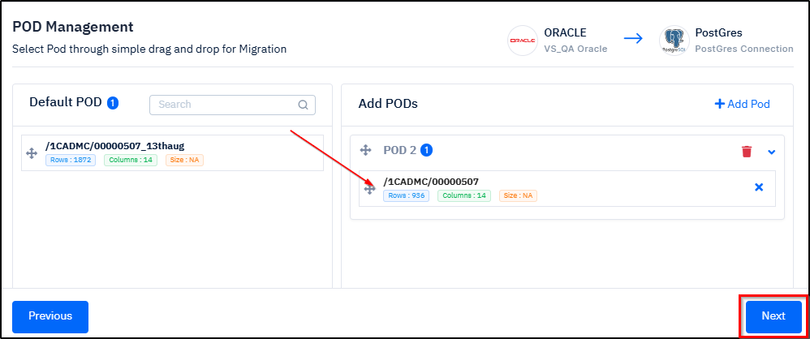
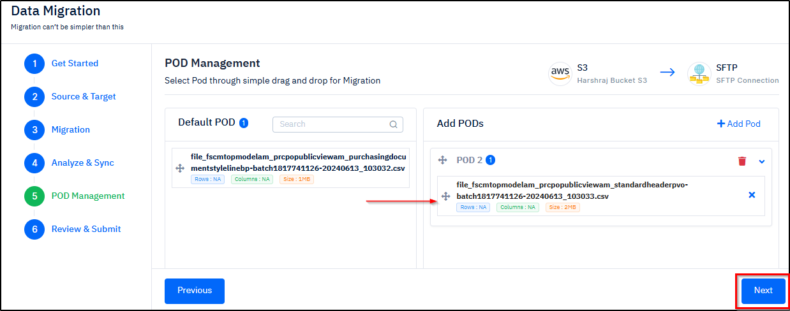
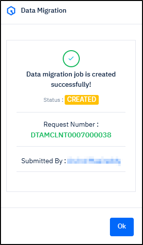
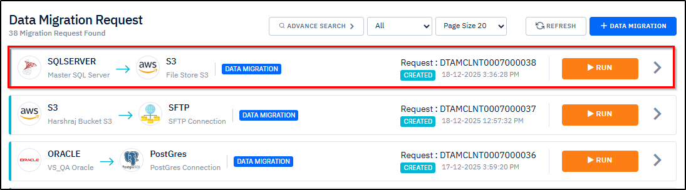
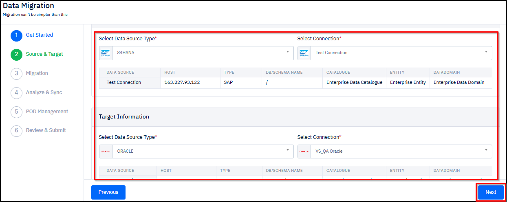
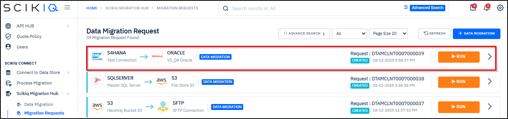

# Migrating Data

***

### Instructions for Using this Page

* Click on an image to view it in a larger and clearer format. The inputs shown in the images are for example purposes only. You must enter the correct and actual data.
* At any time during the workflow, you can return to the previous section by clicking the **Previous** button.

***

### Overview

In a Data Management Workflow, data migration is typically performed after the data source has been created and properly configured. Migration enables the controlled movement of data from the source system to the target system, while ensuring data integrity, supporting delta (incremental) synchronization, and optimizing overall data processing.&#x20;

This step helps ensure that data is transferred reliably and remains consistent between systems.

***

### Migrating Data

The SCIKIQ application supports multiple types of data migration to accommodate different data movement and integration requirements. Some of these migration types include **Database-to-Database, File-to-File, Database-to-File, File-to-Database, SAP App Server-to-Database,** and **SAP App Server-to-File**.

Click on the below tabs to view the procedure of these migration types.&#x20;



#### Overview

This section describes the process of data migration from a database to another database in the SCIKIQ application. After creating a connection, you can migrate data from a source system (for example, Oracle) to a target system (for example, PostGres).&#x20;

The migration process is carried out through a sequence of structured steps, including **selecting the source and target, selecting source tables for migration, performing analysis and synchronization, managing PODs,** and **reviewing and submitting the request**. Once the process is completed, the migration request is listed on the **Migration Requests** page.

***

#### Procedure

The panels below provide step-by-step instructions help you to carry out the migration process. Expand each panel to view detailed information.

Select Source and Target

**Purpose**

This is the first step in the data migration workflow. Selecting the **Source and Target** is critical, as it defines where the data originates and where it will be migrated. This step ensures the system can correctly extract, transform, and load the data between the chosen source and destination systems.

**Procedure Overview**

As part of the process, you must specify the source and target details, including the data source type and connection. Once this information is provided, the **Migration** section is activated. The step-by-step instructions below guide you through selecting the source and target information.

**Step-by-step Instructions**

1\. On the **Left Navigation Bar** of the **SCIKIQ** application, go to **SCIKIQ CONNECT,** and then click **Data Migration** under **SCIKIQ Migration Hub.**

<figure><figcaption>
Data Migration Menu Option
</figcaption></figure>

The Data Migration Wizard page is displayed.

2. On the  **Data Migration Wizard** page, click the **Next** button at the right side bottom of the page.

<figure><figcaption>
Data Migration Wizard
</figcaption></figure>

The Source & Target section is activated.


**Tip:** In the **Source Information** section, If the required data source is not listed, click the icon shown below to create a new data source.


<figure><figcaption>
Create Connection Icon
</figcaption></figure>

3. In the **Source & Target** section (See the image below):

**Under Source Information**&#x20;

* From the **Select Data Source Type** drop-down box, select **Oracle**.
* From the **Select Connection** drop-down box, select the **required connection**.

The Data Source details including selected connection name, host, type, db/schema name, catalogue, entity, and data domain are displayed below.

**Under Target Information**&#x20;

* From the **Select Data Source Type** drop-down box, select **PostGres**.
* From the **Select Connection** drop-down box, select the **required connection**.

4. After specifying all  the details, click the **Next** button.&#x20;

<figure><figcaption>
Souce Information
</figcaption></figure>

The Data Source details including selected connection name, host, type, db/schema name, catalogue, entity, and data domain are displayed.


**Tip:** At any time during the workflow, you can return to the previous section by clicking the **Previous** button.


The **Migration** section is activated, and the available tables are displayed in the left-side selection box.

Select Source Tables for Migration

**Purpose**

Selecting **Source Tables** tells the system **which specific tables from the source database or application should be extracted and included in the migration.** This step defines the exact dataset that will be moved to the target system.

**Procedure Overview**

As part of the table selection step, select the required tables from the left pane and move them to the right pane for migration. You can choose a single table, multiple tables, or all tables, as required.

**Step-by-step Instructions**

1\. In the **Migration** section (See the image below):.

* From the **left box**, select the **required tables**, and then click the **Forward Arrow** .png>)button.
* After selecting the tables, click the **Next** button.

The selected tables are moved to the right box for migration.


**Tip:**&#x20;

* You can migrate **multiple files** by selecting in the left side box and moving them to the right side box by clicking the .png>) button.
* You can also migrate **all** the files by clicking the .png>)button.
* If you wish to **move back either a single or multiple** files from the right box, then select them, and click the .png>) button.&#x20;
* If you wish to **move all the files** from the right box, then select all of them , and click the .png>) button.&#x20;


<figure><figcaption>
Source Tables Selection for Migration
</figcaption></figure>



The Analyze & Sync section is displayed.



Manage POD

**Purpose**

The **POD (Process-Oriented Design) Management** step enables you to structure and categorize data into logical units called PODs for migration. By grouping tables into these modular units, it simplifies the planning, execution, and monitoring of large-scale migrations, while providing greater control and visibility throughout the process.

**Procedure Overview**

As part of POD Management, add the required tables to the right pane. Once you click the **Next** button, the **Review and Submit** section is activated.

**Step-by-Step Instructions**

1. In the **POD Management** section, click the **Add** button.

<figure><figcaption>
POD Management - Add POD Button
</figcaption></figure>

2. From the **Default POD** box, drag and drop the **required POD** into the right box.


Tip: If required, you can remove a POD by clicking the **Delete** .png>) button.


3. Click the **Next** button.

<figure><figcaption>
Adding PODs
</figcaption></figure>

The Review & Submit section is highlighted.

Review and Submit

**Purpose**

This is the **last step** in the process of migration. It enables you to review the selected tables and provides you to submit them for migration. Upon successful completion, the migration request is created and displayed on the **Migration Requests** page.

**Procedure Overview**

As part of the procedure, you can review the selected tables and then provide the task name and description. Once you click the **Finish** button, a success message is displayed and the migration request appears on the **Migration Requests** page.

**Step-by-Step Instructions**

1. In the **Review & Submit** section, enter the **Task Name, Task Description**, and then click the **Finish** button at the bottom.

<figure><figcaption>
Task Name and Task Description Specification
</figcaption></figure>

The Data Migration  job is created successfully! message is displayed. See the image below.

2. Click the **Ok** button.&#x20;

<figure><figcaption>
Data Migration Success Message
</figcaption></figure>

Also, the request is displayed on the [Migration Requests](/broken/pages/O0fkcjHMx4j4cAnUm99P) page. See the image below.

<figure><figcaption>
Migration Request
</figcaption></figure>




#### Overview

This section describes the process of data migration from a file to another file in the SCIKIQ application. After creating a connection, you can migrate data from a source system (for example, Amazon S3) to a target system (for example, Storage).&#x20;

The migration process is carried out through a sequence of structured steps, including **selecting the source and target**, **selecting source tables for migration, performing analysis and synchronization, managing PODs, and reviewing** and **submitting the request**. Once the process is completed, the migration request is listed on the **Migration Requests** page.

***

#### Procedure

The panels below provide step-by-step instructions help you to carry out the migration process. Expand each panel to view detailed information.

Select Source and Target

**Purpose**

This is the first step in the data migration workflow. Selecting the **Source and Target** is critical, as it defines where the data originates and where it will be migrated. This step ensures the system can correctly extract, transform, and load the data between the chosen source and destination systems.

**Procedure Overview**

As part of the process, you must specify the source and target details, including the data source type and connection. Once this information is provided, the **Migration** section is activated. The step-by-step instructions below guide you through selecting the source and target information.

**Step-by-step Instructions**

1\. On the **Left Navigation Bar** of the **SCIKIQ** application, go to **SCIKIQ CONNECT,** and then click **Data Migration** under **SCIKIQ Migration Hub.**

<figure><figcaption>
Data Migration Menu Option
</figcaption></figure>

The Data Migration Wizard page is displayed.

2. On the  **Data Migration Wizard** page, click the **Next** button at the right side bottom of the page.

<figure><figcaption>
Data Migration Wizard
</figcaption></figure>

The Source & Target section is activated.


**Tip:** In the **Source Information** section, If the required data source is not listed, click the icon shown below to create a new data source.


<figure><figcaption>
Create Connection Icon
</figcaption></figure>

3. In the **Source & Target** section (See the image below):

**Under Source Information**&#x20;

* From the **Select Data Source Type** drop-down box, select **S3**.
* From the **Select Connection** drop-down box, select the **required connection**.

The Data Source details including selected connection name, host, type, db/schema name, catalogue, entity, and data domain are displayed below.

**Under Target Information**&#x20;

* From the **Select Data Source Type** drop-down box, select **Storage**.
* From the **Select Connection** drop-down box, select the **required connection**.

<figure><figcaption>
Source Information
</figcaption></figure>

The Data Source details including selected connection name, host, type, db/schema name, catalogue, entity, and data domain are displayed below.

* After specifying all  the details, click the **Next** button.&#x20;


**Tip:** At any time during the workflow, you can return to the previous section by clicking the **Previous** button.


The Migration section is activated.&#x20;

Select Source Tables for Migration

**Purpose**

Selecting **Source Tables** tells the system **which specific tables from the source database or application should be extracted and included in the migration.** This step defines the exact dataset that will be moved to the target system.

**Procedure Overview**

As part of the table selection step, select the required tables from the left pane and move them to the right pane for migration. You can choose a single table, multiple tables, or all tables, as required.

**Step-by-step Instructions**

1\. In the **Migration** section, click the **Search Storage** button button.

<figure><figcaption>
Search Storage Button 
</figcaption></figure>

The Storage dialogue box is displayed.

2. On the **Storage** dialogue box, select the **Bucket, File Extn**, and then click the **Search** button.

<figure><figcaption>
Specification of Inputs in Storage Dialogue Box
</figcaption></figure>

The Storage dialogue box is extended by displaying the folders and files. (See the below image)

3. Now, from the **Storage** dialogue box, select the **required folder** or **file.**&#x20;
4. Select the **Delimited Text File** option choosing from **Comma, Tab, Semicolon, Space, or Other**.

> <mark style="color:red;">**Note:**</mark> A **Delimited Text File** is a text file where information is separated by a specific character (like comma or tab) so that systems can easily understand and process the data.

5. Enable the **First row is column header** option if required.
6. Enable the **Skip Row(s)** option if required.

> <mark style="color:red;">**Note:**</mark> When the **Skip Row(s)** option is chosen while selecting a file for migration, the system **ignores (does not import) the specified number of rows from the top of the file** during data extraction.&#x20;
>
> This option is usually needed when the beginning of the file contains Extra header lines, Metadata information, Notes or comments, Blank rows, and Titles or descriptions, etc.

7. Click the **Save** button.

<figure><figcaption>
Selection of Folder and Configuring Settings in Storage Dialogue Box
</figcaption></figure>

The file is displayed in the left box of the Migration section. (See the below image)

8. Now from the **left box**, select the **required tables**, and then click the **Forward Arrow** button to move them to the right side box.
9. After moving the tables, click the **Next** button.

<figure><figcaption>
Selection of Tables for Migration
</figcaption></figure>

The selected tables are moved to the right box for migration.


**Tip:**&#x20;

* You can migrate **multiple files** by selecting and moving them to the right box by clicking the .png>) button.
* You can also migrate **all** the files by clicking the .png>)button.
* If you wish to **move back either a single or multiple** files from the right box, then select them, and click the .png>) button.&#x20;
* If you wish to **move all the files** from the right box, then select all of them , and click the .png>) button.&#x20;


The Analyze & Sync section is displayed.



Manage POD

**Purpose**

The **POD (Process-Oriented Design) Management** step enables you to structure and categorize data into logical units called PODs for migration. By grouping tables into these modular units, it simplifies the planning, execution, and monitoring of large-scale migrations, while providing greater control and visibility throughout the process.

**Procedure Overview**

As part of POD Management, add the required tables to the right pane. Once you click the **Next** button, the **Review and Submit** section is activated.

**Step-by-Step Instructions**

1. In the **POD Management** section, click the **Add** button.

<figure><figcaption>
POD Management - Add POD Button
</figcaption></figure>

1. From the **Default POD** box, drag and drop the **required POD** into the right box.


Tip: If required, you can remove a POD by clicking the **Delete** .png>) button.


3. Click the **Next** button.

<figure><figcaption>
Adding PODs
</figcaption></figure>

The **Review & Submit** section is highlighted.

Review and Submit

**Purpose**

This is the **last step** in the process of migration. It enables you to review the selected tables and provides you to submit them for migration. Upon successful completion, the migration request is created and displayed on the **Migration Requests** page.

**Procedure Overview**

As part of the procedure, you can review the selected tables and then provide the task name and description. Once you click the **Finish** button, a success message is displayed and the migration request appears on the **Migration Requests** page.

**Step-by-Step Instructions**

1. In the **Review & Submit** section, enter the **Task Name, Task Description**, and then click the **Finish** button at the bottom.

<figure><figcaption>
Task Name and Task Description Specification
</figcaption></figure>

The Data Migration  job is created successfully! message is displayed. See the image below.

2. Click the **Ok** button.&#x20;

<figure><figcaption>
Data Migration Success Message
</figcaption></figure>

Also, the request is displayed on the [Migration Requests](/broken/pages/O0fkcjHMx4j4cAnUm99P) page. See the image below.

<figure><figcaption>
Migration Request
</figcaption></figure>




#### Overview

This section describes the process of data migration from a file to another file in the SCIKIQ application. After creating a connection, you can migrate data from a source system (for example, MS SQL) to a target system (for example, Storage S3).&#x20;

The migration process is carried out through a sequence of structured steps, including **selecting the source and target, selecting source tables for migration, performing analysis and synchronization, managing PODs, and reviewing** and **submitting the request**. Once the process is completed, the migration request is listed on the **Migration Requests page**.

***

#### Procedure

The panels below provide step-by-step instructions help you to carry out the migration process. Expand each panel to view detailed information.

Select Source and Target

**Purpose**

This is the first step in the data migration workflow. Selecting the **Source and Target** is critical, as it defines where the data originates and where it will be migrated. This step ensures the system can correctly extract, transform, and load the data between the chosen source and destination systems.

**Procedure Overview**

As part of the process, you must specify the source and target details, including the data source type and connection. Once this information is provided, the **Migration** section is activated. The step-by-step instructions below guide you through selecting the source and target information.

**Step-by-step Instructions**

1\. On the **Left Navigation Bar** of the **SCIKIQ** application, go to **SCIKIQ CONNECT,** and then click **Data Migration** under **SCIKIQ Migration Hub.**

<figure><figcaption>
Data Migration Menu Option
</figcaption></figure>

The Data Migration Wizard page is displayed.

2. On the  **Data Migration Wizard** page, click the **Next** button at the right side bottom of the page.

<figure><figcaption>
Data Migration Wizard
</figcaption></figure>

The Source & Target section is activated.


**Tip:** In the **Source Information** section, If the required data source is not listed, click the icon shown below to create a new data source.


<figure><figcaption>
Create Connection Icon
</figcaption></figure>

3. In the **Source & Target** section (See the image below):

**Under Source Information**&#x20;

* From the **Select Data Source Type** drop-down box, select **SQL Server**.
* From the **Select Connection** drop-down box, select the **required connection**.

The Data Source details including selected connection name, host, type, db/schema name, catalogue, entity, and data domain are displayed below.

**Under Target Information**&#x20;

* From the **Select Data Source Type** drop-down box, select **Storage**.
* From the **Select Connection** drop-down box, select the **required connection**.

<figure><figcaption>
Source Information Selection
</figcaption></figure>

The Data Source details including selected connection name, host, type, db/schema name, catalogue, entity, and data domain are displayed below.

* After specifying all  the details, click the **Next** button.&#x20;


**Tip:** At any time during the workflow, you can return to the previous section by clicking the **Previous** button.


The Migration section is activated with tables for displayed for selection in the left. See the next panel.

Select Source Tables for Migration

**Purpose**

Selecting **Source Tables** tells the system **which specific tables from the source database or application should be extracted and included in the migration.** This step defines the exact dataset that will be moved to the target system.

**Procedure Overview**

As part of the table selection step, select the required tables from the left pane and move them to the right pane for migration. You can choose a single table, multiple tables, or all tables, as required.

**Step-by-step Instructions**

1. Now in the **Migration** section, from the **left box**, select the **required tables**, and then click the **Forward Arrow** button to move them to the right side box.
2. After moving the tables, click the **Next** button.

<figure><figcaption>
Selection of Table for Migration
</figcaption></figure>

The selected tables are moved to the right box for migration.


**Tip:**&#x20;

* You can migrate **multiple files** by selecting and moving them to the right box by clicking the .png>) button.
* You can also migrate **all** the files by clicking the .png>)button.
* If you wish to **move back either a single or multiple** files from the right box, then select them, and click the .png>) button.&#x20;
* If you wish to **move all the files** from the right box, then select all of them , and click the .png>) button.&#x20;


The Analyze & Sync section is displayed.



Manage POD

**Purpose**

The **POD (Process-Oriented Design) Management** step enables you to structure and categorize data into logical units called PODs for migration. By grouping tables into these modular units, it simplifies the planning, execution, and monitoring of large-scale migrations, while providing greater control and visibility throughout the process.

**Procedure Overview**

As part of POD Management, add the required tables to the right pane. Once you click the **Next** button, the **Review and Submit** section is activated.

**Step-by-Step Instructions**

1. In the **POD Management** section, click the **Add** button.

<figure><figcaption>
POD Management - Add POD Button
</figcaption></figure>

1. From the **Default POD** box, drag and drop the **required POD** into the right box.


Tip: If required, you can remove a POD by clicking the **Delete** .png>) button.


3. Click the **Next** button.

<figure><figcaption>
Adding PODs
</figcaption></figure>

The Review & Submit section is highlighted.

Review and Submit

**Purpose**

This is the **last step** in the process of migration. It enables you to review the selected tables and provides you to submit them for migration. Upon successful completion, the migration request is created and displayed on the [Migration Requests ](/broken/pages/O0fkcjHMx4j4cAnUm99P)page.

**Procedure Overview**

As part of the procedure, you can review the selected tables and then provide the task name and description. Once you click the **Finish** button, a success message is displayed and the migration request appears on the [Migration Requests](/broken/pages/O0fkcjHMx4j4cAnUm99P) page.

**Step-by-Step Instructions**

1. In the **Review & Submit** section, enter the **Task Name, Task Description**, and then click the **Finish** button at the bottom.

<figure><figcaption>
Task Name and Task Description Specification
</figcaption></figure>

The Data Migration  job is created successfully! message is displayed. See the image below.

2. Click the **Ok** button.&#x20;

<figure><figcaption>
Data Migration Success Message
</figcaption></figure>

Also, the request is displayed on the [Migration Requests](/broken/pages/O0fkcjHMx4j4cAnUm99P) page. See the image below.

<figure><figcaption>
Migration Request
</figcaption></figure>




### Overview

This section describes the process of data migration from a file to a database in the SCIKIQ application. After creating a connection, you can migrate data from a source system (for example, Amazon S3) to a target system (for example, Oracle).&#x20;

The migration process is carried out through a sequence of structured steps, including **selecting the source and target, selecting source tables for migration, performing analysis and synchronization, managing PODs,** and **reviewing and submitting the request**. Once the process is completed, the migration request is listed on the **Migration Requests** page.

***

### Procedure

The panels below provide step-by-step instructions help you to carry out the migration process. Expand each panel to view detailed information.

Select Source Tables for Migration

**Purpose**

Selecting **Source Tables** tells the system **which specific files from the source database or application should be extracted and included in the migration.** This step defines the exact dataset that will be moved to the target system.

**Procedure Overview**

As part of the table selection step, select the required tables from the left pane and move them to the right pane for migration. You can choose a single table, multiple tables, or all tables, as required.

**Step-by-step Instructions**

1\. In the **Migration** section, click the **Search Storage** button.

<figure><figcaption>
Search Storage Button
</figcaption></figure>

The Storage dialogue box is displayed.

2. On the **Storage** dialogue box:

* From the **Select** [**Buck**](#user-content-fn-1)[^1]**et** drop-down box, select the required **bucket**.
* From the **File Extn.**  drop-down box, select the required file extension. For example, CSV[^2].
* Click the Search button.

<figure><figcaption>
 Storage Dialogue Box
</figcaption></figure>

The Storage dialogue box is extended by displaying the folders.

* Now, from the list of folders, select the **required folder.**&#x20;
* Select the **Delimited Text File** option choosing from **Comma, Tab, Semicolon, Space, or Other**.

> <mark style="color:red;">**Note:**</mark> A **Delimited Text File** is a text file where information is separated by a specific character (like comma or tab) so that systems can easily understand and process the data.

* Enable the **First row is column header** option if required.
* Enable the **Skip Row(s)** option if required.

> <mark style="color:red;">**Note:**</mark> When the **Skip Row(s)** option is chosen while selecting a file for migration, the system **ignores (does not import) the specified number of rows from the top of the file** during data extraction.&#x20;
>
> This option is usually needed when the beginning of the file contains Extra header lines, Metadata information, Notes or comments, Blank rows, and Titles or descriptions, etc.

Click the **Save** button.

* From the **left box**, select the **required tables**, and then click the **Forward Arrow** .png>)button.
* After selecting the tables, click the **Next** button.

The selected tables are moved to the right box for migration.


**Tip:**&#x20;

* You can migrate **multiple files** by selecting and moving them to the right box by clicking the .png>) button.
* You can also migrate **all** the files by clicking the .png>)button.
* If you wish to **move back either a single or multiple** files from the right box, then select them, and click the .png>) button.&#x20;
* If you wish to **move all the files** from the right box, then select all of them , and click the .png>) button.&#x20;


The Analyze & Sync section is displayed.

Select Source and Target

**Purpose**

This is the first step in the data migration workflow. Selecting the **Source and Target** is critical, as it defines where the data originates and where it will be migrated. This step ensures the system can correctly extract, transform, and load the data between the chosen source and destination systems.

**Procedure Overview**

As part of the process, you must specify the source and target details, including the data source type and connection. Once this information is provided, the **Migration** section is activated. The step-by-step instructions below guide you through selecting the source and target information.

**Step-by-step Instructions**

1\. On the **Left Navigation Bar** of the **SCIKIQ** application, go to **SCIKIQ CONNECT,** and then click **Data Migration** under **SCIKIQ Migration Hub.**

<figure><figcaption>
Data Migration Menu Option
</figcaption></figure>

The Data Migration Wizard page is displayed.

2. On the  **Data Migration Wizard** page, click the **Next** button at the right side bottom of the page.

<figure><figcaption>
Data Migration Wizard
</figcaption></figure>

The Source & Target section is activated.


**Tip:** In the **Source Information** section, If the required data source is not listed, click the icon shown below to create a new data source.


<figure><figcaption>
Create Connection Icon
</figcaption></figure>

3. In the **Source & Target** section (See the image below):

**Under Source Information**&#x20;

* From the **Select Data Source Type** drop-down box, select **Oracle**.
* From the **Select Connection** drop-down box, select the **required connection**.

The Data Source details including selected connection name, host, type, db/schema name, catalogue, entity, and data domain are displayed below.

**Under Target Information**&#x20;

* From the **Select Data Source Type** drop-down box, select **Oracle**.
* From the **Select Connection** drop-down box, select the **required connection**.

<figure><figcaption>
Data Source Selection
</figcaption></figure>

The Data Source details including selected connection name, host, type, db/schema name, catalogue, entity, and data domain are displayed below.

* After specifying all  the details, click the **Next** button.&#x20;


**Tip:** At any time during the workflow, you can return to the previous section by clicking the **Previous** button.


The Migration section is activated with tables for displayed for selection in the left. See the next panel.



Manage POD

**Purpose**

The **POD (Process-Oriented Design) Management** step enables you to structure and categorize data into logical units called PODs for migration. By grouping tables into these modular units, it simplifies the planning, execution, and monitoring of large-scale migrations, while providing greater control and visibility throughout the process.

**Procedure Overview**

As part of POD Management, add the required tables to the right pane. Once you click the **Next** button, the **Review and Submit** section is activated.

**Step-by-Step Instructions**

1. In the **POD Management** section, click the **Add** button.

<figure><figcaption>
POD Management - Add POD Button
</figcaption></figure>

2. From the **Default POD** box, drag and drop the **required POD** into the right box.


Tip: If required, you can remove a POD by clicking the **Delete** .png>) button.


3. Click the **Next** button.

<figure><figcaption>
Adding PODs
</figcaption></figure>

The Review & Submit section is highlighted.

Review and Submit

**Purpose**

This is the **last step** in the process of migration. It enables you to review the selected tables and provides you to submit them for migration. Upon successful completion, the migration request is created and displayed on the **Migration Requests** page.

**Procedure Overview**

As part of the procedure, you can review the selected tables and then provide the task name and description. Once you click the **Finish** button, a success message is displayed and the migration request appears on the **Migration Requests** page.

**Step-by-Step Instructions**

1. In the **Review & Submit** section, enter the **Task Name, Task Description**, and then click the **Finish** button at the bottom.

<figure><figcaption>
Task Name and Task Description Specification
</figcaption></figure>

The Data Migration  job is created successfully! message is displayed. See the image below.

2. Click the **Ok** button.&#x20;

<figure><figcaption>
Data Migration Success Message
</figcaption></figure>

Also, the request is displayed on the **Migration Requests** page. See the image below.

<figure><figcaption>
Migration Request
</figcaption></figure>




#### Overview

This section describes the process of data migration from SAP  App Server to a database in the SCIKIQ application. After creating a connection, you can migrate data from a source system (for example, S4 Hana) to a target system (for example, Oracle).&#x20;

The migration process is carried out through a sequence of structured steps, including **selecting the source and target, selecting source tables for migration, performing analysis and synchronization, managing PODs,** and **reviewing and submitting the request**. Once the process is completed, the migration request is listed on the **Migration Requests** page.

***

#### Procedure

The panels below provide step-by-step instructions help you to carry out the migration process. Expand each panel to view detailed information.

Select Source Tables for Migration

**Purpose**

Selecting **Source Tables** tells the system **which specific tables from the source database or application should be extracted and included in the migration.** This step defines the exact dataset that will be moved to the target system.

**Procedure Overview**

As part of the table selection step, select the required tables from the left pane and move them to the right pane for migration. You can choose a single table, multiple tables, or all tables, as required.

**Step-by-step Instructions**

1. In the **Migration** section, click the **Search Storage** button button.

<figure><figcaption>
Search Storage Button
</figcaption></figure>

The Advanced Search dialogue box is displayed.

2. On the **Advanced Search** dialogue box, select the **required option** from either **Source Type** or **Select Process.** For example, **Process Migration** from **Select Process.**
3. Click the **Add** button.

<figure><figcaption>
Advanced Search Dialogue Box
</figcaption></figure>


**Tip:** &#x20;

The below is  the description for the Advanced Search dialogue box fields:

* Source Type contains three options: Table[^3], [CDS Views, ](#user-content-fn-4)[^4]and [BAPI Functions](#user-content-fn-5)[^5].&#x20;
  * If the **Table** option is selected, then you need to search by Table and provide either single or a selected range of values in the **Advanced Search** dialogue box.
  * If the **CDS Views** option is selected, then you need to search by Table and provide either single or a selected range of values in the **Advanced Search** dialogue box.
  * If the **BAPI Functions** option is selected, then you need to specify the BAP Function value. in the **Advanced Search** dialogue box.
* Select contains two options: [Process Migration](#user-content-fn-6)[^6] and T-Code[^7].
  * If the **Process** option is selected, then you need to select the required processes from the drop-down box.
  * If the  **T-Code** option is selected, then you need to select the required T-Codes from the drop-down box.


> <mark style="color:red;">**Note:**</mark> For the example purpose, Process Migration is shown as the selected option in the below description.

After selecting the required options in the Advanced Search dialogue box, the tables are displayed in the left side box of Migration.

3. Now, from the **left side box**, select the **required tables**, and then click the **Forward Arrow** button to move them to the right side box.


**Tip:**&#x20;

* You can migrate **multiple files** by selecting and moving them to the right box by clicking the .png>) button.
* You can also migrate **all** the files by clicking the .png>)button.
* If you wish to **move back either a single or multiple** files from the right box, then select them, and click the .png>) button.&#x20;
* If you wish to **move all the files** from the right box, then select all of them , and click the .png>) button.&#x20;


> <mark style="color:red;">**Note:**</mark> If any suggested tables are available, they will be displayed at the bottom of the **Migration** page. You can add the required number of suggested tables to the right side box by clicking on them. See the below image.

4. After moving the tables, click the **Next** button.

<figure><figcaption>
Migration - Table Selection
</figcaption></figure>

The Analyze & Sync section is displayed.

Select Source and Target

**Purpose**

This is the first step in the data migration workflow. Selecting the **Source and Target** is critical, as it defines where the data originates and where it will be migrated. This step ensures the system can correctly extract, transform, and load the data between the chosen source and destination systems.

**Procedure Overview**

As part of the process, you must specify the source and target details, including the data source type and connection. Once this information is provided, the **Migration** section is activated. The step-by-step instructions below guide you through selecting the source and target information.

**Step-by-step Instructions**

1\. On the **Left Navigation Bar** of the **SCIKIQ** application, go to **SCIKIQ CONNECT,** and then click **Data Migration** under **SCIKIQ Migration Hub.**

<figure><figcaption>
Data Migration Menu Option
</figcaption></figure>

The Data Migration Wizard page is displayed.

2. On the  **Data Migration Wizard** page, click the **Next** button at the right side bottom of the page.

<figure><figcaption>
Data Migration Wizard
</figcaption></figure>

The Source & Target section is activated.


**Tip:** In the **Source Information** section, If the required data source is not listed, click the icon shown below to create a new data source.


<figure><figcaption>
Create Connection Icon
</figcaption></figure>

3. In the **Source & Target** section (See the image below):

**Under Source Information**&#x20;

* From the **Select Data Source Type** drop-down box, select **S4 Hana**.
* From the **Select Connection** drop-down box, select the **required connection**.

The Data Source details including selected connection name, host, type, db/schema name, catalogue, entity, and data domain are displayed below.

**Under Target Information**&#x20;

* From the **Select Data Source Type** drop-down box, select **Oracle**.
* From the **Select Connection** drop-down box, select the **required connection**.

The Data Source details including selected connection name, host, type, db/schema name, catalogue, entity, and data domain are displayed below.

* After specifying all  the details, click the **Next** button.&#x20;

<figure><figcaption>
Data Source Type Selection
</figcaption></figure>


**Tip:** At any time during the workflow, you can return to the previous section by clicking the **Previous** button.


The Migration section is activated with tables for displayed for selection in the left. See the next panel.



Manage POD

**Purpose**

The **POD (Process-Oriented Design) Management** step enables you to structure and categorize data into logical units called PODs for migration. By grouping tables into these modular units, it simplifies the planning, execution, and monitoring of large-scale migrations, while providing greater control and visibility throughout the process.

**Procedure Overview**

As part of POD Management, add the required tables to the right pane. Once you click the **Next** button, the **Review and Submit** section is activated.

**Step-by-Step Instructions**

1. In the **POD Management** section, click the **Add POD** button.

<figure><figcaption>
POD Management - Add POD Button
</figcaption></figure>

2. From the **Default POD** box, drag and drop the **required POD** into the right box.


Tip: If required, you can remove a POD by clicking the **Delete** .png>) button.


3. Click the **Next** button.

<figure><figcaption>
Adding PODs
</figcaption></figure>

The Review & Submit section is highlighted.

Review and Submit

**Purpose**

This is the **last step** in the process of migration. It enables you to review the selected tables and provides you to submit them for migration. Upon successful completion, the migration request is created and displayed on the [Migration Requests ](/broken/pages/O0fkcjHMx4j4cAnUm99P)page.

**Procedure Overview**

As part of the procedure, you can review the selected tables and then provide the task name and description. Once you click the **Finish** button, a success message is displayed and the migration request appears on the [Migration Requests](/broken/pages/O0fkcjHMx4j4cAnUm99P) page.

**Step-by-Step Instructions**

1. In the **Review & Submit** section, enter the **Task Name, Task Description**, and then click the **Finish** button at the bottom.

<figure><figcaption>
Task Name and Task Description Specification
</figcaption></figure>

The Data Migration  job is created successfully! message is displayed. See the image below.

2. Click the **Ok** button.&#x20;

<figure><figcaption>
Data Migration Success Message
</figcaption></figure>

Also, the request is displayed on the [Migration Requests](/broken/pages/O0fkcjHMx4j4cAnUm99P) page. See the image below.

<figure><figcaption>
Migration Request
</figcaption></figure>




#### Overview

This section describes the process of data migration from SAP App Server to a file in the SCIKIQ application. After creating a connection, you can migrate data from a source system (for example, SAP Hana) to a target system (for example, Storage S3).&#x20;

The migration process is carried out through a sequence of structured steps, including selecting the **source and target, selecting source tables for migration, performing analysis and synchronization, managing PODs, and reviewing and submitting the request**. Once the process is completed, the migration request is listed on the M**igration Requests** page.

***

#### Procedure

The panels below provide step-by-step instructions help you to carry out the migration process. Expand each panel to view detailed information.

Select Source and Target

**Purpose**

This is the first step in the data migration workflow. Selecting the **Source and Target** is critical, as it defines where the data originates and where it will be migrated. This step ensures the system can correctly extract, transform, and load the data between the chosen source and destination systems.

**Procedure Overview**

As part of the process, you must specify the source and target details, including the data source type and connection. Once this information is provided, the **Migration** section is activated. The step-by-step instructions below guide you through selecting the source and target information.

**Step-by-step Instructions**

1\. On the **Left Navigation Bar** of the **SCIKIQ** application, go to **SCIKIQ CONNECT,** and then click **Data Migration** under **SCIKIQ Migration Hub.**

<figure><figcaption>
Data Migration Menu Option
</figcaption></figure>

The Data Migration Wizard page is displayed.

2. On the  **Data Migration Wizard** page, click the **Next** button at the right side bottom of the page.

<figure><figcaption>
Data Migration Wizard
</figcaption></figure>

The Source & Target section is activated.


**Tip:** In the **Source Information** section, If the required data source is not listed, click the icon shown below to create a new data source.


<figure><figcaption>
Create Connection Icon
</figcaption></figure>

3. In the **Source & Target** section (See the image below):

**Under Source Information**&#x20;

* From the **Select Data Source Type** drop-down box, select **SAP Hana**.
* From the **Select Connection** drop-down box, select the **required connection**.

The Data Source details including selected connection name, host, type, db/schema name, catalogue, entity, and data domain are displayed below.

**Under Target Information**&#x20;

* From the **Select Data Source Type** drop-down box, select **Storage**.
* From the **Select Connection** drop-down box, select the **required connection**.

The Data Source details including selected connection name, host, type, db/schema name, catalogue, entity, and data domain are displayed below.

* After specifying all  the details, click the **Next** button.&#x20;

<figure><figcaption>
Data Source Type Selection
</figcaption></figure>


**Tip:** At any time during the workflow, you can return to the previous section by clicking the **Previous** button.


The Migration section is activated with tables for displayed for selection in the left. See the next panel.

Select Source Tables for Migration

**Purpose**

Selecting **Source Tables** tells the system **which specific tables from the source database or application should be extracted and included in the migration.** This step defines the exact dataset that will be moved to the target system.

**Procedure Overview**

As part of the table selection step, select the required tables from the left pane and move them to the right pane for migration. You can choose a single table, multiple tables, or all tables, as required.

**Step-by-step Instructions**

1. In the **Migration** section, click the **Search Storage** button button.

<figure><figcaption>
Search Storage Button
</figcaption></figure>

The Advanced Search dialogue box is displayed.

2. On the **Advanced Search** dialogue box, select the **required option** from either **Source Type** or **Select Process.** For example, **Process Migration** from **Select Process.**
3. Click the **Add** button.

<figure><figcaption>
Advanced Search Dialogue Box
</figcaption></figure>


**Tip:** &#x20;

The below is  the description for the Advanced Search dialogue box fields:

* Source Type contains three options: Table[^3], [CDS Views, ](#user-content-fn-4)[^4]and [BAPI Functions](#user-content-fn-5)[^5].&#x20;
  * If the **Table** option is selected, then you need to search by Table and provide either single or a selected range of values in the **Advanced Search** dialogue box.
  * If the **CDS Views** option is selected, then you need to search by Table and provide either single or a selected range of values in the **Advanced Search** dialogue box.
  * If the **Table** option is selected, then you need to specify the BAP Function value. in the **Advanced Search** dialogue box.
* Select contains two options: [Process Migration](#user-content-fn-6)[^6] and T-Code[^7].
  * If the **Process** option is selected, then you need to select the required processes from the drop-down box.
  * If the  **T-Code** option is selected, then you need to select the required T-Codes from the drop-down box.


> <mark style="color:red;">**Note:**</mark> For the example purpose, Process Migration is shown as the selected option in the below description.

After selecting the required options in the Advanced Search dialogue box, the tables are displayed in the left side box of Migration.

3. Now, from the **left side box**, select the **required tables**, and then click the **Forward Arrow** button to move them to the right side box.


**Tip:**&#x20;

* You can migrate **multiple files** by selecting and moving them to the right box by clicking the .png>) button.
* You can also migrate **all** the files by clicking the .png>)button.
* If you wish to **move back either a single or multiple** files from the right box, then select them, and click the .png>) button.&#x20;
* If you wish to **move all the files** from the right box, then select all of them , and click the .png>) button.&#x20;


> <mark style="color:red;">**Note:**</mark> If any suggested tables are available, they will be displayed at the bottom of the **Migration** page. You can add the required number of suggested tables to the right side box by clicking on them. See the below image.

4. After moving the tables, click the **Next** button.

<figure><figcaption>
Migration - Table Selection
</figcaption></figure>

The Analyze & Sync section is displayed.



Manage POD

**Purpose**

The **POD (Process-Oriented Design) Management** step enables you to structure and categorize data into logical units called PODs for migration. By grouping tables into these modular units, it simplifies the planning, execution, and monitoring of large-scale migrations, while providing greater control and visibility throughout the process.

**Procedure Overview**

As part of POD Management, add the required tables to the right pane. Once you click the **Next** button, the **Review and Submit** section is activated.

**Step-by-Step Instructions**

1. In the **POD Management** section, click the **Add POD** button.

<figure><figcaption>
POD Management - Add POD Button
</figcaption></figure>

2. From the **Default POD** box, drag and drop the **required POD** into the right box.


Tip: If required, you can remove a POD by clicking the **Delete** .png>) button.


3. Click the **Next** button.

<figure><figcaption>
Adding PODs
</figcaption></figure>

The Review & Submit section is highlighted.

Review and Submit

**Purpose**

This is the **last step** in the process of migration. It enables you to review the selected tables and provides you to submit them for migration. Upon successful completion, the migration request is created and displayed on the [Migration Requests ](/broken/pages/O0fkcjHMx4j4cAnUm99P)page.

**Procedure Overview**

As part of the procedure, you can review the selected tables and then provide the task name and description. Once you click the **Finish** button, a success message is displayed and the migration request appears on the [Migration Requests](/broken/pages/O0fkcjHMx4j4cAnUm99P) page.

**Step-by-Step Instructions**

1. In the **Review & Submit** section, enter the **Task Name, Task Description**, and then click the **Finish** button at the bottom.

<figure><figcaption>
Task Name and Task Description Specification
</figcaption></figure>

The Data Migration  job is created successfully! message is displayed. See the image below.

2. Click the **Ok** button.&#x20;

<figure><figcaption>
Data Migration Success Message
</figcaption></figure>

Also, the request is displayed on the [Migration Requests](/broken/pages/O0fkcjHMx4j4cAnUm99P) page. See the image below.

<figure><figcaption>
Migration Request
</figcaption></figure>




***

### Related Topics

* [**Managing Migration Requests**](managing-migration-requests.md)&#x20;

[^1]: In **Amazon S3**, a **bucket** is a **logical container** used to store and organize data.

[^2]: Comma Separated values

[^3]: Tables are the **physical storage objects** in the SAP HANA database. These are used to:&#x20;

    * Store **transactional and master data**
    * Serve as the base layer for all business data

[^4]: CDS (Core Data Services) Views are **virtual data models** built on top of database tables. These are used to:&#x20;

    * Provide a **semantic and reusable data model**
    * Support **analytics, reporting, and OData services**
    * Abstract complexity of underlying tables

    Some of the examples are:&#x20;

    * `I_SalesOrder`
    * `C_SalesOrderItem`
    * `I_Material`

[^5]: BAPIs (Business Application Programming Interfaces) are **standardized SAP function modules**. These are used to:&#x20;

    * **Read and write** business data safely
    * Perform **business transactions** with validations and logic
    * Enable **system-to-system integration**

    The key advantage of  BAPIs is they ensure **data consistency** by executing SAP’s business rules, unlike direct table updates.

[^6]: **Process Migration** refers to the transition of **business processes** from a legacy SAP system (such as ECC) to **SAP S/4HANA**. It ensures that business operations continue smoothly and take advantage of S/4HANA’s performance and simplification.

[^7]: **T-Codes** are **short command codes** used to directly access SAP transactions.
