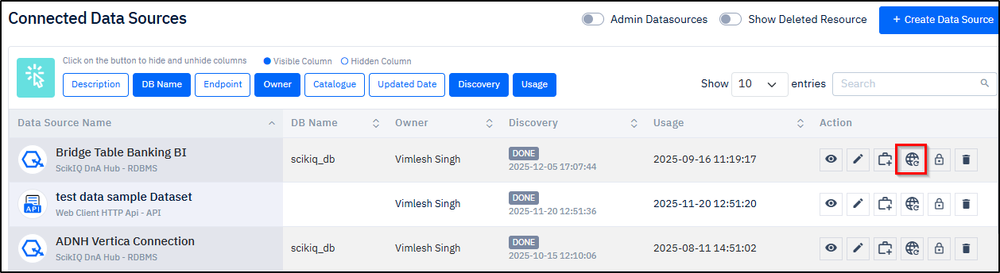
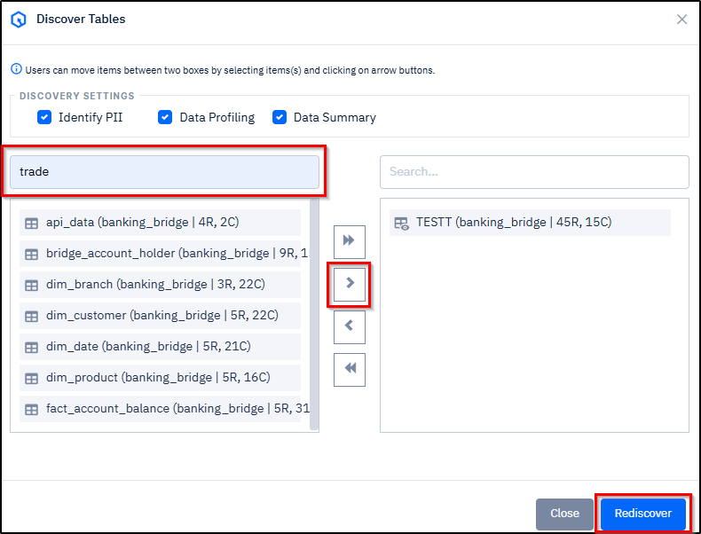

# Managing Connected Data Sources

**Contents**

* [**Instructions for Using this Page**](managing-connected-data-sources.md#instructions-for-using-this-page)
* [**Overview**](managing-connected-data-sources.md#overview)
* [**Procedure**](managing-connected-data-sources.md#procedure)
* [**Related Topics**](managing-connected-data-sources.md#related-topics)

***

## Instructions for Using this Page

* Click on an image to view it in a larger and clearer format.
* The inputs shown in the images are for example purposes only. You must enter the correct and actual data.

***

## Overview

SCIKIQ provides comprehensive capabilities to manage connected data sources efficiently. you can **update** its configuration, and create assets as required.&#x20;

The platform also allows **rediscovery** of tables from an existing data source to reflect any structural changes. In addition, you can **share** connected data sources, **delete** them when no longer needed, and **view deleted data resources** for reference or audit purposes. You can also **restore** a deleted version based on the requirement.

The application also to **view admin resources**, and the interface also supports **hiding or unhiding columns** to customize data visibility as required. Apart from these, you can also **switch** between the versions.

## **Procedure**



**Overview**

This section describes the features and functions available on the Connected Data Sources page. When a data source is successfully connected to the SCIKIQ application, it appears on this page for ongoing management and use.&#x20;

The below mentioned section helps you understand the functionality of various parts of Connected Data Sources page.

**Parts of Connected Data Sources page**

<figure><figcaption>
Connected Data Sources Page Parts
</figcaption></figure>

The description in the below table enables you to understand the functionalities of the above Connected Data Sources page:

> <mark style="color:red;">**Note:**</mark> The part numbers mentioned in the below table refers to the part numbers indicated in the above screenshot.

<table><thead><tr><th width="87">Number</th><th width="122">Name</th><th width="192"></th><th>Functionality</th></tr></thead><tbody><tr><td>1</td><td>Column Header/Tab</td><td></td><td>Clicking on a column header or tab enables to <a href="/broken/pages/yRwxJghAEPPir8WRBNp9">hide or unhide</a> that column.</td></tr><tr><td>2</td><td>View Icon</td><td></td><td>Clicking on this icon enables you to <a href="/broken/pages/Y2HggGaFtLDyHPoQsj20">view</a> the details of a connected data source.</td></tr><tr><td>3</td><td>Edit Icon</td><td></td><td>Clicking on this icon enables you to <a href="/broken/pages/X1FEEkSSlM15nIeuwMet">update</a> the details of an intended connected data source.</td></tr><tr><td>4</td><td>Change History Icon</td><td></td><td>Clicking on this icon enables you to view the <a href="/broken/pages/ygLx1xGbBqKPdi9yMkR2">change history</a> of the intended connected data source.</td></tr><tr><td>5</td><td>Create Asset Icon</td><td></td><td>Clicking on this icon enables you to <a href="/broken/pages/m9HgqxqwHFgvtRGcp0ij">create an asset</a> of an intended connected data source.</td></tr><tr><td>6</td><td>Rediscover</td><td></td><td>Clicking on this icon enables you to <a href="/broken/pages/8wZgkdSrOKwKpxta3jcP">rediscover</a> the required tables from an intended connected data source.</td></tr><tr><td>7</td><td>Share</td><td></td><td>Clicking on this icon enables you to <a href="/broken/pages/2iwEVG7KvI70u2Orooop">share</a> an intended connected data source.</td></tr><tr><td>8</td><td>Delete</td><td></td><td>Clicking on this icon enables you to <a href="/broken/pages/eo0yVXJVs9fIMpuIecVc">delete</a> an intended connected data source.</td></tr><tr><td>9</td><td>Admin Datasources</td><td></td><td>Turning ON this option enables to <a href="/broken/pages/4Rig4ZhBCnIOlWqScF2M">view  admin data resources</a>.</td></tr><tr><td>10</td><td>Show Deleted Resources</td><td></td><td>Turning ON this option enables to <a href="/broken/pages/Y6bAjpWgCWnWDAR9J4SG">view  deleted resources</a>.</td></tr><tr><td>11</td><td>Create Data Source</td><td></td><td>Clicking this button enables to create a datasource.</td></tr><tr><td>12</td><td>Search</td><td></td><td>The Search functionality enables you to retrieve the required datasource from the Connected Data Sources page.</td></tr></tbody></table>



**Overview**

This section explains how to change the version of a connected data source. SCIKIQ allows you to switch between the current version and previously saved versions of the same data source configuration.&#x20;

This capability enables you to revert to an earlier configuration when required—for example, to undo recent changes—or switch back to the latest version once the issue is resolved.

**Procedure**

1. On the **Left Navigation Bar**, go to **SCIKIQ CONNECT**, expand **Connect to Data Source**, and then click **Data Source List**.

<figure><figcaption>
Data Source List Menu Item
</figcaption></figure>

The Connected Data Sources page is displayed.&#x20;

2. On the **Connected Data Sources** page, in the **Version** column, select the **Previous Version**. In this example, it is Version 1. See the below image.  &#x20;

<figure><figcaption>
Changing from Current to Previous Version
</figcaption></figure>

The **Version Change Confirmation Notification** is displayed.

3. On the **Version Change Confirmation Notification,** click the **Yes** button

<figure><figcaption>
Version Change Confirmation Notification
</figcaption></figure>

The version is changed from current to previous. See the image below.

<figure><figcaption>
Display of Version Change from Current to Previous
</figcaption></figure>



1. On the **Connected Data Sources** page, in the **Version** column, select the **Current Version**.  See the below image.  &#x20;

<figure><figcaption>
Changing from Current to Previous Version
</figcaption></figure>

The **Version Restore/View Confirmation** notification is displayed.

2. xxOn the **Version Change Confirmation Notification,** click the **Yes** button.

<figure><figcaption>
Version Change Confirmation Notification
</figcaption></figure>

The version is changed from previous to current. See the image below.

<figure><figcaption>
Display of Version Change from Previous to  Current
</figcaption></figure>



**Overview**

This section explains how to view the details of a connected data source. As part of the process, you will click the **View** icon on the **Connected Data Sources** page. Once done, the connection details are displayed. &#x20;

The step-by-step instructions are given in the procedure section below.

**Procedure**

1. On the **Left Navigation Bar**, go to **SCIKIQ CONNECT**, expand **Connect to Data Source**, and then click **Data Source List**.

<figure><figcaption>
Data Source List Menu Item
</figcaption></figure>

The Connected Data Sources page is displayed.&#x20;

2. On the **Connected Data Sources** page, click the **View** icon. See the image below:

<figure><figcaption>
View Icon
</figcaption></figure>

The Connected Data Source Details are  displayed. See the example image below:

<figure><figcaption>
Connection Details
</figcaption></figure>



**Overview**

This section describes how to update the details of a connected data source. You can modify connection settings, metadata, discovered tables, configuration details, as well as the connection name and description. Once you click **Finish** in the **Review & Submit** section, the updates are saved.&#x20;

Detailed, step-by-step instructions are provided in the procedure section below.

**Procedure**

1. On the **Left Navigation Bar**, go to **SCIKIQ CONNECT**, expand **Connect to Data Source**, and then click **Data Source List**.

<figure><figcaption>
Data Source List Menu
</figcaption></figure>

The Connected Data Sources page is displayed.

2. On the **Connected Data Sources** page, click the **Edit** .png>) icon corresponding to the required data source.

<figure><figcaption>
Connected Data Sources Page - Edit Icon
</figcaption></figure>

The **Configure and create a data source** is displayed.&#x20;

3. On the **Configure and create a data source** page:

* Navigate to the required sections among **Connection Details, Add Meta Data, Discovery, Configuration,** and **Review & Submit.**&#x20;
* Make the **required changes.**
* Finally, click the **Finish** button in the **Review & Submit** section.

The **Connection updated successfully** message is displayed.



**Overview**

This section explains how to create an asset from a connected data source. Once created, it cannot be modified or deleted.&#x20;

As part of the process, you need to configure [<mark style="color:blue;">**Asset Information**</mark>](#user-content-fn-1)[^1]**,** [<mark style="color:blue;">**Connectivity Mechanism**</mark>](#user-content-fn-2)[^2]**,** [<mark style="color:blue;">**Resource Approval**</mark>](#user-content-fn-3)[^3]**,** and specify **a name and description** for the asset . Once submitted, the asset is created.

The step-by-step instructions are given in the procedure section below.

**Procedure**

1. **Navigate to Create Asset Page**

A. On the **Left Navigation Bar**, go to **SCIKIQ CONNECT**, expand **Connect to Data Source**, and then click **Data Source List**.

<figure><figcaption>
Data Source List Menu Item
</figcaption></figure>

The Connected Data Sources page is displayed.

B. On the **Connected Data Sources** page, click the **Create Asset** .png>) icon corresponding to the required data source.

<figure><figcaption>
Create Asset Icon
</figcaption></figure>

The **Add Asset** page is displayed. See the next panel.

2. **Configure Asset Information**

A. On the **Add Asset** page, in the **Asset section,** specify the **Asset Category, Asset Class, Asset Scope, Catalogue,** and **Owner.**

B. In the **Connectivity Mechanism**, select the required option choosing from Secured or Unsecured.

C. In the **Resource Approval section**, specify the **Approver Role** and **Recommended Role.**

<figure><figcaption>
Asset Information Section
</figcaption></figure>

3. **Configure Connectivity Mechanism**

* In the [<mark style="color:blue;">**Connectivity Mechanism**</mark>](#user-content-fn-4)[^4] section, select the required option choosing from [<mark style="color:blue;">**Secured**</mark>](#user-content-fn-5)[^5] or [<mark style="color:blue;">**Unsecured**</mark>](#user-content-fn-6)[^6].

<figure><figcaption>
Configuring Connectivity Mechanism
</figcaption></figure>

4.  **Configure Resource Approvals**

    * In the **Resource Approvals** section, select the **Approver Role** and **Recommended Role**, and then click the **Next** button.

    <figure><figcaption>
Configuring Resource Approval Roles
</figcaption></figure>

The Description tab is opened.&#x20;

5. **Configure Asset Name and Description**

* On the **Description** tab, enter a **name** for the asset, provide **description**, and then click the  **Submit** button.

<figure><figcaption>
Configuring Asset name and Description
</figcaption></figure>

The asset is created.



**Overview**

This section explains how to rediscover tables from a connected data source. Rediscovery allows you to refresh the list of available tables to reflect any changes made in the source system, such as newly added tables, modified structures, or removed objects. You can choose to rediscover a single table, multiple selected tables, or all tables from the connected data source as required.&#x20;

The below step-by-step instructions describe the procedure.

**Procedure**

1. On the **Left Navigation Bar**, go to **SCIKIQ CONNECT**, expand **Connect to Data Source**, and then click **Data Source List**.

<figure><figcaption>
<strong>Data Source List Menu Item</strong>
</figcaption></figure>

The Connected Data Sources page is displayed.

2. On the **Connected Data Sources** page, click the **Rediscover** .png>) icon corresponding to the required data source.

<figure><figcaption>
<strong>Discovery Icon</strong>
</figcaption></figure>

The Discover Tables dialogue box is displayed.

3. On the **Discover Tables** dialogue box:

* In the **Search** box, enter the **search key word**.&#x20;

The tables are displayed.

* From the **left box**, select the **required tables**, and then click the **Forward Arrow** button.

The tables are moved to the right box.


**Tip:**&#x20;

* You can rediscover **one or more** **tables** by selecting the required ones in the **left box** of **Discover Tables dialogue box**, and then click the **Forward Arrow** button to move them to the **right box**.
* If required, you can rediscover all the tables by selecting all of them and then click the **Forward Arrow** button.


* Finally, click the **Rediscover** button.

<figure><figcaption>
<strong>Discovering Tables</strong>
</figcaption></figure>

The **success message** is displayed and Done status is displayed in the **Discovery** column on the **Connected Data Sources** page. You will also receive a notification. See the below image.

<figure><figcaption>
Rediscovery Status
</figcaption></figure>



**Overview**

This section explains how to share a connected data source with other users. You can set the sharing level as **Public, Private,** or **Shared** based on your access requirements.&#x20;

If you choose the **Shared** option, you must select the appropriate group and role to define who can access the data source. You can also share the same data source with **multiple groups** as needed, providing flexible and controlled access across teams.

The step-by-step instructions are given in the procedure section below.

**Procedure**

1. On the **Left Navigation Bar**, go to **SCIKIQ CONNECT**, expand **Connect to Data Source**, and then click **Data Source List**.

<figure><figcaption>
Data Source List Menu Item
</figcaption></figure>

The Connected Data Sources page is displayed.

2. On the **Connected Data Sources** page, click the **Share** icon .png>) corresponding to the required data source.

<figure><figcaption>
Share Icon
</figcaption></figure>

The **Resource Permission** dialogue box is displayed.&#x20;

3. On the **Resource Permission** dialogue box:

A. If you wish to share it as **Public** or **Private**, select either of those options, and click the **Yes** button.&#x20;

B. If you wish to choose the **Share** option, then select **Shared,** and click the **Add More** button.&#x20;

&#x20;     The Group and Role fields are displayed.

C. Select the required **Group**. If more groups are required, click the **Add More** button.

D. Select the **Role** choosing from **Contributor** or **Viewer**.

E. Click the **Save** button.

<figure><figcaption>
Sharing Connected Data Source
</figcaption></figure>

The connected data source is shared.



**Overview**

This page explains how to delete a connected data source from the Connected Data Sources page. To remove a data source, click the **Delete Data Source** icon corresponding to the required connection. You will be prompted to confirm the action to prevent accidental deletion. Once confirmed, the selected data source is deleted.

The step-by-step instructions are given in the procedure section below.

**Procedure**

1. On the **Left Navigation Bar**, go to **SCIKIQ CONNECT**, expand **Connect to Data Source**, and then click **Data Source List**.

<figure><figcaption>
Data Source List Menu
</figcaption></figure>

The Connected Data Sources page is displayed.

2. On the **Connected Data Sources** page, click the **Delete Data Source** .png>)icon corresponding to the required data source.

<figure><figcaption>
Connected Data Sources Page - Delete Icon
</figcaption></figure>

The **Are you sure you want to delete** message is displayed.&#x20;

3. On the **Are you sure you want to delete** message, click the **Yes** button.&#x20;

<figure><figcaption>
Deleting Connected Data Source
</figcaption></figure>

The connected data source is deleted.

4. To view the deleted data source, enable the .png>)option on the **Connected Data Sources** page.

The Deleted Resource is displayed in <mark style="color:red;">red</mark> color. See the image below.

<figure><figcaption>
Display of Deleted Resource
</figcaption></figure>



**Overview**

This section explains how to view deleted resources from the **Connected Data Sources** page. To access deleted items, click the **Show Deleted Resources** option. The system then displays a list of resources that have been previously deleted, allowing you to review them as needed.

The step-by-step instructions are given in the procedure section below.

**Procedure**

1. On the **Left Navigation Bar**, go to **SCIKIQ CONNECT**, expand **Connect to Data Source**, and then click **Data Source List**.

<figure><figcaption>
Data Source List Menu Item
</figcaption></figure>

The Connected Data Sources page is displayed.

2. On the **Connected Data Sources** page, click the **Show Deleted ReSource** option.

<figure><figcaption>
Show Deleted Resource Option
</figcaption></figure>

The **deleted** resources are displayed and highlighted in <mark style="color:red;">red</mark> color.  See the below image:

<figure><figcaption>
Deleted Resources
</figcaption></figure>




**Overview**

This section explains how to restore a deleted resource from the **Connected Data Sources** page. To restore a resource, click the **Reactivate** button corresponding to the deleted item. You will be prompted to confirm the action to prevent accidental restoration. Once confirmed, the resource is restored and becomes available again in the list of connected data sources.

The below step-by-step instructions describe the procedure.

**Procedure**

1. On the **Left Navigation Bar**, go to **SCIKIQ CONNECT**, expand **Connect to Data Source**, and then click **Data Source List**.

<figure><figcaption>
Data Source List Menu Item
</figcaption></figure>

The Connected Data Sources page is displayed.

2. On the **Connected Data Sources** page, click the **Show Deleted ReSource** option.

<figure><figcaption>
Show Deleted Resource Option
</figcaption></figure>

The **deleted** resource row is displayed in <mark style="color:red;">red</mark> color.  See the below image:

<figure><figcaption>
Display of Deleted Resource
</figcaption></figure>

3. Click the **Reactivate** .png>) button corresponding to that deleted resource.

<figure><figcaption>
Deleted Resource - Reactivate Button
</figcaption></figure>

The Reactivation Confirmation Notification is displayed.

4. On the **Reactivation** **Confirmation Notification**, click the **Yes** button.

<figure><figcaption>
Reactivation Confirmation Notification
</figcaption></figure>

The Resource activated successfully message is displayed and the resource is restored. See the image below:

<figure><figcaption>
Restored Resource
</figcaption></figure>



**Overview**

This page explains how to view admin-managed data sources. To access them, click the **Admin Data Sources** option on the **Connected Data Sources** page. The system then displays a list of data sources that are managed by administrators, allowing you to view and review these connections as required.&#x20;

The step-by-step instructions are given in the procedure section below.

**Procedure**

1. On the **Left Navigation Bar**, go to **SCIKIQ CONNECT**, expand **Connect to Data Source**, and then click **Data Source List**.

<figure><figcaption>
Data Source List Menu Item
</figcaption></figure>

The Connected Data Sources page is displayed.

2. On the **Connected Data Sources** page, click the **Admin Data Sources** option.

<figure><figcaption>
Admin Data Sources Option
</figcaption></figure>

The **admin data sources** are displayed.  See the below image:

<figure><figcaption>
Admin Datasources
</figcaption></figure>




**Overview**

This section explains how to view the change history of a data source. The change history provides a complete audit trail of all updates made to the data source, including **the action performed, the field that was modified, the previous value, the updated value, who made the change, when the change was made,** and **any associated comments.** This helps ensure transparency, traceability, and accountability for all modifications.&#x20;

Detailed, step-by-step instructions are provided in the procedure section below.

**Procedure**

1. On the **Left Navigation Bar**, go to **SCIKIQ CONNECT**, expand **Connect to Data Source**, and then click **Data Source List**.

<figure><figcaption>
Data Source List Menu
</figcaption></figure>

The Connected Data Sources page is displayed.

2. On the **Connected Data Sources** page, click the **Change History** .png>) icon corresponding to the required data source.

<figure><figcaption>
Connected Data Sources Page - Change History Icon
</figcaption></figure>

The **Resource Change Log** screen is displayed.&#x20;

3. On the **Resource Change Log** screen, click on the **Down Arrow** .png>) corresponding to a required row under **Modified On** column.&#x20;

The complete change history including action performed, field changed, old value, new value, who modified, and when modified is displayed. See the image below.

<figure><figcaption>
Change History
</figcaption></figure>




**Overview**

This section explains how to **hide** or **unhide** columns on the **Connected Data Sources** page to customize your view. You can show a column by clicking its corresponding tab. When the column is visible, the tab appears in blue. Clicking the same tab again hides the column, and the tab changes to gray. This allows you to control which columns are displayed based on your preference.

The step-by-step instructions are given in the procedure section below.

**Procedure**

1. On the **Left Navigation Bar**, go to **SCIKIQ CONNECT**, expand **Connect to Data Source**, and then click **Data Source List**.

<figure><figcaption>
<strong>Data Source List Menu</strong>
</figcaption></figure>

The Connected Data Sources page is displayed.

2. Click a button to **hide** the column corresponding to it. For example, **Rediscover.**

The color of the button turns gray and the column disappears.

<figure><figcaption>
<strong>Hiding a Column</strong>
</figcaption></figure>

2. Click back to **unhide** it.

The color of the button turns blue again and the column appears.

<figure><figcaption>
<strong>Unhiding a Column</strong>
</figcaption></figure>



Expand the below panels to view step-by-step instructions:

<strong>Viewing Connected Data Sources</strong>

**Overview**

This section describes the features and functions available on the Connected Data Sources page. When a data source is successfully connected to the SCIKIQ application, it appears on this page for ongoing management and use.&#x20;

The below mentioned section helps you understand the functionality of various parts of Connected Data Sources page.

**Parts of Connected Data Sources page**

<figure><figcaption>
Connected Data Sources Page Parts
</figcaption></figure>

The description in the below table enables you to understand the functionalities of the above Connected Data Sources page:

> <mark style="color:red;">**Note:**</mark> The part numbers mentioned in the below table refers to the part numbers indicated in the above screenshot.

<table><thead><tr><th width="87">Number</th><th width="122">Name</th><th width="192"></th><th>Functionality</th></tr></thead><tbody><tr><td>1</td><td>Column Header/Tab</td><td></td><td>Clicking on a column header or tab enables to <a href="/broken/pages/yRwxJghAEPPir8WRBNp9">hide or unhide</a> that column.</td></tr><tr><td>2</td><td>View Icon</td><td></td><td>Clicking on this icon enables you to <a href="/broken/pages/Y2HggGaFtLDyHPoQsj20">view</a> the details of a connected data source.</td></tr><tr><td>3</td><td>Edit Icon</td><td></td><td>Clicking on this icon enables you to <a href="/broken/pages/X1FEEkSSlM15nIeuwMet">update</a> the details of an intended connected data source.</td></tr><tr><td>4</td><td>Change History Icon</td><td></td><td>Clicking on this icon enables you to view the <a href="/broken/pages/ygLx1xGbBqKPdi9yMkR2">change history</a> of the intended connected data source.</td></tr><tr><td>5</td><td>Create Asset Icon</td><td></td><td>Clicking on this icon enables you to <a href="/broken/pages/m9HgqxqwHFgvtRGcp0ij">create an asset</a> of an intended connected data source.</td></tr><tr><td>6</td><td>Rediscover</td><td></td><td>Clicking on this icon enables you to <a href="/broken/pages/8wZgkdSrOKwKpxta3jcP">rediscover</a> the required tables from an intended connected data source.</td></tr><tr><td>7</td><td>Share</td><td></td><td>Clicking on this icon enables you to <a href="/broken/pages/2iwEVG7KvI70u2Orooop">share</a> an intended connected data source.</td></tr><tr><td>8</td><td>Delete</td><td></td><td>Clicking on this icon enables you to <a href="/broken/pages/eo0yVXJVs9fIMpuIecVc">delete</a> an intended connected data source.</td></tr><tr><td>9</td><td>Admin Datasources</td><td></td><td>Turning ON this option enables to <a href="/broken/pages/4Rig4ZhBCnIOlWqScF2M">view  admin data resources</a>.</td></tr><tr><td>10</td><td>Show Deleted Resources</td><td></td><td>Turning ON this option enables to <a href="/broken/pages/Y6bAjpWgCWnWDAR9J4SG">view  deleted resources</a>.</td></tr><tr><td>11</td><td>Create Data Source</td><td></td><td>Clicking this button enables to create a datasource.</td></tr><tr><td>12</td><td>Search</td><td></td><td>The Search functionality enables you to retrieve the required datasource from the Connected Data Sources page.</td></tr></tbody></table>

<strong>Switching from Current to Previous Version</strong>

**Overview**

This section explains how to change the version of a connected data source. SCIKIQ allows you to switch between the current version and previously saved versions of the same data source configuration.&#x20;

This capability enables you to revert to an earlier configuration when required—for example, to undo recent changes—or switch back to the latest version once the issue is resolved.

**Procedure**

1. On the **Left Navigation Bar**, go to **SCIKIQ CONNECT**, expand **Connect to Data Source**, and then click **Data Source List**.

<figure><figcaption>
Data Source List Menu Item
</figcaption></figure>

The Connected Data Sources page is displayed.&#x20;

2. On the **Connected Data Sources** page, in the **Version** column, select the **Previous Version**. In this example, it is Version 1. See the below image.  &#x20;

<figure><figcaption>
Changing from Current to Previous Version
</figcaption></figure>

The **Version Change Confirmation Notification** is displayed.

3. On the **Version Change Confirmation Notification,** click the **Yes** button

<figure><figcaption>
Version Change Confirmation Notification
</figcaption></figure>

The version is changed from current to previous. See the image below.

<figure><figcaption>
Display of Version Change from Current to Previous
</figcaption></figure>

<strong>Restoring Current Version</strong>

1. On the **Connected Data Sources** page, in the **Version** column, select the **Current Version**.  See the below image.  &#x20;

<figure><figcaption>
Changing from Current to Previous Version
</figcaption></figure>

The **Version Restore/View Confirmation** notification is displayed.

2. xxOn the **Version Change Confirmation Notification,** click the **Yes** button.

<figure><figcaption>
Version Change Confirmation Notification
</figcaption></figure>

The version is changed from previous to current. See the image below.

<figure><figcaption>
Display of Version Change from Previous to  Current
</figcaption></figure>

<strong>Viewing Connection Details</strong>

#### Overview

This section explains how to view the details of a connected data source. As part of the process, you will click the **View** icon on the **Connected Data Sources** page. Once done, the connection details are displayed. &#x20;

The step-by-step instructions are given in the procedure section below.

#### Procedure

1. On the **Left Navigation Bar**, go to **SCIKIQ CONNECT**, expand **Connect to Data Source**, and then click **Data Source List**.

<figure><figcaption>
Data Source List Menu Item
</figcaption></figure>

The Connected Data Sources page is displayed.&#x20;

2. On the **Connected Data Sources** page, click the **View** icon. See the image below:

<figure><figcaption>
View Icon
</figcaption></figure>

The Connected Data Source Details are  displayed. See the example image below:

<figure><figcaption>
Connection Details
</figcaption></figure>

<strong>Updating a Connected Data Source</strong>

**Overview**

This section describes how to update the details of a connected data source. You can modify connection settings, metadata, discovered tables, configuration details, as well as the connection name and description. Once you click **Finish** in the **Review & Submit** section, the updates are saved.&#x20;

Detailed, step-by-step instructions are provided in the procedure section below.

**Procedure**

1. On the **Left Navigation Bar**, go to **SCIKIQ CONNECT**, expand **Connect to Data Source**, and then click **Data Source List**.

<figure><figcaption>
Data Source List Menu
</figcaption></figure>

The Connected Data Sources page is displayed.

2. On the **Connected Data Sources** page, click the **Edit** .png>) icon corresponding to the required data source.

<figure><figcaption>
Connected Data Sources Page - Edit Icon
</figcaption></figure>

The **Configure and create a data source** is displayed.&#x20;

3. On the **Configure and create a data source** page:

* Navigate to the required sections among **Connection Details, Add Meta Data, Discovery, Configuration,** and **Review & Submit.**&#x20;
* Make the **required changes.**
* Finally, click the **Finish** button in the **Review & Submit** section.

The **Connection updated successfully** message is displayed.

<strong>Creating an Asset</strong>

**Overview**

This section explains how to create an asset from a connected data source. Once created, it cannot be modified or deleted.&#x20;

As part of the process, you need to configure [<mark style="color:blue;">**Asset Information**</mark>](#user-content-fn-1)[^1]**,** [<mark style="color:blue;">**Connectivity Mechanism**</mark>](#user-content-fn-2)[^2]**,** [<mark style="color:blue;">**Resource Approval**</mark>](#user-content-fn-3)[^3]**,** and specify **a name and description** for the asset . Once submitted, the asset is created.

The step-by-step instructions are given in the procedure section below.

**Procedure**

1. **Navigate to Create Asset Page**

A. On the **Left Navigation Bar**, go to **SCIKIQ CONNECT**, expand **Connect to Data Source**, and then click **Data Source List**.

<figure><figcaption>
Data Source List Menu Item
</figcaption></figure>

The Connected Data Sources page is displayed.

B. On the **Connected Data Sources** page, click the **Create Asset** .png>) icon corresponding to the required data source.

<figure><figcaption>
Create Asset Icon
</figcaption></figure>

The **Add Asset** page is displayed. See the next panel.

2. **Configure Asset Information**

A. On the **Add Asset** page, in the **Asset section,** specify the **Asset Category, Asset Class, Asset Scope, Catalogue,** and **Owner.**

B. In the **Connectivity Mechanism**, select the required option choosing from Secured or Unsecured.

C. In the **Resource Approval section**, specify the **Approver Role** and **Recommended Role.**

<figure><figcaption>
Asset Information Section
</figcaption></figure>

3. **Configure Connectivity Mechanism**

* In the [<mark style="color:blue;">**Connectivity Mechanism**</mark>](#user-content-fn-4)[^4] section, select the required option choosing from [<mark style="color:blue;">**Secured**</mark>](#user-content-fn-5)[^5] or [<mark style="color:blue;">**Unsecured**</mark>](#user-content-fn-6)[^6].

<figure><figcaption>
Configuring Connectivity Mechanism
</figcaption></figure>

4.  **Configure Resource Approvals**

    * In the **Resource Approvals** section, select the **Approver Role** and **Recommended Role**, and then click the **Next** button.

    <figure><figcaption>
Configuring Resource Approval Roles
</figcaption></figure>

The Description tab is opened.&#x20;

5. **Configure Asset Name and Description**

* On the **Description** tab, enter a **name** for the asset, provide **description**, and then click the  **Submit** button.

<figure><figcaption>
Configuring Asset name and Description
</figcaption></figure>

The asset is created.

<strong>Rediscovering Tables</strong>

**Overview**

This section explains how to rediscover tables from a connected data source. Rediscovery allows you to refresh the list of available tables to reflect any changes made in the source system, such as newly added tables, modified structures, or removed objects. You can choose to rediscover a single table, multiple selected tables, or all tables from the connected data source as required.&#x20;

The below step-by-step instructions describe the procedure.

**Procedure**

1. On the **Left Navigation Bar**, go to **SCIKIQ CONNECT**, expand **Connect to Data Source**, and then click **Data Source List**.

<figure><figcaption>
<strong>Data Source List Menu Item</strong>
</figcaption></figure>

The Connected Data Sources page is displayed.

2. On the **Connected Data Sources** page, click the **Rediscover** .png>) icon corresponding to the required data source.

<figure><figcaption>
<strong>Discovery Icon</strong>
</figcaption></figure>

The Discover Tables dialogue box is displayed.

3. On the **Discover Tables** dialogue box:

* In the **Search** box, enter the **search key word**.&#x20;

The tables are displayed.

* From the **left box**, select the **required tables**, and then click the **Forward Arrow** button.

The tables are moved to the right box.


**Tip:**&#x20;

* You can rediscover **one or more** **tables** by selecting the required ones in the **left box** of **Discover Tables dialogue box**, and then click the **Forward Arrow** button to move them to the **right box**.
* If required, you can rediscover all the tables by selecting all of them and then click the **Forward Arrow** button.


* Finally, click the **Rediscover** button.

<figure><figcaption>
<strong>Discovering Tables</strong>
</figcaption></figure>

The **success message** is displayed and Done status is displayed in the **Discovery** column on the **Connected Data Sources** page. You will also receive a notification. See the below image.

<figure><figcaption>
Rediscovery Status
</figcaption></figure>

<strong>Sharing a Connected Data Source</strong>

**Overview**

This section explains how to share a connected data source with other users. You can set the sharing level as **Public, Private,** or **Shared** based on your access requirements.&#x20;

If you choose the **Shared** option, you must select the appropriate group and role to define who can access the data source. You can also share the same data source with **multiple groups** as needed, providing flexible and controlled access across teams.

The step-by-step instructions are given in the procedure section below.

**Procedure**

1. On the **Left Navigation Bar**, go to **SCIKIQ CONNECT**, expand **Connect to Data Source**, and then click **Data Source List**.

<figure><figcaption>
Data Source List Menu Item
</figcaption></figure>

The Connected Data Sources page is displayed.

2. On the **Connected Data Sources** page, click the **Share** icon .png>) corresponding to the required data source.

<figure><figcaption>
Share Icon
</figcaption></figure>

The **Resource Permission** dialogue box is displayed.&#x20;

3. On the **Resource Permission** dialogue box:

A. If you wish to share it as **Public** or **Private**, select either of those options, and click the **Yes** button.&#x20;

B. If you wish to choose the **Share** option, then select **Shared,** and click the **Add More** button.&#x20;

&#x20;     The Group and Role fields are displayed.

C. Select the required **Group**. If more groups are required, click the **Add More** button.

D. Select the **Role** choosing from **Contributor** or **Viewer**.

E. Click the **Save** button.

<figure><figcaption>
Sharing Connected Data Source
</figcaption></figure>

The connected data source is shared.

<strong>Deleting a Data Source</strong>

**Overview**

This page explains how to delete a connected data source from the Connected Data Sources page. To remove a data source, click the **Delete Data Source** icon corresponding to the required connection. You will be prompted to confirm the action to prevent accidental deletion. Once confirmed, the selected data source is deleted.

The step-by-step instructions are given in the procedure section below.

**Procedure**

1. On the **Left Navigation Bar**, go to **SCIKIQ CONNECT**, expand **Connect to Data Source**, and then click **Data Source List**.

<figure><figcaption>
Data Source List Menu
</figcaption></figure>

The Connected Data Sources page is displayed.

2. On the **Connected Data Sources** page, click the **Delete Data Source** .png>)icon corresponding to the required data source.

<figure><figcaption>
Connected Data Sources Page - Delete Icon
</figcaption></figure>

The **Are you sure you want to delete** message is displayed.&#x20;

3. On the **Are you sure you want to delete** message, click the **Yes** button.&#x20;

<figure><figcaption>
Deleting Connected Data Source
</figcaption></figure>

The connected data source is deleted.

4. To view the deleted data source, enable the .png>)option on the **Connected Data Sources** page.

The Deleted Resource is displayed in <mark style="color:red;">red</mark> color. See the image below.

<figure><figcaption>
Display of Deleted Resource
</figcaption></figure>

<strong>Viewing Deleted Resources</strong>

**Overview**

This section explains how to view deleted resources from the **Connected Data Sources** page. To access deleted items, click the **Show Deleted Resources** option. The system then displays a list of resources that have been previously deleted, allowing you to review them as needed.

The step-by-step instructions are given in the procedure section below.

**Procedure**

1. On the **Left Navigation Bar**, go to **SCIKIQ CONNECT**, expand **Connect to Data Source**, and then click **Data Source List**.

<figure><figcaption>
Data Source List Menu Item
</figcaption></figure>

The Connected Data Sources page is displayed.

2. On the **Connected Data Sources** page, click the **Show Deleted ReSource** option.

<figure><figcaption>
Show Deleted Resource Option
</figcaption></figure>

The **deleted** resources are displayed and highlighted in <mark style="color:red;">red</mark> color.  See the below image:

<figure><figcaption></figcaption></figure>

<strong>Restoring a Deleted Resource</strong>

**Overview**

This section explains how to restore a deleted resource from the **Connected Data Sources** page. To restore a resource, click the **Reactivate** button corresponding to the deleted item. You will be prompted to confirm the action to prevent accidental restoration. Once confirmed, the resource is restored and becomes available again in the list of connected data sources.

The below step-by-step instructions describe the procedure.

**Procedure**

1. On the **Left Navigation Bar**, go to **SCIKIQ CONNECT**, expand **Connect to Data Source**, and then click **Data Source List**.

<figure><figcaption>
Data Source List Menu Item
</figcaption></figure>

The Connected Data Sources page is displayed.

2. On the **Connected Data Sources** page, click the **Show Deleted ReSource** option.

<figure><figcaption>
Show Deleted Resource Option
</figcaption></figure>

The **deleted** resource row is displayed in <mark style="color:red;">red</mark> color.  See the below image:

<figure><figcaption>
Display of Deleted Resource
</figcaption></figure>

3. Click the **Reactivate** .png>) button corresponding to that deleted resource.

<figure><figcaption>
Deleted Resource - Reactivate Button
</figcaption></figure>

The Reactivation Confirmation Notification is displayed.

4. On the **Reactivation** **Confirmation Notification**, click the **Yes** button.

<figure><figcaption>
Reactivation Confirmation Notification
</figcaption></figure>

The Resource activated successfully message is displayed and the resource is restored. See the image below:

<figure><figcaption>
Restored Resource
</figcaption></figure>

<strong>Viewing Admin Resources</strong>

**Overview**

This page explains how to view admin-managed data sources. To access them, click the **Admin Data Sources** option on the **Connected Data Sources** page. The system then displays a list of data sources that are managed by administrators, allowing you to view and review these connections as required.&#x20;

The step-by-step instructions are given in the procedure section below.

**Procedure**

1. On the **Left Navigation Bar**, go to **SCIKIQ CONNECT**, expand **Connect to Data Source**, and then click **Data Source List**.

<figure><figcaption>
Data Source List Menu Item
</figcaption></figure>

The Connected Data Sources page is displayed.

2. On the **Connected Data Sources** page, click the **Admin Data Sources** option.

<figure><figcaption>
Admin Data Sources Option
</figcaption></figure>

The **admin data sources** are displayed.  See the below image:

<figure><figcaption>
Deleted Admin Datasources
</figcaption></figure>

<strong>Viewing Change History</strong>

**Overview**

This section explains how to view the change history of a data source. The change history provides a complete audit trail of all updates made to the data source, including **the action performed, the field that was modified, the previous value, the updated value, who made the change, when the change was made,** and **any associated comments.** This helps ensure transparency, traceability, and accountability for all modifications.&#x20;

Detailed, step-by-step instructions are provided in the procedure section below.

**Procedure**

1. On the **Left Navigation Bar**, go to **SCIKIQ CONNECT**, expand **Connect to Data Source**, and then click **Data Source List**.

<figure><figcaption>
Data Source List Menu
</figcaption></figure>

The Connected Data Sources page is displayed.

2. On the **Connected Data Sources** page, click the **Change History** .png>) icon corresponding to the required data source.

<figure><figcaption>
Connected Data Sources Page - Change History Icon
</figcaption></figure>

The **Resource Change Log** screen is displayed.&#x20;

3. On the **Resource Change Log** screen, click on the **Down Arrow** .png>) corresponding to a required row under **Modified On** column.&#x20;

The complete change history including action performed, field changed, old value, new value, who modified, and when modified is displayed. See the image below.

<figure><figcaption>
Change History
</figcaption></figure>

<strong>Hiding or Unhiding Columns</strong>

**Overview**

This section explains how to **hide** or **unhide** columns on the **Connected Data Sources** page to customize your view. You can show a column by clicking its corresponding tab. When the column is visible, the tab appears in blue. Clicking the same tab again hides the column, and the tab changes to gray. This allows you to control which columns are displayed based on your preference.

The step-by-step instructions are given in the procedure section below.

**Procedure**

1. On the **Left Navigation Bar**, go to **SCIKIQ CONNECT**, expand **Connect to Data Source**, and then click **Data Source List**.

<figure><figcaption>
<strong>Data Source List Menu</strong>
</figcaption></figure>

The Connected Data Sources page is displayed.

2. Click a button to **hide** the column corresponding to it. For example, **Rediscover.**

The color of the button turns gray and the column disappears.

<figure><figcaption>
<strong>Hiding a Column</strong>
</figcaption></figure>

2. Click back to **unhide** it.

The color of the button turns blue again and the column appears.

<figure><figcaption>
<strong>Unhiding a Column</strong>
</figcaption></figure>

***

## Related Topics

* [**Creating a Data Source Connection**](/broken/pages/NQamWuz7vUgQ2NLWzOdj)

[^1]: Configuring the **Asset Information** includes **Asset Category, Asset Class, Asset Scope, Catalogue,** and **Owner.**

[^2]: **Connectivity Mechanism** refers to the method used to connect to the data source.

[^3]: Configuring the **Resource Approval**  consists of **Approver Role** and **Recommended Role**.

[^4]: Connectivity Mechanism refers to the method used to connect to the data source.

[^5]: **Secured** option refers to the connection where data is encrypted, making it safe from hackers and unauthorized access.

[^6]: **Unsecured** option refers to the connection where data is sent without encryption.
