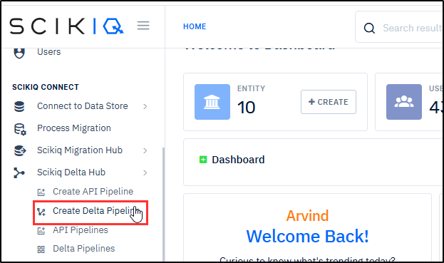

# Variable Node

**Contents**

* [**Instructions for Using this Page**](variable-node.md#instructions-for-using-this-page)
* [**Overview**](variable-node.md#overview)
* [**Procedure**](variable-node.md#procedure)
* [**Related Topics**](variable-node.md#related-topics)

***

## Instructions for Using this Page

* Click on an image to view it in a larger and clearer format.
* The inputs shown in the images are for example purposes only. You must enter the correct and actual data.
* Hover over an italicized annotated term (italic, blue, dotted and underlined) to view its meaning. Here is an example: [_<mark style="color:blue;">**Host Name**</mark>_](#user-content-fn-1)[^1]

***

## Overview

This page explains how to use the **Vaiable** node while creating a pipelin&#x65;**.** It is used to store reusable data that can be referenced across different stages of a pipeline. It enables to capture and reuse values such as constants, selected columns, or entire tables, making the pipeline more flexible and easier to manage.

By storing data in variables, the node helps improve the **modularity and reusability of ETL workflows**, allowing pipelines to reference dynamic or static content without repeatedly defining the same values.

The **Variable Node** allows users to store and reuse the following types of data:

* **A single value** (for example, a constant or parameter used in transformations)
* **A single column** from a dataset
* **An entire table or dataset** that can be referenced in subsequent nodes

Using variables helps simplify pipeline design, reduce redundancy, and make workflows easier to maintain.

***

## Procedure

The procedure to use the **Vaiable** node involves the steps including [Add Variable Node](variable-node.md#add-variable-node), [Define Variable Name and Type,](variable-node.md#define-variable-name-and-type) [Connect Variable Node to Source Node](variable-node.md#connect-variable-node-to-source-node), [Save Pipeline](variable-node.md#save-pipeline), and [Preview Result](variable-node.md#preview-result). The expandable panels below provide guided assistance for each step in the procedure.&#x20;

Expand the panels to view detailed, step-by-step instructions.

<strong>Add Variable Node</strong> 

1. On the **Left Navigation Bar**, under **SCIKIQ CONNECT**, expand **SCIKIQ Delta Hub,** and then click either **Create API Pipeline** or **Create Delta Pipeline**. For example, Create Delta Pipeline.

<figure><figcaption>
Create Delta Pipeline Menu Item
</figcaption></figure>

The Create Delta Pipeline page is displayed.

2. On the **Right Pane**, add an **input node**. For example, Database input node.
3. Now, from the **Top Toolbar** drag the **Variable node** on to the **Main Workspace.**

<figure><figcaption>
Adding Variable Node
</figcaption></figure>

The Define Variable section is displayed on the left pane.&#x20;

<strong>Define Variable Name and Type</strong>

**Purpose:**

The **purpose** of defining the Variable Name and Type when connecting the Variable node with a source node is to identify the stored data and specify the type of data that the variable will hold for reuse within the pipeline.

The **Variable Name** uniquely identifies the variable within the pipeline so that it can be easily referenced by other nodes.

The **Variable Type** specifies **what kind of data the variable will store**, such as a single value, a column, or an entire table.

**Procedure:**&#x20;

The information below outlines the step-by-step instructions for completing this task:

**Step-by-Step Instructions**

1. On the **Left Pane**, specify a **name** for the variable.
2. From the **Variable Type** drop-down box, select the **variable type** choosing from **Single value, Single Column,** or **Table.** For example, Single Column.

<figure><figcaption>
Defining Variable Name and Type
</figcaption></figure>


**Tip:**&#x20;

* The **Single Value** option is used to store **one constant or scalar value** that can be reused in different parts of the pipeline.
* The **Single Column** option is used to store **values from a specific column of a dataset** so that they can be referenced or used in other nodes.
* The **Entire Table** option is used to store **a complete dataset or table** so that it can be reused by other nodes in the pipeline.


<strong>Connect Variable Node to Source Node</strong>

**Purpose:**

The **purpose** of connecting the Variable Node to a Source Node is to capture data from the source and store it in a variable so that it can be reused in other parts of the pipeline.

**Procedure:**&#x20;

The information below outlines the step-by-step instructions for completing this task:

**Step-by-Step Instructions**

* On the **Right Pane**, connect the **Variable Node** to **Source Node**.&#x20;

<figure><figcaption>
Connecting Variable Node
</figcaption></figure>

Once connected, the defined name is displayed on the Variable node.

<strong>Save Pipeline</strong>

**Purpose**

The purpose of saving the pipeline while connecting the **Variable node** with input nodes is to store the configured pipeline structure and settings so that the variable configuration and node connections are preserved and can be executed later.

**Procedure**

The information below outlines the step-by-step instructions for completing this task:

**Step-by-Step Instructions**

1. On the extreme right of the **Top Toolbar**, click the **Save** button.

<figure><figcaption></figcaption></figure>

The Save Data Pipeline dialogue box is displayed.

2. In the **Name** field, enter a **name** for the pipeline.&#x20;
3. In the **Description,** enter the **summary** of the delta pipeline.
4. Next, configure the **meta data** by specifying **Catalogue, Data Domain, Sub Data Domain, Business Owner,** and **Technical Owner.**
5. Finally, click the **Save and Submit** button.

<figure><figcaption>
Saving Pipeline
</figcaption></figure>

The Pipeline is saved.

<strong>Preview Result</strong>

**Overview:**

The purpose of previewing the result while connecting the **Variable node** with input nodes is to verify that the variable configuration is correct and that the data retrieved from the input dataset is captured as expected before running the entire pipeline.

**Procedure**&#x20;

The information below outlines the step-by-step instructions for completing this task:

**Step-by-Step Instructions**

1\. On the **Data Pipelines** page, click the **Edit** icon corresponding to the **Variable** node.

The connected nodes are displayed.

2. On the **Right Pane**, click the **Preview** icon on the top of **Variable** nod&#x65;**.**

<figure><figcaption>
Preview Icon
</figcaption></figure>

The result is displayed on the Preview tab. See the example image below:

<figure><figcaption>
Preview Result
</figcaption></figure>

## Related Topics

* [Configuring Input Nodes](/broken/pages/Qe52MzyFrHp43dWO41kf)
* [Configuring Output Nodes](/broken/pages/BOHoiMbsoFJCedoWAASx)
* [Configuring Transform Nodes](/broken/pages/hbzg9uHn194g3ivtwx4q)

[^1]: **Host Name** refers to the **address** of the computer/server where your database is located.
