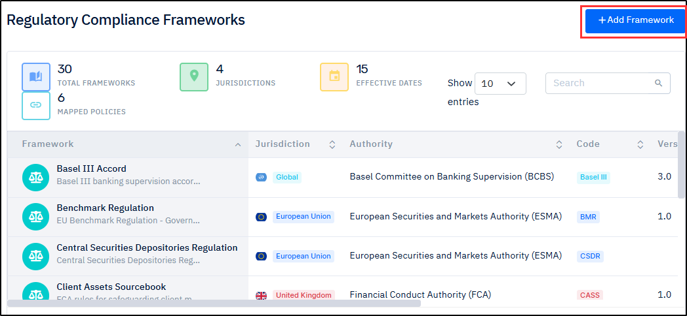

# Compliance

***

### Instructions for Using this Page

* Click on an image to view it in a larger and clearer format.
* The inputs shown in the images are for example purposes only. You must enter the correct and actual data.

***

### **Overview**

The **Compliance** module ensures that all archival and data management activities adhere to regulatory and organizational policies. It provides tools to enforce data governance, track activities, manage legal holds, and define compliance rules.

This module helps organizations maintain **data integrity, security, and regulatory adherence** by offering visibility into system activities and enforcing controlled data handling practices.

***

### Key Components&#x20;



**Overview**

As part of the regulatory compliance setup, you need to add a **Compliance Framework**. A compliance framework defines the rules and policies for archiving, retaining, and deleting data in accordance with regulatory and organizational requirements. It ensures consistent data management, supports compliance with applicable standards, and enables secure lifecycle management of archived data.

***

**Adding a Compliance Framework**

1. On the **SCIKIQ Left Navigation Bar**, go to **SCIKIQ Archival.**&#x20;
2. Under **SCIKIQ Archival**, expand **Compliance**, and then click **Regulatory Compliance**.

<figure><figcaption>
Regulatory Compliance Menu Item
</figcaption></figure>

The Regulatory Compliance Frameworks page is displayed.

3. On the **Regulatory Compliance Frameworks** page, click the **Add Framework** button.

<figure><figcaption>
Regulatory Compliance Frameworks Page 
</figcaption></figure>

The **Add Framework** dialogue-box is displayed.

4. On the **Add Framework** dialogue-box, enter the **Framework Code, Version, Framework Name, Description, Jurisdiction, Effective Date, Regulatory Authority,** and **Mapped Policy Types.**&#x20;


**Tip**: Refer to the below table for the description of these fields.


| Field                | Description                                                                                                        |
| -------------------- | ------------------------------------------------------------------------------------------------------------------ |
| Framework Code       | A unique identifier assigned to the compliance framework for easy reference and tracking                           |
| Version              | Indicates the specific version of the framework, helping manage updates and changes over time                      |
| Framework Name       | The official name of the compliance framework (e.g., GDPR, HIPAA, etc.)                                            |
| Description          | A brief summary explaining the purpose, scope, and key objectives of the framework                                 |
| Jurisdiction         | Specifies the geographic region or legal authority where the framework is applicable (e.g., India, EU, US)         |
| Effective Date       | The date from which the framework becomes applicable and enforceable                                               |
| Regulatory Authority | The governing body or organization responsible for defining and enforcing the framework                            |
| Mapped Policy Types  | The categories of internal policies (e.g., data retention, security, privacy) that are aligned with this framework |

5. Finally, click the **Add Framework**  button.

<figure><figcaption></figcaption></figure>

The **Framework added successfully** message box appears and the framework is displayed on the Regulatory Compliance Frameworks page.&#x20;

<figure><figcaption>
Regulatory Compliance Frameworks
</figcaption></figure>

> <mark style="color:red;">**Note:**</mark>&#x20;
>
> * To view the details of a framework, click the View Framework  icon corresponding to it.
> * To update a framework, click the Edit   icon corresponding to it.
> * To delete a framework, click the Delete  icon corresponding to it.



**Overview**

The **Audit Trail** provides a detailed log of all activities performed within the system. It helps track user actions, system changes, and operational events related to archival and compliance processes.

This feature ensures **transparency, accountability, and traceability** by maintaining a record of who performed an action, what action was performed, and when it occurred. It is essential for monitoring system usage and meeting compliance and regulatory requirements.

**Viewing Audit Trail**

1. Under **SCIKIQ Archival**, expand **Compliance**, and then click **Audit Trail**.

<figure><figcaption></figcaption></figure>

The **Audit Trail** page is displayed.

2. On the **Audit Trail** page, review the activities.
3. If you want to download the audit log details, click the **Export Log** button.

<figure><figcaption></figcaption></figure>

The audit log is downloaded in your local system.



**Overview**

Creating a Legal Hold in the system involves a series of configuration steps to ensure the proper preservation and management of information related to legal or regulatory matters.&#x20;

The process includes specifying basic legal hold details, assigning custodians and legal information, defining relevant dates and preservation periods, configuring physical schema mappings to identify the data to be preserved, and setting up approval rule mappings to support the review and authorization workflow.

> <mark style="color:red;">**Note:**</mark> Once a Legal Hold is applied, the associated records cannot be deleted or modified from the system or source files until the hold is released.

**Creating a Legal Hold**&#x20;

The expandable panels below guide you through the legal hold creation procedure.

<strong>1.Specify Basic Legal Hold Details</strong>

**Purpose**

The purpose is to define the legal hold and capture key information such as its name, description, matter type, and business context. This helps uniquely identify and manage the legal hold throughout its lifecycle.

**Procedure**

1. On the **SCIKIQ Left Navigation Bar**, go to **SCIKIQ Archival.**&#x20;
2. Under S**CIKIQ Archival,** expand **Compliance Jobs**, and then click **Legal Hold.**

<figure><figcaption></figcaption></figure>

The **Legal Hold Management** page is displayed.

3. On the **Legal Hold Management** page, click on **"+Create Hold"**

<figure><figcaption></figcaption></figure>

4. In the **Basic Information** section, enter the **Hold Title**, **Description**, **Matter Name** (if applicable), and **Matter Number**.
5. Then, select the **Hold Type** and **Priority**, and  **Status** (default is Draft).

<figure><figcaption></figcaption></figure>

<strong>2.Assign Custodians and Legal Information</strong>

**Purpose**

The purpose is to identify the individuals, departments, or entities responsible for the relevant data and to associate the hold with specific legal matters. This ensures that all affected parties and legal requirements are properly tracked.

**Procedure**

* On the same page (**Create Legal Hold** page), in the **Custodians and Legal Information,** select the **Legal Counsel** and choose one or more **Custodians.**

<figure><figcaption></figcaption></figure>

<strong>3.Define Dates and Preservation Period</strong>

**Purpose**

The purpose is to specify when the legal hold becomes effective and how long the relevant data must be preserved. This helps ensure compliance with legal and regulatory retention requirements.

**Procedure**

1. In the **Dates and Preservation Period** section, enter the **Issued Date**, **Effective Date**, **Preservation Period From**, and **Preservation Period To.**
2. If no end date is required, enable the **Mark as Ongoing** checkbox.

<figure><figcaption></figcaption></figure>

<strong>4.Configure Physical Schema Mapping</strong>

**Purpose**

The purpose is to identify and map the physical data sources, repositories, or systems that contain information subject to the legal hold. This ensures that the appropriate data is located and preserved.

**Procedure**

1. In the **Physical Schema Mapping** section, select the **Business Term, choose** the **Operator**, and enter the **Value**.&#x20;

The Connection, Operator, and Value fields are displayed.

2. Specify the **Connection**, **Operator**, and **Value.**


**Tip:**

* For more physical schema mapping rows, click the .png>)button.
* To delete a  physical schema mapping row, click the **Remove Row** .png>) button.


<figure><figcaption></figcaption></figure>

<strong>5.Set up Approval Rule Mapping</strong>

**Purpose**

The purpose is to define the approval workflow and designate the reviewers or approvers responsible for authorizing legal hold actions. This helps maintain governance, accountability, and compliance with organizational processes.

**Procedure**

1. In the **Approval Mapping** section, select the **Approver** and **Recommender**.
2. Click the **Create Hold** button.

<figure><figcaption></figcaption></figure>

The Legal Hold is successfully created and displayed in the Legal Hold list.

<figure><figcaption></figcaption></figure>

***

**Managing Legal Hold**

The Legal Hold Management page provides a centralized view of all legal holds created in the system. It enables you to monitor legal hold activity, track key metrics, and manage existing legal holds through actions such as viewing, editing, and deleting.

At the top of the page, summary metrics provide a quick overview of the current legal hold status:

* **Active Holds** – Displays the total number of legal holds that are currently active.
* **Preserved Items** – Indicates the total number of items being preserved under active legal holds.
* **Pending Review** – Shows the number of legal holds that are awaiting review or further action.

These metrics help you quickly assess the overall status of legal holds and identify items that may require attention.

**Procedure**

As part of legal hold management, you can **view** legal hold details to verify the configured information, **update** legal holds to modify their configuration and preservation requirements, and **delete** legal holds when they are no longer needed.

The expandable panels below provide instructions for performing these tasks:

<strong>View Legal Hold Details</strong>

1. On the **SCIKIQ Left Navigation Bar**, go to **SCIKIQ Archival.**&#x20;
2. Under S**CIKIQ Archival,** expand **Compliance Jobs**, and then click **Legal Hold.**

<figure><figcaption></figcaption></figure>

The **Legal Hold Management** page is displayed.

3. On the **Legal Hold Management** page, click the **View Hold** icon.

<figure><figcaption></figcaption></figure>

The Legal Hold Details page is displayed.

<figure><figcaption></figcaption></figure>

<strong>Update Legal Hold</strong> 

1. On the **Legal Hold Management** page, click the **Edit** button corresponding to the legal hold, which you wish to update.

<figure><figcaption></figcaption></figure>

The Edit Legal Hold screen is displayed.

2. On the **Edit Legal Hold** screen, make the required **changes**, and then click the **Update Hold** button.

<figure><figcaption></figcaption></figure>

The legal hold is updated as per the changes made.

<strong>Delete Legal Hold</strong> 

1. On the **Legal Hold Management** page, click the **Delete** button corresponding to the legal hold, which you wish to delete.

<figure><figcaption></figcaption></figure>

The Delete Legal Hold message box is displayed.

2. On the **Delete Legal Hold** message box, click the **Yes** button.

<figure><figcaption></figcaption></figure>

The legal hold is deleted.




**Overview**

Creating a compliance policy as part of an archival process is essential to ensure that archived data is handled in accordance with regulatory, security, and business requirements.

Importance of creating a creating a compliance policy:

<table><thead><tr><th width="209.4444580078125" valign="top">Importance</th><th valign="top">Description</th></tr></thead><tbody><tr><td valign="top"><strong>Regulatory Compliance</strong></td><td valign="top">Ensures that data is retained, protected, and deleted in line with regulations (e.g., GDPR, SOX, DORA), avoiding legal penalties.</td></tr><tr><td valign="top"><strong>Defined Retention Rules</strong></td><td valign="top">Specifies how long data should be stored (e.g., 7 years), preventing both premature deletion and unnecessary storage.</td></tr><tr><td valign="top"><strong>Audit &#x26; Traceability</strong></td><td valign="top">Maintains proper audit logs and evidence to support audits, investigations, and reporting requirements.</td></tr><tr><td valign="top"><strong>Risk Management</strong></td><td valign="top">Minimizes risks related to data breaches, non-compliance, and operational failures.</td></tr></tbody></table>

***

**Creating a Compliance Policy**

In the SCIKIQ application, the process of archival involves a series of steps including inputting Policy Basic Details, specifying Data Retention Settings and Data Security Settings, configuring Access Control Settings, Setting up Audit Logging, Data Privacy Settings, Incident response Settings, and Conflict Resolution Settings.&#x20;

The expandable panels below guide you through the process.

<strong>1.Input Policy Basic Details</strong>

1. On the **SCIKIQ Left Navigation Bar**, under **SCIKIQ Archival,** expand **Compliance**, and then click **Compliance Policies**.&#x20;

<figure><figcaption>
Compliance Policies Menu Item 
</figcaption></figure>

2. The Compliance Policies page is displayed.&#x20;
3. On the **Compliance Policies** page, click the **Create Policy** button.&#x20;

<figure><figcaption>
Compliance Policies Page
</figcaption></figure>

4. The Create New Policy dialogue box is displayed.&#x20;
5. On the **Create New Policy** dialogue box:

<figure><figcaption>
Create New Policy Dialogue Box
</figcaption></figure>

6. Specify the **Policy Title, Description, Policy Category, Data Classification, Effective Date, Version,** and **Policy Domain.** &#x20;
7. From the **Attach Frameworks** drop-down box, select the **applicable framework**.&#x20;

> <mark style="color:red;">**Note:**</mark> See the below table for the description of the frameworks.    &#x20;

**Description of Frameworks**

| Basel III – Basel III Accord                                | A global regulatory framework that strengthens bank capital requirements, risk management, and liquidity to improve financial system stability                                                                                                      |
| ----------------------------------------------------------- | --------------------------------------------------------------------------------------------------------------------------------------------------------------------------------------------------------------------------------------------------- |
| BMR – Benchmark Regulation                                  | An EU regulation that ensures the accuracy, reliability, and integrity of financial benchmarks like interest rates and indices                                                                                                                      |
| CSDR – Central Securities Depositories Regulation           | An EU regulation aimed at improving the safety, efficiency, and transparency of securities settlement and central securities depositories                                                                                                           |
| CASS – Client Assets Sourcebook                             | A UK regulatory framework that governs how firms must safeguard and manage client money and assets.                                                                                                                                                 |
| DORA – Digital Operational Resilience Act                   | An EU regulation that ensures financial institutions can withstand, respond to, and recover from ICT (technology-related) disruptions and cyber threats                                                                                             |
| Dodd-Frank – Dodd-Frank Act                                 | A U.S. financial reform law designed to increase transparency, reduce systemic risk, and prevent another financial crisis after 2008                                                                                                                |
| DODD\_FRANK – Dodd-Frank Wall Street Reform Act             | A comprehensive U.S. regulation (same core law as above) focused on stricter oversight of financial institutions, derivatives, and consumer protection                                                                                              |
| EMIR\_REFIT – EMIR Refit                                    | An updated version of EMIR that simplifies reporting requirements and reduces regulatory burdens while maintaining transparency in derivatives markets                                                                                              |
| EMIR – European Market Infrastructure Regulation            | An EU regulation that improves transparency and reduces risk in over-the-counter (OTC) derivatives through reporting, clearing, and risk mitigation rules.                                                                                          |
| FCA\_HANDBOOK – FCA Handbook                                | A detailed set of rules and guidance issued by the UK regulator governing financial firms’ conduct and compliance obligations.                                                                                                                      |
| FCA – Financial Conduct Authority                           | The UK regulatory body responsible for overseeing financial markets, protecting consumers, and ensuring fair competition                                                                                                                            |
| GDPR – General Data Protection Regulation                   | An EU regulation that governs how organizations collect, process, and protect personal data while ensuring individuals’ privacy rights                                                                                                              |
| IFPR – Investment Firms Prudential Regime                   | A UK regulatory framework that sets capital, liquidity, and risk management requirements specifically for investment firms                                                                                                                          |
| MAR – Market Abuse Regulation                               | An EU regulation aimed at preventing insider trading, market manipulation, and ensuring market integrity and transparency                                                                                                                           |
| MiFID II – Markets in Financial Instruments Directive       | An EU directive that regulates investment services and financial markets to enhance transparency, investor protection, and competition                                                                                                              |
| MiFID\_II – Markets in Financial Instruments Directive II   | Another reference to MiFID II, emphasizing the same EU framework governing trading, reporting, and investor safeguards in financial markets                                                                                                         |
| MiFID\_III – Markets in Financial Instruments Directive III | A proposed or evolving extension of MiFID II expected to further refine market transparency, investor protection, and regulatory oversight in EU financial markets                                                                                  |
| NIS2 – Network and Information Security Directive 2         | An EU directive that strengthens cybersecurity requirements and incident reporting obligations for critical and digital service providers                                                                                                           |
| PSD2 – Payment Services Directive 2                         | An EU regulation that enhances payment security, promotes open banking, and increases competition by enabling third-party access to banking data                                                                                                    |
| SOX – Sarbanes-Oxley Act                                    | A U.S. law that enforces strict financial reporting, internal controls, and corporate governance standards to prevent fraud                                                                                                                         |
| SFTR – Securities Financing Transactions Regulation         | An EU regulation that improves transparency in securities financing markets (like repos and securities lending) through detailed reporting requirements                                                                                             |
| SMCR – Senior Managers & Certification Regime               | A UK framework that holds senior financial services staff accountable for their conduct and ensures employees are fit and proper for their roles                                                                                                    |
| SDR – Settlement Discipline Regime                          | An EU regime under CSDR that enforces timely securities settlement through penalties and mandatory buy-ins for settlement failures                                                                                                                  |
| SEC – SOC 2                                                 | A compliance framework (developed by AICPA and often associated with SEC-regulated environments) that evaluates how organizations manage customer data based on security, availability, processing integrity, confidentiality, and privacy controls |
| SFDR – Sustainable Finance Disclosure Regulation            | An EU regulation requiring financial firms to disclose how they integrate environmental, social, and governance (ESG) factors into investment decisions                                                                                             |
| UK\_DPA\_2018 – UK Data Protection Act 2018                 | A UK law that complements UK GDPR by setting out how personal data must be processed, protected, and handled within the UK                                                                                                                          |
| UK\_EMIR – UK European Market Infrastructure Regulation     | The UK version of EMIR that governs derivatives reporting, clearing, and risk mitigation post-Brexit                                                                                                                                                |
| UK\_GDPR – UK General Data Protection Regulation            | The UK’s adaptation of EU GDPR that regulates personal data protection and privacy rights within the UK                                                                                                                                             |
| UK\_LISTING\_RULES – UK Listing Rules                       | A set of regulations governing how companies list and maintain securities on UK stock exchanges, ensuring transparency and investor protection                                                                                                      |
| UK\_MAR – UK Market Abuse Regulation                        | A UK regulation that prevents insider trading, market manipulation, and unlawful disclosure to ensure fair and transparent financial markets                                                                                                        |
| UK\_MIFIR – UK Markets in Financial Instruments Regulation  | The UK version of MiFIR that sets rules for trade transparency, reporting, and market structure for financial instruments post-Brexit                                                                                                               |

<strong>2.Specify Data Retention Settings</strong>

1. In the **Policy Domains** section, select the **Data Retention panel**.

&#x20;     The Data Retention panel is expanded.

2. On the **Data Retention panel**, specify the **retention period** for **each storage tier** by selecting the appropriate **unit** choosing from **Days, Months,** or **Years**.
3. Specify the **Start date (From)** and **End date (To).**&#x20;
4. From the **Action** drop-down box, **retain** the default selections—**Move for Hot, Warm, and Cold storage tiers, and Archive for the Deep Cold storage tier**.

<figure><figcaption>
Data Retention Settings
</figcaption></figure>

<strong>3.Specify Data Security Settings</strong>

1. In the **Policy Domains** section, select the **Data Security panel**.

&#x20;     The Data Security panel is expanded.

2. In the expanded **Data Security panel**, select the **Encryption at Rest** and **Encryption at Rest** checkboxes.

<figure><figcaption>
Data Security Settings
</figcaption></figure>

> <mark style="color:red;">**Note:**</mark> You can select either or both of the **Encryption at Rest** and **Encryption in Transit checkboxes.**
>
> Here is the description of these:
>
> * **Encryption at Rest:** Protects data stored on disks or storage systems by encrypting it so unauthorized users cannot access it even if the storage is compromised.
> * **Encryption in Transit:** Protects data as it moves between systems over networks by encrypting it to prevent interception or eavesdropping during transmission.

<strong>4.Configure Access Control Settings</strong>

**Overview**&#x20;

Configuring access control settings defines which users, data owners, and roles are authorized to access specific resources. It ensures that only approved entities can view, modify, or manage data in accordance with security and compliance requirements.&#x20;

The following section provides step-by-step instructions to help you set up and manage access control.

**Procedure**

The following step-by-step instructions guide you through the process.

1. In the **Policy Domains** section, select the **Access Control panel.**

&#x20;     The Access Control panel is expanded.

2. On the expanded **Access Control panel,** specify the **Users, Data Owner Group,** and **Allowed Roles.**
3. Select the **Approval Required checkbox** based on the requirement.

<figure><figcaption>
Access Control Settings
</figcaption></figure>

<strong>5.Setup Audit Logging</strong>

**Overview**&#x20;

Configuring Audit Logging enables you to define the level of detail captured in system logs and the duration for which these logs are retained. These settings support regulatory compliance and audit requirements by ensuring that relevant activities are recorded and preserved for the required retention period.&#x20;

**Procedure**

The following section provides step-by-step instructions to help you set up audit logging.

1. In the **Policy Domains** section, select the **Audit Logging** panel.

&#x20;     The Audit Logging panel is expanded.

2. On the expanded **Audit Logging** panel, from the **Log Level** drop-down box, select the required **audit level** choosing from **Full (All Operations), Changes Only, Critical Only,** or **Minimal.**&#x20;


**Tip:** **Description of Log Levels**

* **Full (All Operations):** Logs every action performed in the system (read, write, update, delete, etc.); provides maximum visibility but generates high log volume&#x20;
* **Changes Only:** Logs only actions that modify data or configurations (e.g., create, update, delete), excluding read/view operations
* **Critical Only:** Logs only high-risk or sensitive actions (e.g., admin changes, access control updates, security events)
* **Minimal:** Logs only essential system events, reducing storage and performance overhead but offering limited traceability


3. In the **Audit Retention** days field, specify how long audit logs should be stored and retained before deletion or archival.
4. Select the **Immutable Logs (Cannot be modified)** checkbox based on requirement.

> <mark style="color:red;">**Note:**</mark> Immutable Logs (Cannot be modified) is an option that ensures once audit logs are written, they cannot be altered, deleted, or overwritten, even by administrators.

<figure><figcaption>
Audit Log Settings
</figcaption></figure>

<strong>6.Setup Data Privacy Settings</strong>

**Overview**&#x20;

Data Privacy Settings allow you to enable controls for protecting sensitive personal data and ensuring compliance with privacy regulations such as GDPR. When enabled, you can select the required options—PII Masking, Data Anonymization, Consent Requirement, and Right to Erasure—based on your data protection and compliance needs.&#x20;

The following section provides step-by-step instructions to help you set up data privacy settings.

**Procedure**

1. In the **Policy Domains** section, select the **Data Privacy** panel.

&#x20;     The Data Privacy panel is expanded.

2. On the expanded **Data Privacy** panel, select the required options choosing from **PII Masking, Data Anonymization, Consent Requirement,** and **Right to Erasure.**


**Tip: Description of Data Privacy options**

* **PII Masking Enabled:** Masks sensitive personally identifiable information (PII), such as names or account numbers, to prevent unauthorized visibility while still allowing limited use of the data
* **Data Anonymization:** Transforms data in a way that individuals cannot be identified, ensuring privacy while allowing the data to be used for analysis or reporting
* **Consent Required:** Ensures that user consent is obtained and recorded before collecting or processing their personal data, in line with privacy regulations
* **Right to Erasure (GDPR):** Allows individuals to request deletion of their personal data, ensuring compliance with GDPR’s “right to be forgotten” requirement


<figure><figcaption>
Data Privacy Settings
</figcaption></figure>

<strong>7.Setup Incident Response Settings</strong>

**Overview**&#x20;

Configuring Incident Response settings allows you to define the Incident Detection SLA and Notification SLA in hours, ensuring timely identification and communication of incidents. These settings are essential for maintaining operational resilience and meeting compliance requirements.

The following section provides step-by-step instructions to help you set up incident response settings.

**Procedure**

1. In the **Policy Domains** section, select the **Incident Response** panel.

&#x20;     The Incident Response panel is expanded.

2. On the expanded **Incident Response** panel, specify the **Incident Detection SLA** and **Notification SLA in hours.**


**Tip: Description of Incident Response panel options**

* **Incident Detection SLA (In Hours)**: Specifies the maximum time allowed to detect or identify an incident after it occurs
* **Notification SLA (hours):** Defines the maximum time within which relevant stakeholders must be notified after an incident is detected


3. Select the **Escalation Required** checkbox to enable automatic escalation workflows if SLA thresholds are breached.

<figure><figcaption>
Incident Response Settings
</figcaption></figure>

<strong>8.Setup Conflict Resolution Settings</strong>

**Overview**&#x20;

Configuring the Conflict Resolution Settings determines how the system handles situations where multiple policies apply to the same data and produce conflicting outcomes. It defines which policy takes precedence—such as the most restrictive, least restrictive, first match. Or Custom —ensuring consistent and predictable enforcement of rules across the system.

The following section provides step-by-step instructions to help you set up conflict resolution settings.

**Procedure**

1. From the **Conflict Resolution Strategy** drop-down box, select the appropriate option choosing from **Most Restrictive, Least Restrictive, First Match** or **Custom.**&#x20;


**Tip:** **Conflict Resolution Strategy Options**

* **Incident Detection SLA (In Hours)**: Choosing this option applies the strictest rule among all matching policies. You can use this option when compliance and data security are the highest priority.
* **Least Restrictive:** Choosing this option applies the most lenient rule among conflicting policies. You can use this option when ease of access and operational flexibility are more important.
* **First Match:** Choosing this option applies the first policy that matches, based on priority or order. You can use this option when policies are designed in a specific order of precedence.
* **Custom:** This option allows you to define your own conflict resolution logic. You can use this option when standard strategies don’t meet your business requirements.


2. Select the **Inherit Settings from Framework** checkbox if you want to Apply framework-level configurations automatically.
3. Finally, click the **Create Policy** button.

<figure><figcaption>
Conflict Resolution Strategy Settings
</figcaption></figure>

4. The policy is created and displayed on the Compliance Policies page. See the below image.

<figure><figcaption>
Compliance Policies Page
</figcaption></figure>


Tip:&#x20;

To view details of a policy, click the View  ![](data:image/png;base64,iVBORw0KGgoAAAANSUhEUgAAACkAAAAoCAYAAABjPNNTAAADMklEQVR4AeyYe0hTURzHv7uuzJQi0zR7UhYs0KAyfBTVDE0tygw1w6hcSSVTs+jh1oQoTa2MEs1EK6Sihln9odiDEqE006LS3ilpaabiCx/YbOfgrg1i7m6DJd0Lv3PPPb/fOb/P/Z7HxmUGR8HFYOj6+q0V5rQhjL/eWEjineFkC3MYya3LtCB1BZrTx0OaSn1eSV5JUylgqnGMWpPqHyu0tXeirPINHpZWoPr9F/T09pmKjR3HIEgCkqcsgk+IFP5hsYiRn0F8YiYiYo9DHLQXW/YoUF5VDZVqkE1kTIUzZM2HWoRHJSA9V4mu7h5Yj7fCBr8VkEqC4bXUlbJ8rmtAtOw05CcvoKOzm7YZU3CCJNMpjT+Fhu/NNOdKz0XIz0nCwahwbA70QapCipw0GRzsbUEusgSIwuRlyLOhpjdk448WJKRkU/VIsmlT7al6Tc2tCI2UwSNAAkXKRfVvvwNidoVCIBCQMFS8rMH5nJsYGPhFnw0p9IIkG+R6wT31v6QmNoeryBmTbSci88ot1NU30vbiR2W4X1IO1wXOcHK0o22kuFtcispX70jVINMLsrevH59qG7QSTLGbhP7+AbR3dGm1/2xtxxihEBNsrNl2lUql7l/PPnOt6AVpNc4Sweu9wTDD4W8/1sHCggFZl5qkNtZW8HRzQXNLm5bqs6Y7wnu5myaM83046whdPRa7YJ3PMjbq2YsaPH3+GmEbfZGedAAJ+yXIPSvH/DkzcePOA3btMuoXi9waCKI825ljRW9IodAC0TtDELDai6YgU3g0OQt5ykKI5s2G7yp3MAIGsqRM3C4qoTGkjyx2u5ba1MGx0BuSjEum/Uj0NsTtDoPl2DF0x2Zczgc5wMnuDoo4hMdPqkgoyBRnpR6Gn9iD3enUYUDBCZKMzzACbForRuG1NCjiJFiyUETPRXI2kmPJ39sTBO5qxjGqMOljrHGG1CQkqq4Ru+PciTgUXEqmpsxOhHzfDriI5oK8jCbW2LvBkMYm5tL/X4HUycxD6pSHg5NXkoNYOkN5JXXKw8E5+pQ016e/kURllTTHJ78/c+oCZSF1BZnbx0OaagZ4Jf8rJX8DAAD//2kYVkgAAAAGSURBVAMA1+E+y+iyUJwAAAAASUVORK5CYII=) icon corresponding to it.

To update a policy, click the Edit  icon corresponding to it.

To delete a policy, click the Delete  icon corresponding to it.





***

### Related Topics

* [**Archival Jobs**](../archival-jobs.md)
* [**Storages**](../storages/)
