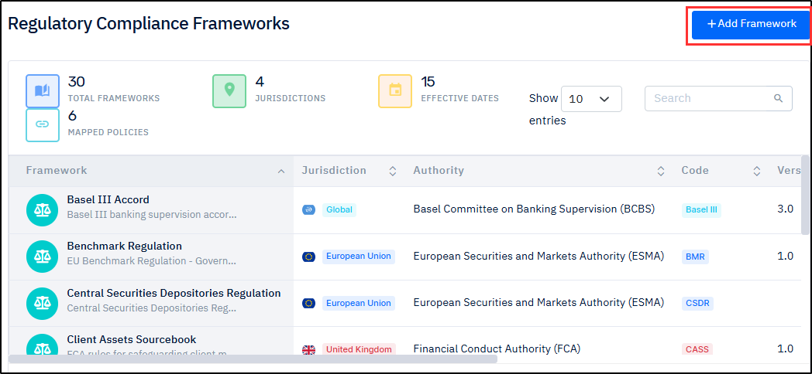

# Regulatory Compliance

***

**Contents**

* [**Instructions for Using this Page**](regulatory-compliance.md#instructions-for-using-this-page)
* [**Overview**](regulatory-compliance.md#overview)
* [**Procedure**](regulatory-compliance.md#procedure)
* [**Related Topics**](regulatory-compliance.md#related-topics)

***

### Instructions for Using this Page

* Click on an image to view it in a larger and clearer format.
* Hover over an italicized annotated term (italic, blue, dotted and underlined) to view its meaning. Here is an example: [_<mark style="color:blue;">**Host Name**</mark>_](#user-content-fn-1)[^1]_<mark style="color:blue;">**.**</mark>_
* The inputs shown in the images are for example purposes only. You must enter the correct and actual data.

***

### Overview

Configuring compliance rules ensures that archived data meets both legal and organizational requirements by enforcing defined data retention, security, and access policies. It helps organizations adhere to regulatory standards while maintaining proper governance over stored data. This also reduces the risk of non-compliance, penalties, and data misuse.

***

### Procedure

1. On the **SCIKIQ Left Navigation Bar**, go to **SCIKIQ Archival.**&#x20;
2. Under **SCIKIQ Archival**, expand **Compliance**, and then click **Regulatory Compliance**.

<figure><figcaption>
Regulatory Compliance Menu Item
</figcaption></figure>

The Regulatory Compliance Frameworks page is displayed.

3. On the **Regulatory Compliance Frameworks** page, click the **Add Framework** button.

<figure><figcaption>
Regulatory Compliance Frameworks Page 
</figcaption></figure>

The Add Framework  dialogue-box is displayed.

5. On the **Add Framework** dialogue-box, enter the **Framework Code, Version, Framework Name, Description, Jurisdiction, Effective Date, Regulatory Authority,** and **Mapped Policy Types.**&#x20;

<figure><figcaption>
Add Framework Dialogue Box
</figcaption></figure>

7. Click the **Add Framework**  button. See the image below:


**Tip**: Refer to the below table for the description of these fields.


**Add Framework Dialogue Box Field Description**

| Field                | Description                                                                                                        |
| -------------------- | ------------------------------------------------------------------------------------------------------------------ |
| Framework Code       | A unique identifier assigned to the compliance framework for easy reference and tracking                           |
| Version              | Indicates the specific version of the framework, helping manage updates and changes over time                      |
| Framework Name       | The official name of the compliance framework (e.g., GDPR, HIPAA, etc.)                                            |
| Description          | A brief summary explaining the purpose, scope, and key objectives of the framework                                 |
| Jurisdiction         | Specifies the geographic region or legal authority where the framework is applicable (e.g., India, EU, US)         |
| Effective Date       | The date from which the framework becomes applicable and enforceable                                               |
| Regulatory Authority | The governing body or organization responsible for defining and enforcing the framework                            |
| Mapped Policy Types  | The categories of internal policies (e.g., data retention, security, privacy) that are aligned with this framework |

The details are entered, the Framework added successfully message box appears and the framework is displayed on the Regulatory Compliance Frameworks page.&#x20;

<figure><figcaption>
Regulatory Compliance Frameworks
</figcaption></figure>

> <mark style="color:red;">**Note:**</mark>&#x20;
>
> * To view the details of a framework, click the View Framework  icon corresponding to it.
> * To update a framework, click the Edit   icon corresponding to it.
> * To delete a framework, click the Delete  icon corresponding to it.

***

## Related Topics

* [**Connect SCIKIQ to Source Database**](/broken/pages/NQamWuz7vUgQ2NLWzOdj)
* [**Configure Table Classification**](../../integrations/vs-meta-data-manager/table-classification.md)
* [**Create Compliance Policy**](compliance-policies.md)
* [**Configure AWS Setup**](../storages/configure-storage.md)
* [**Create Archival Job**](../archival-jobs-2/creating-a-table-archival-job.md)
* [**Setup Deployment Platform**](../archival-jobs-2/deployment-configs.md)
* [**Deploy Archival Job**](/broken/pages/Lhd7keqyZR2EfkoA5qpT#id-2.deploy-archival-job)
* [**Manage Deployment Configurations**](../archival-jobs-2/deployment-configs.md#manage-deployment-configurations)
* [**Validate Archived Data**](../archival-jobs-2/retrieve-data.md#validate-archived-data)
* [**View Archived Data**](../archival-jobs-2/retrieve-data.md)
* [**Delete Archived Data**](../archival-jobs-2/deletion-jobs.md)

[^1]: **Host Name** refers to the **address** of the computer/server where your database is located.
